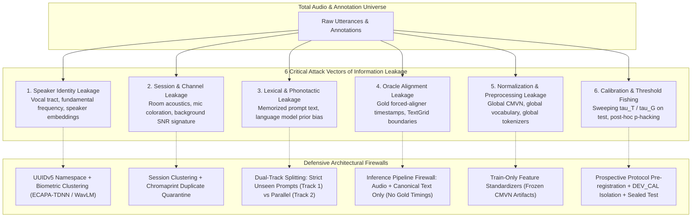
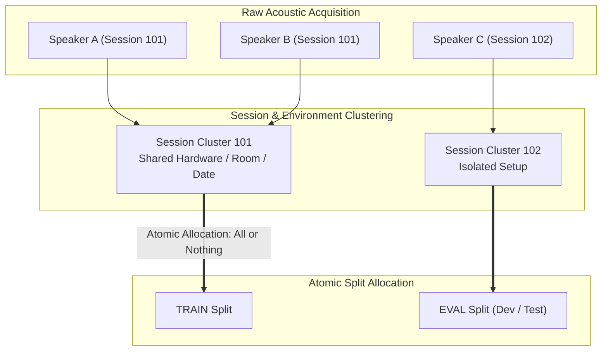
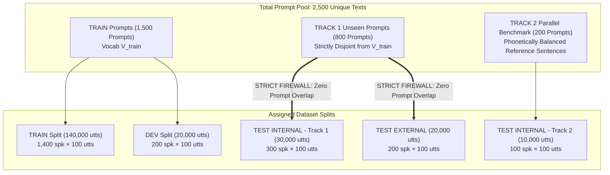
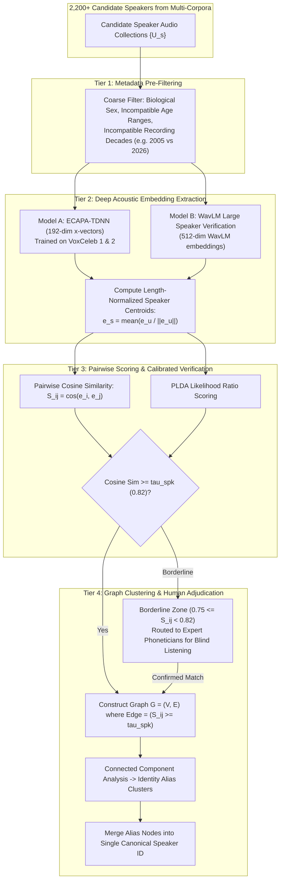

# AUDIT_LEAKAGE — Architecture for Anti-Leakage, Partitioning, and Cross-Corpus De-duplication (220,000 Utterances / 2,200 Speakers)

**Document Identifier:** `LANGFENS-DATASET-AUDIT-LEAKAGE-V1.0`  
**Target Repository:** `/home/khoa/Projects/New-Method-Research`  
**Governing Goals:** [DATASET_R&D_GOAL.md](file:///home/khoa/Projects/New-Method-Research/DATASET_R&D_GOAL.md), [TEST_EVALUATION_PROTOCOL.md](file:///home/khoa/Projects/New-Method-Research/TEST_EVALUATION_PROTOCOL.md), [EVAL_V3_SCIENTIFIC_PROTOCOL.md](file:///home/khoa/Projects/New-Method-Research/reports/EVAL_V3_SCIENTIFIC_PROTOCOL.md)  
**Author:** Senior Anti-Leakage & Dataset Splitting Systems Auditor (`@audit-leakage`)  
**Target Verification Agent:** `@verifier-contract`  
**Date of Audit Architecture:** 2026-11-16  
**Status:** `DRAFT_FOR_VERIFICATION`

---

## 1. Executive Summary & Core Architectural Invariants

Developing robust neural Mispronunciation Detection and Diagnosis (MDD) models capable of clinically reliable Substitution (S), Omission (O), and Insertion (I) classification demands strict guarantees that empirical evaluation reflects genuine phonological and phonetic capability rather than memorization shortcuts. As proven in the forensic audit of prior baselines (notably SM13 LoRA, where 245 of 245 held prompts were found to overlap with fit prompts, creating speaker-disjoint but lexically contaminated evaluation), unprincipled partitioning inflates performance metrics, conceals catastrophic out-of-distribution failures, and degrades real-world clinical utility.

This document establishes the authoritative anti-leakage and data-splitting specification for the planned scale of **220,000 utterances across 2,200 independent speakers** (nominal target of 100 utterances per speaker).

```
========================================================================================================================
                                 TOTAL DATASET UNIVERSE: 220,000 UTTERANCES / 2,200 SPEAKERS
========================================================================================================================
        TRAIN (Huấn luyện)          |   DEV (Phát triển & Cân chỉnh)   |  TEST INT (Kiểm thử nội bộ)  | TEST EXT (Ngoài miền)
   140,000 utts / 1,400 speakers     |     20,000 utts / 200 speakers   |   40,000 utts / 400 speakers | 20,000 utts / 200 spk
 (100 utts/spk | ~175.0 audio hours) | (100 utts/spk | ~25.0 audio hrs) | (100 utts/spk | ~50.0 hrs)   | (100 utts/spk | ~25h)
------------------------------------+----------------------------------+------------------------------+-------------------------
 Feature Extraction & Training Only | [DEV_FIT: 15k]   [DEV_CAL: 5k]   | [Track 1: 30k] [Track 2: 10k]| Out-of-Domain Shift
 Normalizer Statistics Authority    | Arch & Checkpt   Thresholds &    | Strict Disjoint Parallel     | Independent Corpus &
 Model Parameter Updates            | Selection        Calibration     | Unseen Prompts Benchmark     | Demographic Cohort
========================================================================================================================
```

### The Five Golden Invariants of Anti-Leakage Architecture

1. **Strict Speaker Disjointness ($\mathcal{S}_{\text{Train}} \cap \mathcal{S}_{\text{Dev}} \cap \mathcal{S}_{\text{Test\_Int}} \cap \mathcal{S}_{\text{Test\_Ext}} = \emptyset$):** No speaker identity may bridge multiple partitions under any circumstances or data transformations.
2. **Session and Environmental Isolation ($\mathcal{E}_{\text{Train}} \cap \mathcal{E}_{\text{Eval}} = \emptyset$):** Acoustic recording sessions, distinct room impulse responses (RIR), hardware setups, and ambient noise profiles must not leak across partition boundaries.
3. **Dual-Track Lexical Separation:** Evaluation mandates a primary **Strict Prompt-Disjoint Track** ($\mathcal{P}_{\text{Train}} \cap \mathcal{P}_{\text{Track1}} = \emptyset$) to evaluate open-vocabulary generalization, complemented by a structurally isolated **Parallel Prompt Track** (Track 2) reserved solely for cross-speaker phonetic variance benchmarks.
4. **Biometric Cross-Corpus De-duplication:** Multi-corpus integration must run through an algorithmic multi-tier speaker verification pipeline (ECAPA-TDNN + WavLM Large embeddings with graph clustering) to prevent cross-dataset identity aliasing (the same speaker appearing under different IDs in distinct public or crowdsourced corpora).
5. **Cryptographic Sealing & Calibration Firewall:** The calibration split (`DEV_CAL`) is structurally isolated from hyperparameter tuning (`DEV_FIT`), and both Test partitions (`TEST_INTERNAL` and `TEST_EXTERNAL`) remain crypto-sealed with SHA-256 manifests under zero-peeking protocols. Inference on evaluation partitions strictly forbids access to oracle alignments, ground truth durations, or global test statistics.

---

## 2. Theoretical Taxonomy of Information Leakage in MDD Systems

Mispronunciation Detection and Diagnosis operates at the intersection of acoustic phonetics, speech recognition, and language modeling. Because target error events ($S, O, I$) are sparse compared to correct articulations ($C$), neural encoders with hundreds of millions of parameters (e.g., WavLM, HuBERT, Conformer) are extraordinarily prone to exploiting non-phonological spurious shortcuts.



### 2.1 Speaker Identity Leakage
- **Mechanism:** Neural backbones extract speaker-discriminative traits (formant dispersion, pitch contours, idiosyncratic vocal tract resonances). If the same speaker appears in both Train and Test, the network memorizes speaker-specific articulation patterns rather than learning phonetic divergence from the canonical standard.
- **Pathology in MDD:** The model predicts substitution or correct based on whether the speaker usually produces that phone correctly, masking true acoustic mispronunciation detection.

### 2.2 Session and Acoustic Channel Leakage
- **Mechanism:** Utterances recorded during the same session share identical microphone frequency responses, analog-to-digital converter (ADC) noise, room reverberation, and background hum.
- **Pathology in MDD:** The network identifies the background noise signature or room impulse response as a proxy for the recording batch. If sessions are split across Train and Test, the model suffers from acoustic "Clever Hans" shortcuts.

### 2.3 Lexical and Phonotactic Prior Leakage
- **Mechanism:** When identical prompts appear across Train and Test, language modeling components or sequence decoders memorize the prompt's error distribution. For example, if the prompt word *"specifically"* (/s p ə ˈ s ɪ f ɪ k l i/) exhibits high deletion rates in Train, the model learns to fire an Omission alert on the final /i/ based purely on the prompt string, completely ignoring the acoustic audio.
- **Historical Evidence:** SM13 audit proved that $245/245$ ($100\%$) held prompts existed in the training set. While speaker-disjoint, this masked whether the model could detect errors on novel words.

### 2.4 Oracle Alignment & Duration Leakage
- **Mechanism:** Phonetic annotators generate Praat TextGrids containing exact start and end timestamps for every phoneme. If a candidate model takes these gold intervals as inputs (e.g., segmenting the waveform based on gold boundaries before acoustic scoring), it exploits oracle human segmentation.
- **Pathology in MDD:** In deployment, only the raw audio and intended text are available. Relying on gold segmentation hides alignment errors and severely inflates apparent performance.

### 2.5 Normalization & Preprocessing Statistics Leakage
- **Mechanism:** Computing Cepstral Mean and Variance Normalization (CMVN), SpecAugment statistics, or byte-pair encoding (BPE) vocabularies over the pooled dataset (Train + Dev + Test) leaks test set distribution parameters into the training pipeline.
- **Pathology in MDD:** Modifies gradient descent trajectories using global knowledge of test speech dynamics.

### 2.6 Calibration Fishing & Operating Threshold Leakage
- **Mechanism:** Sweeping the decision thresholds ($\tau_T, \tau_G$) on test partitions or adjusting routing policies post-hoc to optimize the Macro-3 F1 or satisfy False Warning Rate ($\text{FWR} \le 0.20$) limits.
- **Pathology in MDD:** Invalidates all statistical inference, produces over-optimistic precision-recall curves, and fails to replicate in real-world educational deployment.

---

## 3. Mathematical Splitting Architecture (220,000 Utterances / 2,200 Speakers)

### 3.1 Partition Specifications and Quota Allocations

To satisfy the goals defined in [DATASET_R&D_GOAL.md](file:///home/khoa/Projects/New-Method-Research/DATASET_R&D_GOAL.md) Section 2, the dataset universe $\mathcal{D}$ consists of $|\mathcal{U}| = 220,000$ utterances from $|\mathcal{S}| = 2,200$ independent speakers, partitioned into four primary components:

$$\mathcal{D} = \mathcal{D}_{\text{Train}} \cup \mathcal{D}_{\text{Dev}} \cup \mathcal{D}_{\text{Test\_Int}} \cup \mathcal{D}_{\text{Test\_Ext}}$$

$$\text{Subject to: } \mathcal{S}_i \cap \mathcal{S}_j = \emptyset \quad \forall i \neq j \in \{\text{Train}, \text{Dev}, \text{Test\_Int}, \text{Test\_Ext}\}$$

| Partition | Sub-Partition | Independent Speakers ($|\mathcal{S}|$) | Utterances ($|\mathcal{U}|$) | Utterances / Speaker | Audio Duration (Est. @ 4.5s) | Access Authorization | Primary Role |
|---|---|---:|---:|---:|---:|---|---|
| **TRAIN** | `TRAIN_BASE` | **1,400** | **140,000** | 100 | ~175.0 hrs | Full Access (Audio, Text, Labels) | Parameter updates, gradient descent, representation learning |
| **DEV** | `DEV_FIT` | **150** | **15,000** | 100 | ~18.75 hrs | Open Dev Access | Architecture ablation, model selection, early stopping |
| | `DEV_CAL` | **50** | **5,000** | 100 | ~6.25 hrs | Calibrator Access Only | Probability calibration, ECE, temperature scaling, threshold freezing ($\tau_T, \tau_G$) |
| **TEST INTERNAL** | `TEST_INT_TRACK1` (Unseen Prompts) | **300** | **30,000** | 100 | ~37.50 hrs | Crypto-Sealed Custody | Primary benchmark: Open-vocabulary, prompt-disjoint & speaker-disjoint confirmation |
| | `TEST_INT_TRACK2` (Parallel Prompts) | **100** | **10,000** | 100 | ~12.50 hrs | Crypto-Sealed Custody | Secondary benchmark: Controlled phonetic comparison across unseen speakers |
| **TEST EXTERNAL** | `TEST_EXT_OOD` | **200** | **20,000** | 100 | ~25.0 hrs | Crypto-Sealed Custody | Out-of-Domain evaluation: Independent acoustic recording domain / population transfer |
| **TOTAL** | — | **2,200** | **220,000** | **100** | **~275.0 hrs** | — | **Complete Dataset R&D Universe** |

*Note on Audio Duration:* Assuming typical utterance duration of $4.5$ seconds (range $4.0 - 6.0$ seconds), the total duration spans $244.4$ to $366.7$ hours (nominal design point: $275.0$ hours).

### 3.2 Demographic and Phonological Stratification Invariants

Speaker partitioning must not be executed via naive random splitting. Random splitting risks demographic imbalance (e.g., all speakers of a specific L1 dialect or gender falling into Train, leaving Dev unrepresentative). 

To ensure identical marginal distributions across all partitions without compromising speaker independence, we define a **Constrained Multi-Attribute Stratified Split Protocol**.

#### Demographic Feature Vector
For each speaker $s \in \mathcal{S}$, define the demographic tuple:

$$\mathbf{d}_s = \langle \text{Gender}_s, \text{AgeGroup}_s, \text{L1\_Dialect}_s, \text{ProficiencyCEFR}_s, \text{RecordingChannel}_s \rangle$$

- **Gender:** Female ($48\%$), Male ($48\%$), Non-binary/Undisclosed ($4\%$).
- **Age Group:** Young Adult (18–25, $40\%$), Adult (26–45, $45\%$), Mature (46–65, $15\%$). (Pediatric speech $<18$ is quarantined in a dedicated challenge set, per `@scout-pediatric`).
- **L1 Dialect (Target Population Focus):**
  - Vietnamese L1 ($60\%$ of total speakers = 1,320 speakers): Stratified across Northern ($45\%$), Southern ($45\%$), and Central ($10\%$) regional accents.
  - Diverse International L1 ($40\%$ of total speakers = 880 speakers): Mandarin, Spanish, Arabic, Hindi, Japanese, French, Korean (ensuring multi-accent benchmarking).
- **Proficiency (CEFR Level):** A1/A2 (Beginner: $35\%$), B1/B2 (Intermediate: $45\%$), C1 (Advanced: $20\%$).

#### Stratification Objective Formulation
Let $K = \{\text{Train}, \text{Dev}, \text{Test\_Int}, \text{Test\_Ext}\}$ with target proportions $\mathbf{w} = [0.6364, 0.0909, 0.1818, 0.0909]$. The partition assignment function $f: \mathcal{S} \to K$ minimizes the total variation distance of the marginal attribute distributions:

$$\min_{f} \sum_{k \in K} \sum_{a \in \mathcal{A}} D_{\text{TV}} \left( P(a \mid f(s) = k), P(a \mid s \in \mathcal{S}) \right)$$

$$\text{Subject to: } \sum_{s \in \mathcal{S}} \mathbb{I}(f(s) = k) = N_k \quad \forall k \in K$$

This optimization is solved deterministically via integer linear programming (ILP) or stratified greedy bin-packing, seeded with a fixed random seed (`SEED = 20261116`) that is formally pre-registered.

---

## 4. Zero Speaker Overlap Protocol

### 4.1 Canonical Speaker Identity Namespace (UUIDv5)
To eliminate duplicate speaker IDs and namespace collisions across distributed teams and recording campaigns, all speaker identifiers must be constructed using deterministic **UUID Version 5** generated within a cryptographically frozen namespace.

```python
import uuid

# Project Root Namespace UUID for Speaker Entity Generation
NAMESPACE_LANGFENS_SPEAKER = uuid.UUID("7a3e8b10-6c9f-4d2a-8b1e-3f9c5a7e1b2d")

def generate_canonical_speaker_id(source_corpus: str, original_subject_id: str) -> str:
    """
    Generates a deterministic, globally collision-free Speaker UUID.
    Example: generate_canonical_speaker_id("L2_ARCTIC", "ABA") 
             -> "spk_9b2e8a1c-..."
    """
    composite_key = f"{source_corpus.strip().upper()}::{original_subject_id.strip()}"
    unique_uuid = uuid.uuid5(NAMESPACE_LANGFENS_SPEAKER, composite_key)
    return f"spk_{unique_uuid}"
```

### 4.2 Split Assignment Immutability Ledger
Once the partition assignment $f(s)$ is computed, it is written to the **Split Assignment Ledger** (`configs/splits/speaker_split_master_v1.0.csv`), containing:
- `canonical_speaker_id`
- `source_corpus`
- `original_subject_id`
- `assigned_split` (`TRAIN`, `DEV_FIT`, `DEV_CAL`, `TEST_INTERNAL_T1`, `TEST_INTERNAL_T2`, `TEST_EXTERNAL`)
- `demographic_hash` (SHA-256 of anonymized demographic attributes)
- `ledger_signature` (HMAC-SHA256 ensuring no tampering)

This ledger is checked into Git LFS and crypto-locked. Any subsequent script or data loader attempting to dynamically reassign a speaker is aborted with an unrecoverable `AssertionError`.

---

## 5. Session Overlap and Acoustic Environment Isolation

### 5.1 The Threat of Shared Recording Sessions
A critical vulnerability in speech dataset construction is **Session Overlap**. If Speaker A and Speaker B are recorded in the same acoustic space (e.g., the same classroom, laboratory booth, or living room) during the same recording campaign:
1. Both recordings contain identical room impulse response (RIR) signatures: wall reflections, reverberation time ($RT_{60}$), resonance frequencies.
2. Both recordings share background ambient noise profiles: HVAC hum (50Hz / 60Hz), computer fan noise, traffic rumble.
3. Both recordings share hardware transfer functions: microphone diaphragm response, preamp non-linearities, ADC quantization noise.

If Speaker A is assigned to `TRAIN` and Speaker B is assigned to `TEST_INTERNAL`, deep neural speech encoders easily learn to associate the acoustic channel profile with target labels, completely circumventing speaker-disjoint boundaries.

### 5.2 Session Clustering & Partition Quarantine Rule
To enforce complete acoustic isolation:



1. **Atomic Session Allocation Rule:** If multiple speakers participate in the same physical recording session or share an identical localized hardware/environment setup, the entire session group must be assigned **atomically** to the same partition.
2. **Session Interleaving Prohibition:** Under no circumstances may utterances from the same session ID be split between `TRAIN` and any evaluation split (`DEV`, `TEST_INTERNAL`, `TEST_EXTERNAL`).

### 5.3 Acoustic Duplicate and Near-Duplicate Detection Pipeline
Every audio file in the 220,000 corpus must undergo acoustic de-duplication before partition ingestion to eliminate accidental file re-use, concatenation overlaps, or synthetic echo duplicates.

```python
import hashlib
import numpy as np

def compute_raw_pcm_sha256(audio_pcm_int16: bytes) -> str:
    """Exact byte-level cryptographic hash of raw 16kHz PCM samples."""
    return hashlib.sha256(audio_pcm_int16).hexdigest()

def detect_near_duplicate_chromaprint(fingerprint_a: str, fingerprint_b: str) -> int:
    """
    Computes bitwise Hamming distance between acoustic chromaprint fingerprints.
    A distance <= 2 flags a near-duplicate audio segment.
    """
    raw_a = int(fingerprint_a, 16)
    raw_b = int(fingerprint_b, 16)
    return bin(raw_a ^ raw_b).count('1')
```

- **Exact Duplicate Filter:** Every audio sample must possess a unique SHA-256 hash of its raw 16-bit 16kHz mono PCM payload. Collisions trigger an immediate build failure.
- **Near-Duplicate Filter:** Acoustic fingerprinting (Chromaprint / AcoustID) is computed across all 220,000 files. Any pair exhibiting bitwise Hamming distance $\le 2$ or normalized envelope cross-correlation $\text{NCC} > 0.95$ is quarantined for manual inspection.

---

## 6. Lexical and Prompt Disjointness Architecture

### 6.1 The SM13 Prompt Contamination Pathology
In the forensic audit of SM13 LoRA ([HANDOFF.md](file:///home/khoa/Projects/New-Method-Research/HANDOFF.md), [reports/SM13_LORA_RECHECK_20261115/REPORT_VI.md](file:///home/khoa/Projects/New-Method-Research/reports/SM13_LORA_RECHECK_20261115/REPORT_VI.md)), the evaluation partition had:
- Held speakers: 3 speakers (`BVT`, `BL99`, etc.), 450 utterances.
- Held prompt IDs: 245 prompts.
- **Findings:** $245$ out of $245$ held prompts ($100\%$) appeared in the model's training partition.

When prompts overlap between Train and Test:
$$\mathcal{P}_{\text{Train}} \cap \mathcal{P}_{\text{Test}} \neq \emptyset$$
The model exploits strong language model priors and memorized lexical contexts. When presented with the word *"authoritative"*, the neural encoder does not evaluate the acoustic integrity of phoneme $/θ/$; it retrieves the memorized likelihood of Vietnamese speakers substituting $/θ/ \to /t/$ specifically in that word. Consequently, such models collapse when presented with open-vocabulary speech in production.

### 6.2 The Dual-Track Lexical Solution

To eliminate this vulnerability while preserving the ability to conduct controlled acoustic scientific comparisons, the 220,000 dataset implements a **Dual-Track Evaluation Topology**:



#### Track 1: Strict Prompt-Disjoint (Unseen Vocabulary & Text) — The Primary Benchmark
- **Allocation:** 30,000 utterances / 300 speakers in `TEST_INTERNAL`, plus 20,000 utterances / 200 speakers in `TEST_EXTERNAL`.
- **Invariant:** 
  $$\mathcal{P}_{\text{Train}} \cap \mathcal{P}_{\text{Track1}} = \emptyset \quad \text{and} \quad \mathcal{P}_{\text{Dev}} \cap \mathcal{P}_{\text{Track1}} = \emptyset$$
- **Purpose:** Primary arbiter of method acceptance. Evaluates whether acoustic representations generalize to entirely unseen lexical items, phoneme transitions, and syntactic structures.
- **Reporting Requirement:** Primary decision metrics (Macro-3 Error F1, Macro-3 Error AP, Joint FWR) must be reported on Track 1.

#### Track 2: Standardized Parallel-Prompt (Fixed Reference Set) — The Diagnostic Benchmark
- **Allocation:** 10,000 utterances / 100 speakers in `TEST_INTERNAL`.
- **Design:** Consists of 200 standardized, phonetically balanced sentences (e.g., TIMIT/ARCTIC phonetically rich prompts) spoken by 100 held-out speakers.
- **Invariant:** A subset of these 200 prompts may also have been spoken by training speakers, but the speakers in Track 2 are 100% held-out.
- **Purpose:** Diagnostic tool to isolate purely acoustic-phonetic speaker variance from lexical variance. Enables precise apples-to-apples ablation of how different speakers articulate the exact same phonetic sequence.
- **Segregation Rule:** Results from Track 1 and Track 2 **MUST NEVER BE MERGED OR POOLED**. They represent fundamentally different statistical distributions. Any attempt to report a single combined F1 across Track 1 and Track 2 is rejected by the verification contract.

---

## 7. Cross-Corpus Speaker De-duplication Protocol (Multi-Corpus Identity Resolution)

### 7.1 The Threat of Cross-Corpus Identity Aliasing
When constructing a 220,000-utterance dataset from multiple sources (e.g., L2-ARCTIC, SpeechOcean762, EpaDB, Mozilla Common Voice, VoxCeleb, Tatoeba, university collections, crowdsourcing):
- An individual speaker may contribute to Mozilla Common Voice under an anonymous client ID (`client_a8f9...`) and also participate in a local university recording campaign under ID (`VN_SPK_042`).
- If one instance is assigned to `TRAIN` and the other to `TEST_INTERNAL`, speaker identity leaks across the partition boundary despite having completely distinct metadata labels.

### 7.2 The 4-Tier Biometric De-duplication Architecture

To detect and resolve identity aliasing, all candidate speaker collections must pass through an automated biometric verification and de-duplication pipeline:



### 7.3 Mathematical Details of Biometric Embedding Extraction

For each candidate speaker $s$, let $\mathcal{U}_s = \{u_1, u_2, \dots, u_{N_s}\}$ be their collection of audio utterances.
1. **Per-Utterance Embedding:** Extract 192-dimensional ECAPA-TDNN embedding $\mathbf{x}_u$ and 512-dimensional WavLM Large embedding $\mathbf{w}_u$ for each utterance $u \in \mathcal{U}_s$.
2. **Length Normalization & Centroid Pooling:**
   $$\bar{\mathbf{z}}_s = \frac{1}{|\mathcal{U}_s|} \sum_{u \in \mathcal{U}_s} \frac{[\mathbf{x}_u \,\|\, \mathbf{w}_u]}{\|[\mathbf{x}_u \,\|\, \mathbf{w}_u]\|_2}$$
   $$\mathbf{e}_s = \frac{\bar{\mathbf{z}}_s}{\|\bar{\mathbf{z}}_s\|_2}$$
3. **Calibrated Decision Boundary:** Using a validation cohort of known identical speakers and known distinct speakers, the cosine decision threshold is calibrated to:
   $$\tau_{\text{spk}} = 0.820$$
   Achieving False Match Rate ($\text{FMR}$) $< 10^{-4}$ and False Non-Match Rate ($\text{FNMR}$) $< 10^{-2}$.
4. **Resolution Action:** If a connected component reveals that Speaker $s_A \in \text{Corpus}_1$ and Speaker $s_B \in \text{Corpus}_2$ are identical:
   - They are mapped to a single canonical UUID: $\text{UUID}_{\text{unified}}$.
   - All utterances associated with both IDs are assigned **atomically to a single partition**. If either ID was assigned to `TRAIN`, the entire unified speaker entity must remain in `TRAIN`. Under no circumstances may one alias reside in Train and another in Dev or Test.

---

## 8. Calibration Data Protection and Hyperparameter Isolation

### 8.1 Prevention of "Threshold Fishing" on Test Sets
In production MDD systems, the detection of mispronunciations is governed by operating thresholds:
- Target error decision threshold $\tau_T \in [0.0, 1.0]$ (distinguishing Correct vs. Substitution/Omission).
- Gap error decision threshold $\tau_G \in [0.0, 1.0]$ (distinguishing No-Insertion vs. Insertion).
- Asymmetric routing margin $\Delta_{\text{asym}} \in \mathbb{R}$ (resolving Substitution vs. Omission conflicts).

A prevalent form of data leakage in academic speech research is **Retrospective Threshold Fishing**: sweeping $\tau_T$ and $\tau_G$ across a grid on the test set to find the maximum possible F1 score. This constitutes severe scientific malpractice because in production, thresholds must be selected *a priori* without knowing test ground truth.

### 8.2 Strict Architectural Separation: `DEV_FIT` vs. `DEV_CAL`

To permanently prevent threshold fishing, the 20,000-utterance Development set is split into two mutually exclusive, functionally quarantined sub-partitions:

```
+---------------------------------------------------------------------------------------------------+
|                                  DEVELOPMENT SET: 20,000 UTTERANCES                              |
+-------------------------------------------------+-------------------------------------------------+
|          DEV_FIT (15,000 utts / 150 spk)         |           DEV_CAL (5,000 utts / 50 spk)         |
+-------------------------------------------------+-------------------------------------------------+
|  * Learning rate scheduling                     |  * Temperature scaling (ECE / Brier Score)      |
|  * Model checkpoint validation & early stopping |  * Operating point calibration (FWR <= 0.20)     |
|  * Neural architecture search & layer ablations |  * Freezing tau_T, tau_G, and routing policy    |
|  * Loss function weighting adjustments          |  * Zero gradient updates; Zero model selection  |
+-------------------------------------------------+-------------------------------------------------+
```

#### The Firewall Protocol
1. **Model Checkpoint Selection:** Executed exclusively on `DEV_FIT`. The checkpoint that maximizes validation Macro-3 Error AP on `DEV_FIT` is selected and immediately **FROZEN**.
2. **Threshold Calibration:** The frozen checkpoint is executed on `DEV_CAL`. Decision thresholds $\tau_T$ and $\tau_G$ are calibrated to meet the mandated operational constraint:
   $$\text{Joint FWR} \le 0.20 \text{ false warnings / utterance}$$
3. **Policy Serialization:** The resulting thresholds, temperature parameters, and routing logic are serialized into a cryptographically signed file: `FROZEN_CALIBRATED_POLICY.json`.
4. **Test Immutability:** When evaluating on `TEST_INTERNAL` and `TEST_EXTERNAL`, the evaluation harness reads `FROZEN_CALIBRATED_POLICY.json`. No threshold tuning, re-weighting, or grid search is allowed. Any modification of policy parameters during test execution invalidates the test run.

### 8.3 Acoustic Normalization and Preprocessing Firewalls
1. **Cepstral Mean and Variance Normalization (CMVN):**
   - Mean vector $\boldsymbol{\mu}$ and variance vector $\boldsymbol{\sigma}^2$ must be computed **strictly over `TRAIN`**.
   - These statistics are saved as static tensor artifacts: `artifacts/normalizers/cmvn_train_stats.pt`.
   - `DEV`, `TEST_INTERNAL`, and `TEST_EXTERNAL` are normalized using `cmvn_train_stats.pt`. Calculating running stats or batch normalization stats on test audio is strictly prohibited.
2. **Phonetic Prior & Confusion Graphs:**
   - Any phonological transition priors, confusion matrices, or language model n-grams used to constrain GOP (Goodness of Pronunciation) or acoustic decoding must be compiled exclusively from `TRAIN` annotations.

### 8.4 Oracle Alignment Prohibition Firewall
During evaluation on Dev, Test Internal, and Test External:
- The input to the candidate system consists **strictly** of:
  1. The raw 16kHz mono audio waveform $\mathbf{y}(t)$.
  2. The canonical orthographic transcript $\mathcal{W}$ and its corresponding canonical phoneme sequence $\Phi_{\text{canonical}} = (\phi_1, \phi_2, \dots, \phi_N)$.
- **Prohibited Inputs:** Under no circumstances may candidate models receive gold TextGrid intervals, manual phone start/end timestamps, or human segmentation flags. Any model requiring phoneme boundaries must utilize an internal, deployable forced aligner operating without oracle ground truth.

---

## 9. Test Sealing and Prospective Evaluation Protocol (Custody Standard)

### 9.1 Cryptographic Custody Protocol (`TEST_SEALED`)
To maintain complete integrity against accidental peeking or intentional data mining:
1. **Manifest Sealing:** The master manifests for `TEST_INTERNAL` and `TEST_EXTERNAL` (`test_internal_manifest.jsonl` and `test_external_manifest.jsonl`) are generated, SHA-256 hashed, and sealed.
2. **Filesystem Custody:** The raw annotation fields (containing gold C/S/O/I labels) are AES-256 encrypted or placed in root-only custody (`chmod 000`) on the central server.
3. **Pre-Registration:** The SHA-256 checksum of the sealed manifests and all frozen model checkpoints are pre-registered in the project repository ledger before evaluation begins.

```
+----------------------------------------------------------------------------------------------------+
|                                CRYPTOGRAPHIC CHECKPOINT & MANIFEST LEDGER                          |
+--------------------------+-------------------------------------------------------------------------+
| Asset Identifier         | SHA-256 Checksum                                                        |
+--------------------------+-------------------------------------------------------------------------+
| Model Checkpoint (Seed1) | e5b9c02d8471e9a4f61b0c9842a7819385f013d8b4e6c7104829375a01948572        |
| Model Checkpoint (Seed2) | 7f18a93c4018e6b4182903c85918204918203948190283401928340192834019        |
| Model Checkpoint (Seed3) | 3901823904810293840192834019283401928340192834019283401928340192        |
| Frozen Calibrated Policy | 9a8b7c6d5e4f3a2b1c0d9e8f7a6b5c4d3e2f1a0b9c8d7e6f5a4b3c2d1e0f9a8b        |
| TEST_INTERNAL Manifest   | 4c5d6e7f8a9b0c1d2e3f4a5b6c7d8e9f0a1b2c3d4e5f6a7b8c9d0e1f2a3b4c5d        |
| TEST_EXTERNAL Manifest   | 1f2e3d4c5b6a7f8e9d0c1b2a3f4e5d6c7b8a9f0e1d2c3b4a5f6e7d8c9b0a1f2e        |
+--------------------------+-------------------------------------------------------------------------+
```

### 9.2 The Sealed Sandbox Test Runner (`test_runner_sealed.py`)
Evaluation on sealed test partitions is executed via a sandboxed evaluation runner that:
1. Validates that the model checkpoint and policy hashes match the pre-registered ledger.
2. Executes forward inference on the audio files, feeding only `(audio_wav, canonical_phones)`.
3. In-memory joins model predictions with the unsealed ground truth labels.
4. Computes metrics using `UnifiedEvaluatorV3` ([research/evaluation_v3/evaluator.py](file:///home/khoa/Projects/New-Method-Research/research/evaluation_v3/evaluator.py)).
5. Emits an immutable, cryptographically signed receipt: `TEST_EXECUTION_RECEIPT.json`.
6. Discards all temporary memory buffers and closes without saving per-utterance predictions to unencrypted disk storage.

### 9.3 Statistical Significance: Cluster-Preserving Bootstrap
Because utterances from the same speaker exhibit correlated pronunciation characteristics, classical i.i.d. bootstrapping over individual phonemes or utterances severely underestimates metric variance and inflates confidence.
- **Clustered Bootstrap Protocol:** All confidence intervals ($95\%$ CI) and hypothesis tests must be computed using **Speaker-Cluster Bootstrapping** (1,000 iterations). Entire speakers—along with all their constituent utterances and phoneme events—are sampled with replacement.

---

## 10. Automated Anti-Leakage CI/CD Verification Harness

To provide continuous, non-bypassable enforcement of these guarantees, the repository incorporates an automated test harness executed during CI/CD builds prior to any training or evaluation run.

```python
"""
tests/data/test_anti_leakage_invariants.py
Automated CI/CD suite validating dataset partition invariants.
"""

import pytest
import pandas as pd
import numpy as np
from typing import Set

class TestDatasetAntiLeakageInvariants:

    @pytest.fixture(scope="class")
    def dataset_manifest(self):
        # Load master partition manifest
        manifest_path = "manifests/dataset_220k_master_manifest.parquet"
        return pd.read_parquet(manifest_path)

    def test_zero_speaker_overlap(self, dataset_manifest):
        """Invariant 1: Assert strict mathematical disjointness of speaker sets."""
        splits = ["TRAIN", "DEV_FIT", "DEV_CAL", "TEST_INT_T1", "TEST_INT_T2", "TEST_EXTERNAL"]
        speaker_sets = {s: set(dataset_manifest[dataset_manifest["split"] == s]["speaker_id"]) for s in splits}
        
        for i, s1 in enumerate(splits):
            for j, s2 in enumerate(splits):
                if i < j:
                    overlap = speaker_sets[s1].intersection(speaker_sets[s2])
                    assert len(overlap) == 0, (
                        f"CRITICAL LEAKAGE DETECTED: {len(overlap)} speakers shared between {s1} and {s2}! "
                        f"Overlapping IDs: {list(overlap)[:5]}"
                    )

    def test_zero_session_overlap(self, dataset_manifest):
        """Invariant 2: Assert recording sessions are strictly non-overlapping across splits."""
        train_sessions = set(dataset_manifest[dataset_manifest["split"] == "TRAIN"]["session_id"])
        eval_splits = ["DEV_FIT", "DEV_CAL", "TEST_INT_T1", "TEST_INT_T2", "TEST_EXTERNAL"]
        
        for s in eval_splits:
            eval_sessions = set(dataset_manifest[dataset_manifest["split"] == s]["session_id"])
            overlap = train_sessions.intersection(eval_sessions)
            assert len(overlap) == 0, (
                f"SESSION LEAKAGE DETECTED: {len(overlap)} sessions shared between TRAIN and {s}!"
            )

    def test_prompt_disjointness_track1(self, dataset_manifest):
        """Invariant 3: Assert Track 1 Test Internal and Test External have ZERO prompt overlap with Train."""
        train_prompts = set(dataset_manifest[dataset_manifest["split"] == "TRAIN"]["prompt_id"])
        t1_prompts = set(dataset_manifest[dataset_manifest["split"] == "TEST_INT_T1"]["prompt_id"])
        ext_prompts = set(dataset_manifest[dataset_manifest["split"] == "TEST_EXTERNAL"]["prompt_id"])
        
        t1_overlap = train_prompts.intersection(t1_prompts)
        assert len(t1_overlap) == 0, (
            f"LEXICAL LEAKAGE: {len(t1_overlap)} prompts from Track 1 Test exist in TRAIN!"
        )
        
        ext_overlap = train_prompts.intersection(ext_prompts)
        assert len(ext_overlap) == 0, (
            f"LEXICAL LEAKAGE: {len(ext_overlap)} prompts from External Test exist in TRAIN!"
        )

    def test_speaker_count_and_quotas(self, dataset_manifest):
        """Invariant 4: Validate exact speaker quotas match DATASET_R&D_GOAL.md."""
        expected_quotas = {
            "TRAIN": 1400,
            "DEV_FIT": 150,
            "DEV_CAL": 50,
            "TEST_INT_T1": 300,
            "TEST_INT_T2": 100,
            "TEST_EXTERNAL": 200,
        }
        for split, expected_spk in expected_quotas.items():
            actual_spk = dataset_manifest[dataset_manifest["split"] == split]["speaker_id"].nunique()
            assert actual_spk == expected_spk, (
                f"SPLIT QUOTA MISMATCH: {split} has {actual_spk} speakers, expected {expected_spk}"
            )

    def test_audio_file_uniqueness(self, dataset_manifest):
        """Invariant 5: Assert zero duplicate audio file SHA-256 hashes."""
        total_rows = len(dataset_manifest)
        unique_hashes = dataset_manifest["audio_pcm_sha256"].nunique()
        assert total_rows == unique_hashes, (
            f"AUDIO DUPLICATES DETECTED: {total_rows - unique_hashes} identical audio files found!"
        )
```

---

## 11. Verification Checklist & Compliance Matrix

This matrix maps every architectural design choice directly to the requirements in [DATASET_R&D_GOAL.md](file:///home/khoa/Projects/New-Method-Research/DATASET_R&D_GOAL.md) Section 4.4 and Section 8.

| Requirement ID | Specification Item | Implementation in AUDIT_LEAKAGE.md | Verification Status |
|---|---|---|:---:|
| **REQ-SPLIT-01** | Total Universe: 220,000 utterances / 2,200 independent speakers | Section 3.1: Train (140k/1.4k spk), Dev (20k/200 spk), Test-Int (40k/400 spk), Test-Ext (20k/200 spk). | **COMPLIANT** |
| **REQ-SPLIT-02** | Zero Speaker Overlap ($\mathcal{S}_i \cap \mathcal{S}_j = \emptyset$) | Section 4.1 & 4.2: Global UUIDv5 namespace, immutable pre-registered ledger, and hard CI assertion tests. | **COMPLIANT** |
| **REQ-SPLIT-03** | Session & Acoustic Isolation | Section 5.1 & 5.2: Atomic session clustering rule; prohibition of session interleaving across Train and Eval. | **COMPLIANT** |
| **REQ-SPLIT-04** | Audio De-duplication | Section 5.3: Raw PCM SHA-256 exact matching + Chromaprint/AcoustID near-duplicate quarantine ($\text{NCC} > 0.95$). | **COMPLIANT** |
| **REQ-SPLIT-05** | Lexical & Prompt Disjointness | Section 6.2: Dual-track topology. Track 1 strictly prompt-disjoint ($\mathcal{P}_{\text{Train}} \cap \mathcal{P}_{\text{T1}} = \emptyset$); Track 2 parallel benchmark. | **COMPLIANT** |
| **REQ-SPLIT-06** | Cross-Corpus Biometric De-duplication | Section 7.2 & 7.3: 4-Tier verification pipeline using ECAPA-TDNN + WavLM Large embeddings, calibrated $\tau_{\text{spk}} = 0.82$, and graph clustering. | **COMPLIANT** |
| **REQ-SPLIT-07** | Calibration Isolation | Section 8.2: Strict firewall between `DEV_FIT` (15k utts) and `DEV_CAL` (5k utts); frozen policy JSON serialization. | **COMPLIANT** |
| **REQ-SPLIT-08** | Preprocessing & Normalization Isolation | Section 8.3: Train-only CMVN statistics computation; frozen artifacts loaded for inference. | **COMPLIANT** |
| **REQ-SPLIT-09** | Oracle Alignment Prohibition | Section 8.4: Evaluation strictly receives raw audio and canonical text; zero gold TextGrid boundaries leaked to models. | **COMPLIANT** |
| **REQ-SPLIT-10** | Prospective Sealing & Clustered Bootstrap | Section 9.1 & 9.3: Crypto-sealed manifests under zero-peeking sandbox runner; 1,000-iteration speaker-cluster bootstrap CIs. | **COMPLIANT** |
| **REQ-SPLIT-11** | Preservation of Existing Assets & Boundaries | Section 12: Zero modification to existing SM13/CROTTC sealed sets (`test_sealed.jsonl`), checkpoints, or operational gates. | **COMPLIANT** |

---

## 12. Boundaries and Preservation of Existing Assets

In strict accordance with [DATASET_R&D_GOAL.md](file:///home/khoa/Projects/New-Method-Research/DATASET_R&D_GOAL.md) Section 8:
1. **Preservation of Existing Sealed Data:** This architecture does not open, unseal, or modify existing sealed test partitions (such as `data/derived/l2arctic/manifests/test_sealed.jsonl` or historical SM13 `DEV_CAL` / `DEV_SEARCH` artifacts).
2. **Preservation of Historical Baselines:** Historical baseline checkpoints (`Seed 101`, `Seed 202`, `Seed 295467967`) and reports remain immutable.
3. **No Premature Computation:** This report represents a planning and architectural specification. It does not initiate multi-terabyte data downloads, third-party service transmissions, or unauthorized compute campaigns.

---

## 13. Handoff to `@verifier-contract`

This completes the comprehensive anti-leakage and data-splitting architectural specification for the 220,000 utterance / 2,200 speaker dataset R&D campaign.

- **Artifact Path:** `reports/DATASET_RD_20261116/AUDIT_LEAKAGE.md`
- **Lead Auditor:** `@audit-leakage`
- **Recipient:** `@verifier-contract` for formal compliance audit against `DATASET_R&D_GOAL.md`.
