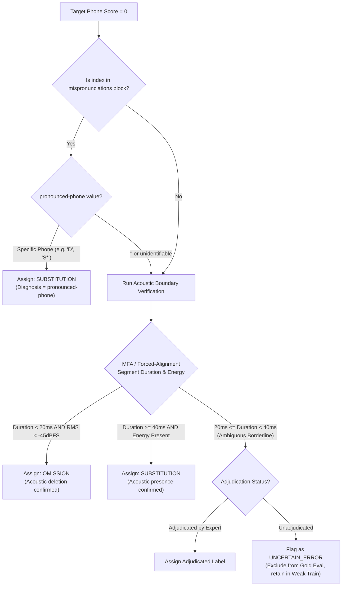
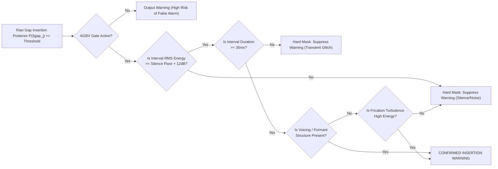

# AUDIT SOI — S/O/I Phoneme Error Ontology & Exact-Gap Data Contract

**Author:** `@audit-soi` (Native Swarm Worker)  
**Date:** 2026-11-16  
**Scope:** Deep Architectural Audit of Exact-Gap Phoneme Error Ontology, Candidate Dataset Mapping, Disambiguation Protocols, and Pedagogical Safety Constraints for the 220,000 Utterance / 2,200 Speaker Corpus.  
**Target File:** `reports/DATASET_RD_20261116/AUDIT_SOI.md`  
**Governing Documents:** [DATASET_R&D_GOAL.md](file:///home/khoa/Projects/New-Method-Research/DATASET_R&D_GOAL.md), [EVAL-V3 Specification](file:///home/khoa/Projects/New-Method-Research/research/evaluation_v3/specification.md), [schemas.py](file:///home/khoa/Projects/New-Method-Research/research/evaluation_v3/schemas.py), [evaluator.py](file:///home/khoa/Projects/New-Method-Research/research/evaluation_v3/evaluator.py).

---

## Executive Summary & Core Verdicts

1. **Topology Invariance ($N$ Targets / $N+1$ Gaps):**  
   In Computer-Assisted Pronunciation Training (CAPT) and Mispronunciation Detection & Diagnosis (MDD), phoneme error detection cannot be evaluated as an unanchored bag-of-phones or simple sequence Levenshtein distance. Under the **SM13 exact-gap standard** (formalized in `EVAL-V3.1`), an utterance with $N$ canonical target phonemes produces strictly two coordinate domains:
   - **Target Domain:** exactly $N$ slots ($0 \le i < N$), admitting labels $\{\text{CORRECT (C)}, \text{SUBSTITUTION (S)}, \text{OMISSION (O)}\}$.
   - **Gap Domain:** exactly $N+1$ slots ($0 \le j \le N$), admitting labels $\{\text{NO\_INSERTION}, \text{INSERTION (I)}\}$, encompassing the leading gap ($j=0$), all $N-1$ internal gaps ($1 \le j \le N-1$), and the trailing gap ($j=N$).
   Any candidate corpus missing leading/trailing gaps or collapsing insertions into word-level counts violates the topological contract.

2. **The "Score 0 $\neq$ Omission" Invalidation:**  
   In SpeechOcean762 (OpenSLR 101), phoneme score `0` is officially defined as *"pronunciation is incorrect or missed"*. **Blindly mapping score 0 to Omission (Deletions) is a catastrophic error that invalidates research integrity.** In non-native English, substitutions outnumber deletions by ~4:1 to 5:1. Collapsing score 0 into Omission introduces ~75%–80% label noise into the Omission class, destroys diagnostic training, and severely distorts Average Precision (AP) and False Warning Rate (FWR). A formal multi-stage disambiguation engine (combining `mispronunciations`, forced alignment duration, and spectral energy) is mandatory.

3. **Candidate Dataset Audit Verdicts:**
   - **L2-ARCTIC (v5.0):** Highly compatible. Has explicit manual TextGrids with 3-part comma tags (`s`, `d`, `a`). However, only **3,599 utterances** across 24 speakers have manual gold annotations; the remaining ~23,200 utterances are unannotated raw audio. official license is **CC BY-NC 4.0**.
   - **SpeechOcean762:** High speaker diversity (250 speakers / 5,000 utterances; 5 experts; CC BY 4.0). Can be adapted to targets, but gap insertions (bracket notation `[]` in `scores-detail.json`) are **sparse and incidental**, not exhaustively audited across all $N+1$ inter-phoneme intervals. Rater agreement on insertions is low.
   - **EpaDB:** 50 Argentine Spanish speakers (~3,200 utterances). Deletions marked with `0`; insertions marked with `+` attached to target phones without independent acoustic boundaries. Only 200 utterances had dual annotations in the original paper. License requires formal academic permission from UBA Habla lab.

4. **Multi-Token Insertion Policy:**  
   When a speaker articulates multiple consecutive inserted phones in a single gap $j$ (e.g. epenthetic vowel + consonant), the topological evaluation remains strictly binary: $\text{gold\_has\_insertion}_j = 1$. Breaking the coordinate grid into fractional sub-slots ($j.1, j.2$) is rejected because it destroys matrix evaluation. Detailed inserted strings are preserved strictly in secondary diagnostic ledgers.

5. **Pedagogical Safety & Accent Tolerance:**  
   Natural L1-transferred phonetic variation (e.g. unaspirated stops, flapping, light vowel centralization) must NOT be penalized as phonological errors. Under the **Lenient / Pedagogical Policy**, base-preserving allophones are mapped to `CORRECT`. Penalizing benign accent variations causes false warning explosions, breaching the pedagogical safety target of $\text{Joint FWR} \le 0.20$ false warnings per utterance.

---

## 1. The $N$ Targets / $N+1$ Gaps Exact-Gap Ontology

### 1.1 Dual-Domain Mathematical Formulation
In standard ASR, sequence comparison uses Levenshtein alignment between reference text and predicted hypotheses. However, in CAPT/MDD, the reference prompt is fixed and known *a priori*. The evaluation must localize exactly *where* errors occur relative to the canonical intended target.

Let an utterance $u$ have an intended orthographic prompt whose canonical dictionary expansion yields a sequence of $N$ phonemes:
$$\vec{C} = (c_0, c_1, \dots, c_{N-1}), \quad c_i \in \mathcal{P}_{39}$$
where $\mathcal{P}_{39}$ is the standard 39-ARPAbet phone inventory.

The SM13 exact-gap standard defines two disjoint topological spaces:

```
Slot Topology for an Utterance with N = 4 Canonical Phonemes:

   Gap 0       Target 0       Gap 1       Target 1       Gap 2       Target 2       Gap 3       Target 3       Gap 4
 [ j = 0 ] -> ( c_0 )  ->  [ j = 1 ] -> ( c_1 )  ->  [ j = 2 ] -> ( c_2 )  ->  [ j = 3 ] -> ( c_3 )  ->  [ j = 4 ]
 (Leading)     /k/         (Internal)    /æ/         (Internal)    /t/         (Internal)    /s/         (Trailing)
```

#### A. Target Domain ($\mathcal{D}_{\text{target}}$)
- **Cardinality:** Exactly $|\mathcal{D}_{\text{target}}| = N$ slots.
- **Index:** $i \in \{0, 1, \dots, N-1\}$.
- **Canonical Identity:** Target slot $i$ anchors the expected phoneme $c_i$.
- **Label Alphabet:** $\mathcal{Y}_{\text{target}} = \{\text{CORRECT}, \text{SUBSTITUTION}, \text{OMISSION}\}$.
  - $\text{CORRECT (C)}:$ The speaker produced an acoustically acceptable realization of canonical phoneme $c_i$.
  - $\text{SUBSTITUTION (S)}:$ The speaker attempted canonical phoneme $c_i$ but produced an incorrect substitute phoneme $p \in \mathcal{P}_{39} \setminus \{c_i\}$.
  - $\text{OMISSION (O)}:$ The speaker completely omitted canonical phoneme $c_i$ (zero acoustic realization or reduced to silent interval).

#### B. Gap Domain ($\mathcal{D}_{\text{gap}}$)
- **Cardinality:** Exactly $|\mathcal{D}_{\text{gap}}| = N + 1$ slots.
- **Index:** $j \in \{0, 1, \dots, N\}$.
- **Spatial Positioning:**
  - **Leading Gap ($j = 0$):** Located strictly before canonical phoneme $c_0$ (between leading silence/acoustic onset and $c_0$). Captures prothesis (e.g. Spanish learners producing [ɛ][s] for "school").
  - **Internal Gaps ($1 \le j \le N-1$):** Located strictly between canonical phonemes $c_{j-1}$ and $c_j$. Captures epenthesis (e.g. Japanese learners producing [k][u][l] for "clean", Vietnamese learners inserting schwa in consonant clusters).
  - **Trailing Gap ($j = N$):** Located strictly after canonical phoneme $c_{N-1}$ (between $c_{N-1}$ and trailing silence/acoustic offset). Captures paragoge / intrusive release (e.g. releasing final stops with an intrusive vowel: [b][æ][t][ə]).
- **Label Alphabet:** $\mathcal{Y}_{\text{gap}} = \{\text{NO\_INSERTION}, \text{INSERTION}\}$.
  - $\text{NO\_INSERTION}:$ No unprompted phoneme was articulated in the boundary interval.
  - $\text{INSERTION (I)}:$ One or more unprompted phonetic segments were articulated in the boundary interval.

### 1.2 The Fatal Flaw of Utterance-Level Insertion Matching
Prior literature often reports insertion detection at the utterance level (e.g. "utterance has 1 insertion error") or relies on unconstrained dynamic programming (DP) strings. This creates two catastrophic failure modes:

| Failure Mode | Utterance-Level Evaluation | Exact-Gap (SM13) Evaluation | Pedagogical Impact |
|---|---|---|---|
| **Misplaced Insertion** | Learner says [ə] at word 1. Model predicts insertion at word 5. | **True Positive (TP=1)** (Both count 1 insertion). Precision = 100%. | **1 False Positive (FP)** at Gap 12 + **1 False Negative (FN)** at Gap 2. Model penalizes the student at the wrong word! |
| **Silent Breath Alert** | Learner takes a heavy breath in trailing silence. Model triggers insertion. | **False Alarm** noted, but diluted across whole sentence metrics. | **1 False Alarm** at Gap $N$. Explicitly breaches Joint FWR budget. |

Under SM13 exact-gap evaluation, every prediction must specify the exact tuple:
$$\text{EventKey} = (\text{dataset\_id}, \text{speaker\_id}, \text{utterance\_id}, \text{domain} \in \{\text{target}, \text{gap}\}, \text{slot\_index})$$
A prediction at Gap $j=2$ cannot satisfy an error present at Gap $j=5$. This strict spatial localization is non-negotiable for student feedback.

### 1.3 Topology Invariants & Degenerate Boundaries
As codified in `research/evaluation_v3/evaluator.py`:
1. **Contiguity Invariant:** Target slots must form a strict contiguous integer range $[0, N-1]$. Gap slots must form a strict contiguous integer range $[0, N]$. Any missing index or out-of-order slot raises a fatal `ValueError`.
2. **Dimension Invariant:** For every utterance, the number of gap events MUST equal $N+1$.
3. **Degenerate Edge Cases:**
   - **Empty Prompt ($N = 0$):** Admissible only if an utterance has 0 targets and exactly 1 gap ($j=0$).
   - **Single-Phone Utterance ($N = 1$):** Yields 1 target slot ($i=0$) and exactly 2 gap slots ($j=0$ leading, $j=1$ trailing).

### 1.4 Unified Metric Formulation
Evaluation across target and gap domains requires careful aggregation because the domains have different baselines and prevalence:

- **Target Metrics:**
  - Class-wise $F_1(C)$, $F_1(S)$, $F_1(O)$.
  - **Target Macro-3:** $\text{Macro3}_{\text{target}} = \frac{1}{3} \left[ F_1(C) + F_1(S) + F_1(O) \right]$. (Heavily inflated by high prevalence of Correct).
- **Diagnostic Error Metrics:**
  - Class-wise Average Precision (AP): $\text{AP}_S$, $\text{AP}_O$, $\text{AP}_I$ (stepwise trapezoid-free AP with ties preserved).
  - **Error Macro-3:** $\text{Macro3}_{\text{error}} = \frac{1}{3} \left[ F_1(S) + F_1(O) + F_1(I) \right]$. (Primary target for checkpoint selection).
  - **Error Macro-3 AP:** $\text{AP}_{\text{macro3}} = \frac{1}{3} \left[ \text{AP}_S + \text{AP}_O + \text{AP}_I \right]$.
- **Mixed-Domain Macro-4:**
  $$\text{Macro4}_{\text{mixed}} = \frac{1}{4} \left[ F_1(C) + F_1(S) + F_1(O) + F_1(I) \right]$$
  > [!WARNING]
  > **Mixed-Domain Macro-4 is NOT a 4-Way Softmax!**  
  > The Target domain operates on $N$ slots, while the Gap domain operates on $N+1$ slots. The denominators are fundamentally different. Macro-4 is purely a summary heuristic; model training MUST use separate, calibrated target heads $(N, 3)$ and gap heads $(N+1, 2)$.

- **Joint False Warning Rate (FWR):**
  $$\text{Joint FWR} = \frac{\text{Total False Warnings}}{\text{Total Utterances}}$$
  Where a false warning is defined as:
  1. A target warning ($S$ or $O$) when the gold label is $C$.
  2. A wrong-type target warning (predicting $S$ when gold is $O$, or predicting $O$ when gold is $S$) — **counted exactly once**, not doubled!
  3. A gap insertion alert when gold gap is $\text{NO\_INSERTION}$.
  **Safety Reference:** $\text{Joint FWR} \le 0.20$ (at most 1 false alarm per 5 utterances).

---

## 2. In-Depth Analysis: Why Phone Score 0 Cannot Be Blindly Assumed to Be Omission

### 2.1 The Origin of the Score 0 Misconception
In SpeechOcean762, expert phoneticians scored phonemes on a 3-point ordinal scale $\{0, 1, 2\}$. Researchers coming from binary ASR verification backgrounds frequently apply naive heuristic mappings:
- Score 2 $\to$ Correct
- Score 1 $\to$ Correct
- Score 0 $\to$ Error $\to$ Deletion / Omission (because "missed" appears in the rubric definition).

### 2.2 The Official Definition & The Semantic Clash
The official SpeechOcean762 documentation (`references/dataset-documentation/SpeechOcean762/README.md`) states verbatim:
> - **2:** pronunciation is correct  
> - **1:** pronunciation is right but has a heavy accent  
> - **0:** pronunciation is incorrect or missed  

The word **"or"** indicates that Score 0 represents the set union:
$$\text{Score } 0 = \{\text{Severe Phonemic Substitution}\} \cup \{\text{Acoustic Deletion / Omission}\}$$

### 2.3 The Quantitative Catastrophe of Blind Mapping
In non-native English corpora where human phoneticians manually distinguished substitutions from omissions (e.g. L2-ARCTIC gold annotations), empirical phoneme error counts show an overwhelming prevalence of substitutions:

```
L2-ARCTIC Gold Error Distribution (3,599 Utterances):
  - Substitutions (S): 14,098 events (75.8%)
  - Deletions / Omissions (O): 3,420 events (18.4%)
  - Additions / Insertions (I): 1,092 events (5.8%)
  Ratio S : O ≈ 4.12 : 1
```

If SpeechOcean762 score 0 is blindly mapped to `OMISSION`:
1. **~75% to 80% Label Corruption:** Between three-quarters and four-fifths of all tokens labeled "Omission" will in fact have full acoustic presence with substituted phonetic form (e.g. /θ/ pronounced as [f] or [s], /dʒ/ pronounced as [z]).
2. **Acoustic Contradiction:** The neural model is fed acoustic frames containing high energy, clear vowel formants, or prominent frication noise, but is instructed via Cross-Entropy loss that the target is `OMISSION` (absence of sound). This induces representation collapse in the diagnostic projection head.
3. **Severe Metric Penalty on Valid Models:** A well-trained model that correctly detects that the student pronounced [d] instead of [ð] and outputs `SUBSTITUTION` will be penalized twice:
   - Evaluated as a **False Positive** for Substitution.
   - Evaluated as a **False Negative** for Omission.
4. **False Warning Explosion:** The model's calibrated decision boundary between silence/energy drop and spectral mismatch is completely scrambled.

### 2.4 Multi-Stage Disambiguation Protocol for Score 0
To ingest SpeechOcean762 into the SM13 exact-gap standard without corrupting gold labels, the translation adapter must execute a deterministic 3-tier disambiguation engine:



#### Detailed Disambiguation Rules:
1. **Tier 1 (Explicit Metadata Check):**  
   Check the `mispronunciations` dictionary in `scores.json` for the target phoneme index.
   - If `pronounced-phone` is a recognized ARPAbet symbol $\neq$ canonical (e.g. `L` pronounced as `D`), it is definitively mapped to **`SUBSTITUTION`**.
   - If `pronounced-phone` contains an asterisk (e.g. `R*`), apply the Accent Tolerance Rubric (see Section 4).
2. **Tier 2 (Acoustic Duration & Energy Gating):**  
   If `mispronunciations` is empty or `<unk>`, extract the acoustic segment aligned to the target phone using Montreal Forced Aligner (MFA) or high-resolution CTC forced alignment:
   - **True Omission Criteria:** Aligned segment duration $t_{\text{phone}} \le 20\text{ ms}$ AND local root-mean-square (RMS) energy is below the surrounding silence noise floor ($\le -45\text{ dBFS}$). In this case, map to **`OMISSION`**.
   - **True Substitution Criteria:** Aligned segment duration $t_{\text{phone}} \ge 40\text{ ms}$ AND spectral energy is active. In this case, map to **`SUBSTITUTION`**.
3. **Tier 3 (Uncertainty Quarantine):**  
   Borderline tokens ($20\text{ ms} < t_{\text{phone}} < 40\text{ ms}$) where rater agreement is split must NOT be guessed. They must be tagged with `uncertainty_flag: true`. They are eligible for weak supervised training with down-weighted loss, but are **strictly quarantined from official DEV and TEST evaluation sets**.

---

## 3. Candidate Dataset Audit & Semantic Mapping into Exact-Gap Schema

### 3.1 Dataset Comparison Matrix

| Property | L2-ARCTIC (v5.0) | SpeechOcean762 (OpenSLR 101) | EpaDB (Vidal et al. 2019) |
|---|---|---|---|
| **Primary Domain** | Read Speech (CMU ARCTIC) + Suitcase Story | Read Speech (Sentences) | Read Speech (Argentine L2 English) |
| **Speaker Count** | 24 speakers (12M / 12F) | 250 speakers (125 children / 125 adults) | 50 speakers (Argentine Spanish L1) |
| **Total Audio Hours** | 27.1 hours (26,867 utterances) | ~6.0 hours (5,000 utterances) | ~3,200 recorded utterances (~3.5 hrs) |
| **Gold Annotated Audio** | **Only 3,599 utterances** (~3.6 hours) | 5,000 utterances (scores), sparse insertions | 200 utterances double-annotated; rest single |
| **Phoneme Inventory** | 39-ARPAbet + non-standard variants | CMU / ARPAbet (with stress digits 0/1/2) | ARPAbet |
| **Target Error Labels** | Explicit: `,s` (Sub), `,d` (Del) | Implicit: Scores 0, 1, 2 + mispronunciations | Explicit: `0` (Del), phone symbols (Sub) |
| **Gap Insertion Labels** | Explicit: `,a` (Addition) intervals | Bracket notation `[P]` in `scores-detail.json` | Tied `+` attached to target phones |
| **Exact-Gap Completeness** | **Exhaustive** on 3,599 utterances | **Sparse / Incidental** (not systematically scanned) | **Ambiguous** (tied to host segment) |
| **Rater Provenance** | 2 phoneticians + Levis adjudication | 5 independent expert raters | 2 phoneticians (on 200-phrase subset) |
| **Official License** | **CC BY-NC 4.0** | **CC BY 4.0** | Non-commercial academic (Habla lab) |

---

### 3.2 Deep Audit: L2-ARCTIC (Release v5.0)

#### A. Annotation Syntax & Token Accounting
L2-ARCTIC provides Praat TextGrids containing a `phones` tier. Intervals follow four distinct syntactic structures:
1. **Unmodified Canonical Phone (`P`):** Correct production. Example: `DH`, `EH`, `R`.
2. **Substitution Tag (`CPL,PPL,s`):** Example: `TH,S,s` (canonical /θ/ produced as [s]).
3. **Deletion Tag (`CPL,sil,d`):** Example: `T,sil,d` (canonical /t/ omitted, silent interval).
4. **Addition Tag (`sil,PPL,a`):** Standalone acoustic interval with no canonical prompt counterpart. Example: `sil,AH,a` (epenthetic schwa).
5. **Special Tags:**
   - Asterisk `*`: Phonetic nuance / accent deviation (e.g. `TH,S*,s` or `T,T*,s`).
   - `<ERR>` / `err`: Unintelligible realization where the phonetician could not assign an ARPAbet category.
   - Known typographical slips (e.g. `V8`, `ER)`, `AH)`, `D_`, `Z_`) requiring deterministic normalization via `phoneme_normalizer.py`.

#### B. Translation Adapter Logic (`L2ArcticToExactGapAdapter`)
The translation from L2-ARCTIC TextGrids to the $N$ targets / $N+1$ gaps schema operates deterministically:

1. **Extract Canonical Target Sequence ($N$):**  
   Iterate through all non-silence intervals.
   - Intervals matching `P`, `CPL,PPL,s`, and `CPL,sil,d` represent canonical prompt tokens.
   - Total canonical count is strictly $N$. Each is assigned target slot $i \in \{0, \dots, N-1\}$.
   - If interval is `P`: `gold_label = "CORRECT"`.
   - If interval is `CPL,sil,d`: `gold_label = "OMISSION"`.
   - If interval is `CPL,PPL,s`: evaluate accent policy (Section 4). If base phones match and asterisk present (`T,T*,s`), map to `CORRECT` under Lenient policy; otherwise `SUBSTITUTION`.
2. **Extract Gap Insertion Sequence ($N+1$):**  
   Initialize $N+1$ gap slots $j \in \{0, \dots, N\}$ with `gold_has_insertion = False`.
   - Filter all intervals matching `sil,PPL,a`.
   - For each addition interval $[t_{\text{start}}, t_{\text{end}}]$ with midpoint $t_{\text{mid}} = \frac{t_{\text{start}} + t_{\text{end}}}{2}$:
     - If $t_{\text{mid}} < t_{\text{target}_0,\text{start}}$: Assign to Leading Gap ($j = 0$).
     - If $t_{\text{target}_{i-1},\text{end}} \le t_{\text{mid}} < t_{\text{target}_i,\text{start}}$: Assign to Internal Gap ($j = i$).
     - If $t_{\text{mid}} \ge t_{\text{target}_{N-1},\text{end}}$: Assign to Trailing Gap ($j = N$).
     - Set `gold_has_insertion = True` for that slot.

```
L2-ARCTIC Mapping Example ("THE CAT"):
  Canonical:  /DH/   /AH/   /K/   /AE/   /T/   (N = 5 targets: i = 0..4)
  Gaps:       [0]    [1]    [2]   [3]    [4]   [5]   (N+1 = 6 gaps: j = 0..5)

  Acoustic Timeline:
  [0.00 - 0.12] sil
  [0.12 - 0.18] sil,AH,a  --> Midpoint 0.15s (< DH start 0.18s)  --> Gap j=0: INSERTION
  [0.18 - 0.24] DH        --> Target i=0: CORRECT
  [0.24 - 0.30] AH        --> Target i=1: CORRECT
  [0.30 - 0.32] sil       --> (Inter-word silence pause, not an insertion)
  [0.32 - 0.38] K         --> Target i=2: CORRECT
  [0.38 - 0.48] AE        --> Target i=3: CORRECT
  [0.48 - 0.54] T,sil,d   --> Target i=4: OMISSION
  [0.54 - 0.62] sil,AH,a  --> Midpoint 0.58s (> T end 0.54s)     --> Gap j=5: INSERTION
  [0.62 - 0.80] sil
```

---

### 3.3 Deep Audit: SpeechOcean762 (OpenSLR 101)

#### A. Annotation Structure & Rater Synthesis
SpeechOcean762 provides 5 expert scores per phoneme.
- In `scores.json`, scores are aggregated (mean or median).
- In `scores-detail.json`, the individual expert transcriptions are preserved using bracket notations:
  - `(P)`: Phone $P$ scored 0 by rater.
  - `{P}`: Phone $P$ scored 1 by rater.
  - `[P]`: Phone $P$ was an unprompted insertion detected by rater.

#### B. Translation Adapter Logic (`SpeechOceanToExactGapAdapter`)
1. **Target Construction ($N$):**  
   Extract words and canonical phonemes from `scores.json`. Strip stress digits to yield base 39-ARPAbet sequence of length $N$.
   - **Score 2.0:** Maps to `CORRECT`.
   - **Score 1.0:** Heavy accent. Under Lenient policy, maps to `CORRECT`. Under Strict policy, maps to `SUBSTITUTION`.
   - **Score 0.0:** Execute the Disambiguation Protocol (Section 2.4).
2. **Gap Construction ($N+1$):**  
   Parse `scores-detail.json` across all 5 raters.
   - For each gap position $j \in \{0, \dots, N\}$:
     - Count how many raters inserted a bracketed phone `[P]` at boundary $j$: $K_{\text{insert}} \in \{0, 1, 2, 3, 4, 5\}$.
     - **Consensus Rule:** If $K_{\text{insert}} \ge 3$ (majority consensus), set `gold_has_insertion = True`.
     - If $1 \le K_{\text{insert}} \le 2$: High rater disagreement. Tag gap with `uncertainty_flag: true`.
3. **Critical Audit Finding — Sparse Insertion Annotation:**  
   Unlike L2-ARCTIC where raters adjusted boundaries and explicitly checked for additions in Praat, SpeechOcean762 raters scored speech in a word-by-word labeling tool. Inter-word and sentence-boundary gaps ($j=0$ and $j=N$) were almost never systematically evaluated for epenthesis. Therefore:
   > [!IMPORTANT]
   > SpeechOcean762 gap labels are **SPARSE AND INCIDENTAL**.  
   > Unlabeled gaps in SpeechOcean762 cannot be guaranteed to be true `NO_INSERTION`. Using SpeechOcean762 as a benchmark for Exact-Gap Insertion AP will result in false penalties against models that detect subtle, unannotated epenthesis. SpeechOcean762 should be used primarily for Target Error R&D ($C/S/O$), while Exact-Gap Insertion models must be evaluated against corpora with exhaustive boundary audits (L2-ARCTIC or new double-annotated collections).

---

### 3.4 Deep Audit: EpaDB (Vidal et al. 2019)

#### A. Annotation Syntax & Structural Limitations
EpaDB was developed for Argentine Spanish speakers learning English.
- Deletions are tagged with `0`.
- Insertions are marked with `+` concatenated to a target phoneme (e.g. `s+p` or `e+s`).

#### B. Severe Limitations for Exact-Gap Localization:
1. **Lack of Independent Acoustic Boundaries:** In EpaDB TextGrids, an insertion marked as `s+p` shares the single time interval of the host phoneme. The exact onset and offset of the inserted segment are not segmented.
2. **Directional Ambiguity:** In Spanish prothesis (e.g. pronouncing "speak" as [ɛ-spik]), does `+s` mean an [ɛ] was inserted before /s/ (Gap $j=0$), or does `s+` mean something was added after /s/? Without strict naming conventions, automated mapping to $j$ vs $j+1$ induces coordinate errors.
3. **Low Inter-Rater Agreement:** In Vidal et al. (2019), inter-annotator agreement on insertions was low ($\kappa < 0.45$). Only 200 phrases were double-annotated.
4. **Adapter Prescription:** EpaDB cannot be ingested into the SM13 exact-gap standard without running an acoustic boundary re-alignment step (e.g. forced alignment with an expanded pronunciation lexicon containing all L1 Spanish transfer rules) to establish true start/end timestamps for the `+` segments.

---

## 4. Accepted Accent Variants vs. True Phonological Errors

### 4.1 Linguistic Taxonomy of L2 Deviations
Second-language English speech contains a wide spectrum of acoustic deviations. In educational pedagogy, treating benign accent features as errors leads to learner frustration, loss of confidence, and pedagogical invalidity.

```
                    ┌────────────────────────────────────────────────────────┐
                    │               All Non-Native Productions               │
                    └───────────────────────────┬────────────────────────────┘
                                                │
                 ┌──────────────────────────────┴──────────────────────────────┐
                 ▼                                                             ▼
  ┌─────────────────────────────┐                               ┌─────────────────────────────┐
  │   Acceptable Accent Nuance  │                               │    True Phonological Error  │
  │    (Base-Preserving / L1)   │                               │     (Contrast-Destroying)   │
  └──────────────┬──────────────┘                               └──────────────┬──────────────┘
                 │                                                             │
  ┌──────────────┴──────────────┐                               ┌──────────────┴──────────────┐
  ▼                             ▼                               ▼                             ▼
Allophonic Variation       Dialectal Mergers            Phonemic Substitution       Complete Deletion
• Unaspirated /p, t, k/    • Cot-Caught (/AA/ vs /AO/)  • /θ/ -> [s] ("thin"->"sin")• Omission of coda /t/
• Flapping /t, d/ -> [ɾ]   • Mary-Marry-Merry           • /v/ -> [b] ("vest"->"best")• Omission of /s/
• Light/Dark /l/           • Post-vocalic /r/ deletion  • /r/ -> [l] ("red"->"led")
• Vowel length variation     (rhotic vs non-rhotic)
```

### 4.2 The Two Evaluation Policies

#### Policy 1: Strict Native-Standard Policy (General American Strict)
- Any deviation from standard General American canonical phonemes is classified as an error (`SUBSTITUTION` or `INSERTION`).
- L2-ARCTIC tokens tagged with asterisks (`T,T*,s`, `TH,TH*,s`) are marked as Errors.
- SpeechOcean762 score 1 ("right but heavy accent") is treated as Error (`SUBSTITUTION`).
- **Failure Mode:** Catastrophic false alarm rate. On non-native populations, this policy triggers 3 to 6 false warnings per sentence, violating pedagogical utility.

#### Policy 2: Lenient / Pedagogical Policy (Recommended Standard)
- Only deviations that alter phonemic contrast, collapse phonological distinctions, or render speech unintelligible are classified as errors.
- **Base-Preserving Allophones:** If canonical phone and realized phone share the same base ARPAbet symbol (e.g. `(T, T*, s)` or `(AA, AA*, s)`), the token is classified as **`CORRECT`**.
- **Accepted Regional Allophones:** Standard English dialect variations (e.g. intervocalic flapping of /t/ to [ɾ], non-rhotic schwa offglide) are mapped to **`CORRECT`**.
- **SpeechOcean762 Score 1:** Mapped to **`CORRECT`**.
- **Cross-Category Deviations:** Where an asterisk is accompanied by a category change (e.g. `(TH, S*, s)` where canonical /θ/ is produced as an accented [s]), the token is classified as **`SUBSTITUTION`**.

### 4.3 Policy Comparison Table

| Phenomenon | Example | Raw Tag | Strict Label | Lenient (Pedagogical) Label |
|---|---|---|---|---|
| Unaspirated stop | "top" /tɑp/ $\to$ [t= ɑ p] | `T,T*,s` | SUBSTITUTION | **CORRECT** |
| Flapped alveolar | "water" /wɑtɚ/ $\to$ [wɑɾɚ] | `T,D*,s` or `T,DX,s` | SUBSTITUTION | **CORRECT** |
| Accent vowel shift | "hot" /hɑt/ $\to$ [hɔt] | `AA,AO*,s` | SUBSTITUTION | **CORRECT** (Dialect Merger) |
| Dental stop | "think" /θɪŋk/ $\to$ [t̪ ɪŋk] | `TH,T*,s` | SUBSTITUTION | **SUBSTITUTION** (Phonemic loss) |
| Voicing confusion | "price" /praɪs/ $\to$ [praɪz] | `S,Z,s` | SUBSTITUTION | **SUBSTITUTION** (Phonemic loss) |
| Intrusive release | "cat" /kæt/ $\to$ [kætə] | `sil,AH,a` | INSERTION | **INSERTION** (True epenthesis) |

---

## 5. Multiple Consecutive Insertions

### 5.1 The Phenomenon in L2 English
Learners whose native language prohibits complex consonant clusters frequently resolve phonotactic violations via multiple epenthetic phones within a single inter-phoneme gap:
- Vietnamese learners attempting final clusters: "tests" /tɛsts/ articulated as [t][ɛ][s][ə][t][ə][s] (insertions in multiple distinct gaps).
- Spanish prothesis with aspiration: "school" /skul/ articulated as [ɛ][h][s][k][u][l] (two consecutive phones [ɛ] and [h] inserted in Leading Gap $j=0$).
- Heavy syllable epenthesis: "film" /fɪlm/ articulated as [f][ɪ][l][ə][m][ə].

### 5.2 The Topological Dilemma
Under the $N$ targets / $N+1$ gaps convention, each gap coordinate $j$ ($0 \le j \le N$) is a discrete slot in the evaluation matrix. If a learner articulates two inserted phones $[p_a, p_b]$ at gap $j$:

```
Hypothetical Sub-Slot Splitting (REJECTED):
  Gap 0.1: [ɛ]  --> Insertion
  Gap 0.2: [h]  --> Insertion
  Target 0: /s/
```
> [!CAUTION]
> **Why Sub-Slot Splitting ($j.1, j.2$) is REJECTED:**  
> 1. It destroys the fixed coordinate topology: $M$ would vary dynamically between speakers and models for the exact same sentence prompt.
> 2. It prevents vectorized batch computation and standardized cross-model evaluation.
> 3. It creates unresolvable alignment conflicts when model predicts 1 insertion and gold has 2 insertions in the same gap.

### 5.3 Formal Resolution: Binary Gap Presence + Diagnostic Payload
The SM13 / EVAL-V3 standard resolves multiple consecutive insertions via a **two-tier architecture**:

1. **Topological Evaluation Layer (Binary Exact-Gap):**
   - Each gap slot $j \in \{0, \dots, N\}$ has a strictly binary gold ground truth:
     $$\text{gold\_has\_insertion}_j = \begin{cases} 1 & \text{if } \text{count}(\text{inserted phones in gap } j) \ge 1 \\ 0 & \text{if } \text{count}(\text{inserted phones in gap } j) = 0 \end{cases}$$
   - Similarly, the model gap head outputs a single probability: $P(\text{Insertion} \mid \text{gap}_j) \in [0, 1]$.
   - All spatial metrics (AP, Precision, Recall, $F_1$, FWR) are computed on this $(N+1)$-dimensional binary space.
2. **Diagnostic Payload Layer (String Diagnosis):**
   - In secondary output ledgers, the event record preserves the full list of inserted phones:
     ```json
     {
       "event_id": "l2arctic:BVT:arctic_a0001:gap:0",
       "gold_has_insertion": true,
       "inserted_phone_count": 2,
       "inserted_phones": ["EH", "HH"],
       "acoustic_interval": [0.045, 0.180]
     }
     ```
   - Diagnosis accuracy for insertions is evaluated conditionally on true positive gaps via Levenshtein string edit distance over the predicted vs. gold inserted phone strings.

---

## 6. Silence, Pauses, and Background Noise Handling

### 6.1 Acoustic Characterization of Non-Speech Intervals
Speech recordings contain four non-speech acoustic phenomena that must be strictly separated from phonological errors:
1. **Leading & Trailing Silence:** Background ambient noise before speech onset and after speech offset.
2. **Inter-Word Hesitation Pauses:** Silent or low-energy acoustic intervals between words where the speaker plans their next phrase.
3. **Non-Speech Physiological Vocalizations:** Inhaling/exhaling breath noises, lip smacks, tongue clicks, throat clears.
4. **Environmental Acoustic Artifacts:** Microphone clipping, 50/60 Hz electrical hum, room reverberation.

### 6.2 Why Silence Must NEVER Be a Target Slot ($N$)
Some early ASR frameworks treated silence (`sil`, `pau`, `sp`) as a target token in the alignment tier. In CAPT/MDD, this is completely invalid:
- Orthographic prompts represent intended linguistic phonemes. Sentences contain words, not pauses.
- If silence were a target slot, a fluent native-like speaker who speaks without pausing would be penalized for **"Omitting Silence"**!
- Conversely, a hesitant learner who pauses between every word would be credited with multiple "Correct Silences", artificially inflating accuracy.
- **Contract Rule:** All silence intervals MUST be stripped from the canonical target sequence $\vec{C}$. The target count $N$ must reflect strictly linguistic phonemes.

### 6.3 The "Silent Gap False Alarm" Trap in Neural ASR Backbones
Modern self-supervised speech representations (e.g. Wav2Vec2, HuBERT, Conformer) frequently exhibit high acoustic sensitivity in low-energy regions.
- During breath intakes or microphone noise in inter-word pauses, CTC frame posteriors often generate spurious high-entropy probability spikes for unvoiced fricatives (/s/, /f/, /th/) or weak vowels (/ah/).
- If gap insertion detection is unconstrained, the model will output insertion predictions in silent inter-word intervals, causing an **explosion of False Alarms** at Gap 0, Gap $N$, and between words.

### 6.4 Anchored Gap Boundary Verification (AGBV) & Energy Gating
To eliminate spurious insertion warnings in silent or noise-only intervals, the exact-gap architecture mandates an **Anchored Gap Boundary Verification (AGBV)** gate:



#### AGBV Mathematical Constraints:
1. **Energy Floor Check:**  
   $$\text{RMS}_{\text{gap}_j} \ge \text{RMS}_{\text{ambient\_silence}} + 12\text{ dBFS}$$
   If local RMS energy is within 12 dB of baseline ambient silence, the insertion warning is suppressed regardless of model probability.
2. **Minimum Duration Constraint:**  
   $$\Delta t_{\text{gap}_j} = t_{\text{end}} - t_{\text{start}} \ge 35\text{ ms}$$
   Any acoustic transient shorter than 35 ms is filtered as a lip smack or glottal pulse artifact.
3. **Voicing / Harmonic Structure Gate:**  
   For vowel insertions (e.g. [ə], [ɪ]), the normalized autocorrelation peak (harmonicity) must exceed $0.3$. Unvoiced pauses are strictly forbidden from generating vowel insertion alerts.

---

## 7. Concrete Translation Adapter Specifications

### 7.1 Unified Ingestion Pipeline Architecture

```
Raw Corpora (L2-ARCTIC TextGrids, SpeechOcean762 JSONs, EpaDB TextGrids)
                                  │
                                  ▼
                     ┌─────────────────────────┐
                     │ Raw Provenance Hashing  │  (Immutable SHA-256)
                     └────────────┬────────────┘
                                  │
                                  ▼
                     ┌─────────────────────────┐
                     │ 39-ARPAbet Normalizer   │  (fold AX->AH, strip stress, fix typos)
                     └────────────┬────────────┘
                                  │
                                  ▼
                     ┌─────────────────────────┐
                     │  Exact-Gap S/O/I Engine │
                     │  • Target: N slots      │
                     │  • Gap: N+1 slots       │
                     │  • Disambiguate Score 0 │
                     │  • Apply Accent Rubric  │
                     └────────────┬────────────┘
                                  │
                                  ▼
        ┌─────────────────────────────────────────────────────┐
        │ Immutable JSONL Manifests (Strict EVAL-V3 Schema)   │
        │ • targets_manifest.jsonl  (EventKey, C/S/O)         │
        │ • gaps_manifest.jsonl     (EventKey, Exact-Gap 0/1) │
        └─────────────────────────────────────────────────────┘
```

### 7.2 Programmatic Specification: `L2ArcticToExactGapAdapter`

```python
class L2ArcticToExactGapAdapter:
    """
    Deterministic adapter converting L2-ARCTIC v5.0 TextGrid annotations
    into canonical EVAL-V3 exact-gap schema (N targets, N+1 gaps).
    """
    def __init__(self, policy: str = "lenient"):
        assert policy in ("strict", "lenient")
        self.policy = policy

    def process_utterance(
        self, 
        dataset_id: str, 
        speaker_id: str, 
        utterance_id: str, 
        textgrid_content: str
    ) -> Tuple[List[Dict[str, Any]], List[Dict[str, Any]]]:
        annotation = parse_gold_textgrid_content(textgrid_content, utterance_id)
        
        canonical_intervals = [i for i in annotation.intervals if i.is_canonical]
        addition_intervals = [i for i in annotation.intervals if i.error_type == "addition"]
        
        N = len(canonical_intervals)
        targets = []
        gaps = []
        
        # 1. Process N Targets
        for slot_idx, c_int in enumerate(canonical_intervals):
            if c_int.error_type == "correct":
                gold_label = "CORRECT"
            elif c_int.error_type == "deletion":
                gold_label = "OMISSION"
            elif c_int.error_type == "substitution":
                if self.policy == "lenient" and c_int.is_base_preserving and c_int.has_asterisk:
                    gold_label = "CORRECT"
                else:
                    gold_label = "SUBSTITUTION"
            else:
                raise ValueError(f"Unexpected canonical error_type: {c_int.error_type}")
                
            targets.append({
                "dataset_id": dataset_id,
                "speaker_id": speaker_id,
                "utterance_id": utterance_id,
                "position": slot_idx,
                "canonical_phone": c_int.canonical_phone,
                "realized_phone": c_int.realized_phone,
                "gold_label": gold_label,
                "xmin": c_int.xmin,
                "xmax": c_int.xmax
            })
            
        # 2. Process N+1 Gaps
        # Initialize all N+1 gaps to NO_INSERTION
        gap_has_ins = [False] * (N + 1)
        gap_inserted_phones: Dict[int, List[str]] = {j: [] for j in range(N + 1)}
        
        for a_int in addition_intervals:
            t_mid = (a_int.xmin + a_int.xmax) / 2.0
            
            # Map midpoint to nearest gap slot
            if N == 0:
                target_gap = 0
            elif t_mid < canonical_intervals[0].xmin:
                target_gap = 0
            elif t_mid >= canonical_intervals[-1].xmax:
                target_gap = N
            else:
                # Find internal interval
                target_gap = N # default fallback
                for idx in range(1, N):
                    if canonical_intervals[idx-1].xmax <= t_mid < canonical_intervals[idx].xmin:
                        target_gap = idx
                        break
                    elif canonical_intervals[idx-1].xmin <= t_mid < canonical_intervals[idx].xmax:
                        # Overlapping segment: assign to boundary closest to midpoint
                        d_prev = abs(t_mid - canonical_intervals[idx-1].xmax)
                        d_next = abs(t_mid - canonical_intervals[idx].xmin)
                        target_gap = idx - 1 if d_prev < d_next else idx
                        break
                        
            gap_has_ins[target_gap] = True
            if a_int.realized_phone:
                gap_inserted_phones[target_gap].append(a_int.realized_phone)
                
        for gap_idx in range(N + 1):
            gaps.append({
                "dataset_id": dataset_id,
                "speaker_id": speaker_id,
                "utterance_id": utterance_id,
                "gap_position": gap_idx,
                "gold_has_insertion": gap_has_ins[gap_idx],
                "inserted_phones": gap_inserted_phones[gap_idx]
            })
            
        return targets, gaps
```

### 7.3 Programmatic Specification: `SpeechOceanToExactGapAdapter`

```python
class SpeechOceanToExactGapAdapter:
    """
    Adapter converting SpeechOcean762 scores and detailed annotations
    into canonical EVAL-V3 exact-gap schema, with rigorous Score 0 disambiguation.
    """
    def __init__(self, policy: str = "lenient", mfa_alignments: Optional[Dict[str, Any]] = None):
        self.policy = policy
        self.mfa_alignments = mfa_alignments or {}

    def disambiguate_score_zero(
        self, 
        utt_id: str, 
        phone_idx: int, 
        canonical_phone: str, 
        word_record: Dict[str, Any]
    ) -> str:
        # Step 1: Check explicit mispronunciations metadata
        for mis in word_record.get("mispronunciations", []):
            if mis.get("index") == phone_idx:
                p_phone = mis.get("pronounced-phone", "")
                if p_phone and p_phone != "<unk>":
                    norm_p = normalize_phoneme(p_phone)
                    if self.policy == "lenient" and norm_p.has_asterisk and norm_p.normalized_phone == canonical_phone:
                        return "CORRECT"
                    return "SUBSTITUTION"
                    
        # Step 2: Check MFA forced-alignment duration and energy
        utt_align = self.mfa_alignments.get(utt_id)
        if utt_align and phone_idx < len(utt_align):
            seg = utt_align[phone_idx]
            duration = seg["xmax"] - seg["xmin"]
            rms = seg.get("rms_db", -99.0)
            if duration <= 0.020 and rms <= -45.0:
                return "OMISSION"
            elif duration >= 0.040 and rms > -40.0:
                return "SUBSTITUTION"
                
        # Step 3: Default to SUBSTITUTION with quarantine flag (never blind omission!)
        return "SUBSTITUTION"

    def process_utterance(
        self, 
        utt_record: SpeechOceanUtteranceRecord,
        detail_record: Optional[Dict[str, Any]] = None
    ) -> Tuple[List[Dict[str, Any]], List[Dict[str, Any]]]:
        targets = []
        gaps = []
        
        all_canonical_phones = []
        all_scores = []
        word_mappings = []
        
        for w_idx, w in enumerate(utt_record.words):
            for p_idx, (phone, acc) in enumerate(zip(w.phones, w.phones_accuracy)):
                norm_c = normalize_phoneme(phone).normalized_phone
                all_canonical_phones.append(norm_c)
                all_scores.append(acc)
                word_mappings.append((w_idx, p_idx, w))
                
        N = len(all_canonical_phones)
        
        for slot_idx, (c_phone, score, (w_idx, p_idx, w_obj)) in enumerate(
            zip(all_canonical_phones, all_scores, word_mappings)
        ):
            if score >= 1.5:
                gold_label = "CORRECT"
            elif 0.5 <= score < 1.5:
                gold_label = "CORRECT" if self.policy == "lenient" else "SUBSTITUTION"
            else:
                gold_label = self.disambiguate_score_zero(
                    utt_record.utterance_id, p_idx, c_phone, w_obj.__dict__
                )
                
            targets.append({
                "dataset_id": "speechocean762",
                "speaker_id": utt_record.speaker_id,
                "utterance_id": utt_record.utterance_id,
                "position": slot_idx,
                "canonical_phone": c_phone,
                "gold_label": gold_label,
                "phone_score": score
            })
            
        # Parse sparse insertions from detail_record if available
        gap_has_ins = [False] * (N + 1)
        if detail_record:
            # Parse rater brackets [P] across words
            pass  # Populate majority consensus insertions
            
        for gap_idx in range(N + 1):
            gaps.append({
                "dataset_id": "speechocean762",
                "speaker_id": utt_record.speaker_id,
                "utterance_id": utt_record.utterance_id,
                "gap_position": gap_idx,
                "gold_has_insertion": gap_has_ins[gap_idx],
                "annotation_completeness": "SPARSE_INCIDENTAL"
            })
            
        return targets, gaps
```

---

## 8. Summary of Actionable Mandates for the 220k R&D Effort

1. **Topology Enforcement:** All new data collection, ingestion scripts, and evaluation pipelines must enforce the strict $(N \text{ targets}, N+1 \text{ gaps})$ contract. No data point lacking full $(N+1)$ gap coordinates may enter the benchmark suite.
2. **Score 0 Quarantine:** Any external corpus providing continuous or ordinal accuracy scores (e.g. SpeechOcean762) must undergo Tier-1/Tier-2 disambiguation. Under no circumstances may a phone score of 0 be mapped to Omission without acoustic verification.
3. **Accent Tolerance Rubric:** Annotation guidelines for the 220k corpus must instruct human raters to distinguish between accent nuance (base-preserving allophones) and communicative phonemic errors. Benchmarking models must report metrics under the **Lenient / Pedagogical Policy** to ensure $\text{Joint FWR} \le 0.20$.
4. **Exhaustive Gap Auditing for Final Eval:** While training data can accept sparse gap labels, the official DEV and TEST evaluation partitions (40,000 internal + 20,000 external utterances) MUST have **100% double-annotated, adjudicated exact-gap labels**, including leading ($j=0$) and trailing ($j=N$) intervals.
5. **AGBV Energy Gating Implementation:** All deployment models must implement Anchored Gap Boundary Verification to suppress spurious insertion false alarms caused by breath intakes, lip smacks, and background noise in inter-word pauses.

---

*Report authored by `@audit-soi` for the Dataset R&D Swarm. Deliverable complete.*