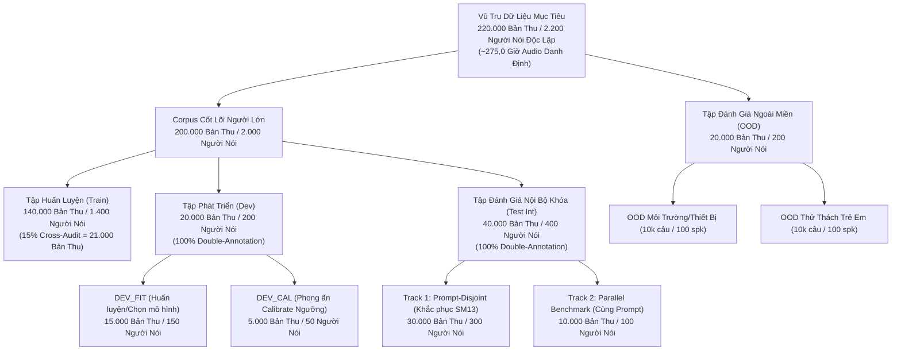
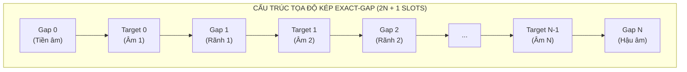
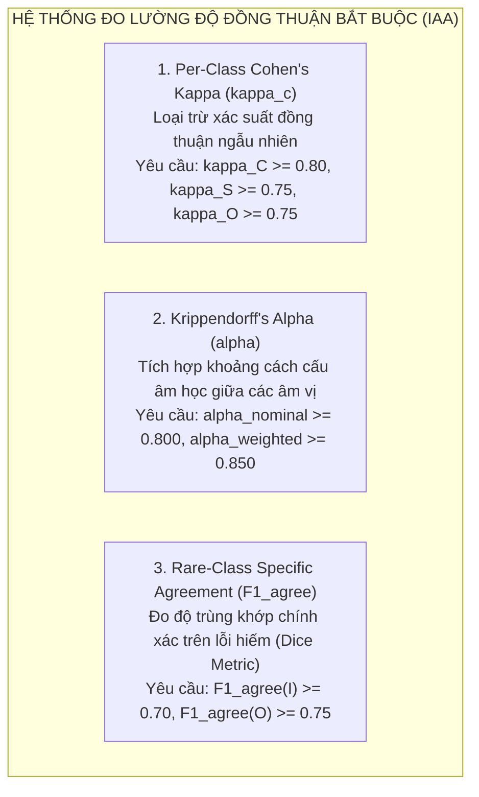
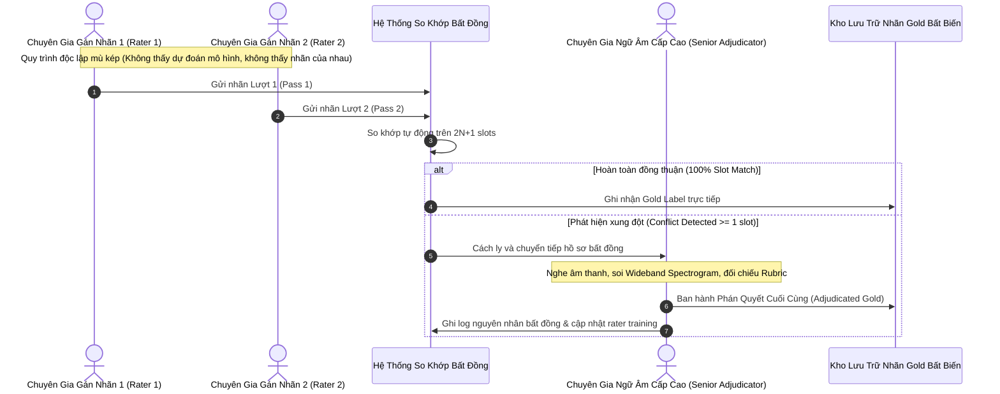
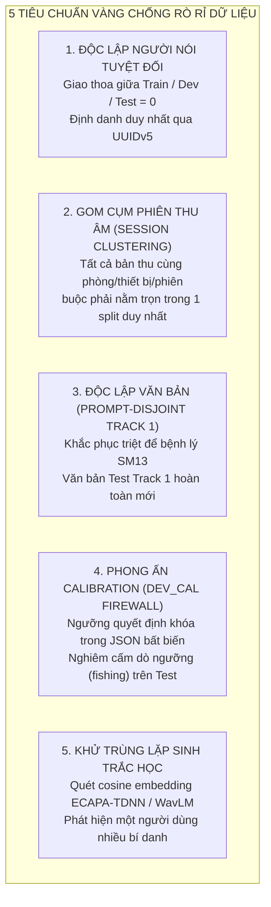
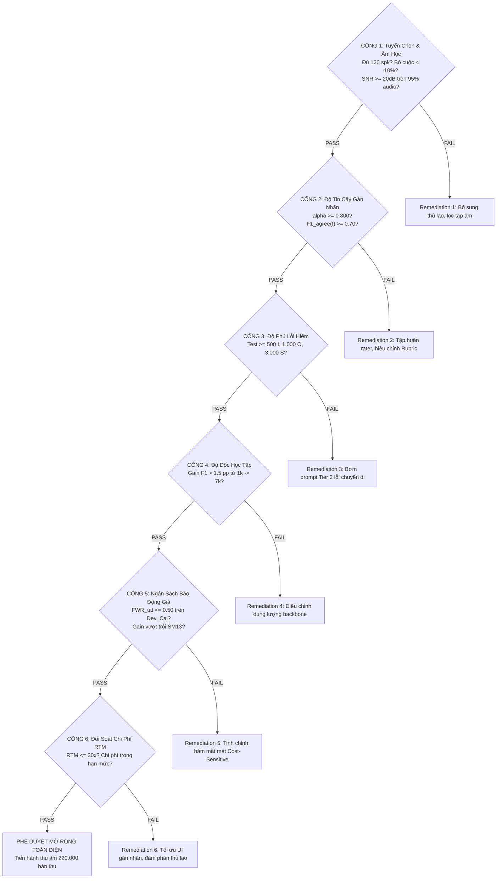

# MASTER DATASET R&D REPORT — BÁO CÁO TỔNG THỂ DỮ LIỆU QUY MÔ LỚN CHO CHẨN ĐOÁN LỖI PHÁT ÂM TIẾNG ANH L2
## Nghiên Cứu & Phát Triển Nền Tảng Dữ Liệu 220.000 Bản Thu / 2.200 Người Nói Độc Lập Cho Bài Toán MDD (S/O/I)

**Mã tài liệu:** `REPORT-DATASET-RD-20261116-MASTER`  
**Ngày hoàn thành:** 16/11/2026  
**Trạng thái:** `R&D_COMPLETED — ARCHITECTURE_FREEZE — PENDING_USER_GATE_APPROVAL`  
**Chủ quản thiết kế (Master Architect):** `@synthesizer`  
**Cộng tác viên & Phân hệ đóng góp:**
- Trinh sát dữ liệu: `@scout-public`, `@scout-vietnamese`, `@scout-crowdsource`, `@scout-pediatric`
- Kiểm toán kỹ thuật & pháp lý: `@audit-soi`, `@audit-quality`, `@audit-leakage`, `@audit-legal`, `@qc-audio`
- Hoạch định kế hoạch & ngân sách: `@plan-pilot`, `@plan-cost`
- Thẩm định độc lập: `@verifier-source`, `@verifier-contract`
- Điều phối viên: `@coordinator`  
**Tài liệu nền tảng & Pháp quy:**
- [DATASET_R&D_GOAL.md](file:///home/khoa/Projects/New-Method-Research/DATASET_R&D_GOAL.md)
- [TEST_EVALUATION_PROTOCOL.md](file:///home/khoa/Projects/New-Method-Research/TEST_EVALUATION_PROTOCOL.md)
- [reports/SM13_DATASET_REQUIREMENTS_20261115/REPORT_VI.md](file:///home/khoa/Projects/New-Method-Research/reports/SM13_DATASET_REQUIREMENTS_20261115/REPORT_VI.md)
- [reports/DATASET_RD_20261116/VERIFY_SOURCES.md](file:///home/khoa/Projects/New-Method-Research/reports/DATASET_RD_20261116/VERIFY_SOURCES.md)
- [reports/DATASET_RD_20261116/VERIFY_CONTRACTS.md](file:///home/khoa/Projects/New-Method-Research/reports/DATASET_RD_20261116/VERIFY_CONTRACTS.md)

---

> ### BẢN TUYÊN BỐ TUÂN THỦ RANH GIỚI SECTION 8 (DATASET_R&D_GOAL.md)
> Toàn bộ nội dung trong báo cáo tổng thể này là **kết quả nghiên cứu khoa học, thẩm định kỹ thuật, và lập kế hoạch kiến trúc (Planning & Architecture Only)**. 
> Việc hoàn thành báo cáo này **TUYỆT ĐỐI KHÔNG**:
> 1. Tự ý phê duyệt hoặc khởi tạo bất kỳ khoản chi tiêu tài chính nào.
> 2. Kích hoạt bất kỳ chiến dịch thu âm thực tế hoặc tuyển dụng người tham gia nào.
> 3. Tải lên (upload) bất kỳ dữ liệu giọng nói hoặc metadata người nói nào lên các dịch vụ đám mây hay API bên thứ ba (100% xử lý on-premises).
> 4. Mở niêm phong, chỉnh sửa, hay xâm phạm các tập dữ liệu đánh giá bị khóa lịch sử (`DEV_CAL`, `held`, official test sets của SM13 và CROTTC).
> 5. Thêm bất kỳ file âm thanh thô nào vào kho lưu trữ Git.
> 6. Khởi chạy các chiến dịch huấn luyện quy mô lớn làm gián đoạn các tiến trình vận hành hiện hữu.

---

## MỤC LỤC CHI TIẾT
1. [BÁO CÁO TỔNG THỂ & QUYẾT ĐỊNH ĐIỀU HÀNH (Executive Summary)](#1-báo-cáo-tổng-thể--quyết-định-điều-hành-executive-summary)
2. [MA TRẬN NGUỒN DỮ LIỆU ĐÃ QUA THẨM ĐỊNH ĐỘC LẬP (Verified Source Inventory)](#2-ma-trận-nguồn-dữ-liệu-đã-qua-thẩm-định-độc-lập-verified-source-inventory)
3. [QUYẾT ĐỊNH VỀ DÂN SỐ ĐÍCH, PHẠM VI SẢN PHẨM & RUBRIC PHÁT ÂM (Population & Rubric Decisions)](#3-quyết-định-về-dân-số-đích-phạm-vi-sản-phẩm--rubric-phát-âm-population--rubric-decisions)
4. [HỢP ĐỒNG DỮ LIỆU & SỔ TAY GÁN NHÃN ÂM VỊ (Data Contract & Annotation Handbook)](#4-hợp-đồng-dữ-liệu--sổ-tay-gán-nhãn-âm-vị-data-contract--annotation-handbook)
5. [QUY TRÌNH ĐẢM BẢO ĐỘ TIN CẬY & ĐỐI SOÁT GÁN NHÃN (Annotation Reliability & Adjudication Protocol)](#5-quy-trình-đảm-bảo-độ-tin-cậy--đối-soát-gán-nhãn-annotation-reliability--adjudication-protocol)
6. [THIẾT KẾ PHÂN CHIA DỮ LIỆU & KIẾN TRÚC CHỐNG RÒ RỈ (Sampling & Split Architecture)](#6-thiết-kế-phân-chia-dữ-liệu--kiến-trúc-chống-rò-rỉ-sampling--split-architecture)
7. [TIÊU CHUẨN KỸ THUẬT ÂM HỌC & KIỂM SOÁT TÍN HIỆU (Acoustic Engineering & Audio QC Specification)](#7-tiêu-chuẩn-kỹ-thuật-âm-học--kiểm-soát-tín-hiệu-acoustic-engineering--audio-qc-specification)
8. [ĐÁNH GIÁ TÍNH KHẢ THI, CHI PHÍ & MÔ HÌNH NGUỒN LỰC (Feasibility, Resource & Cost Comparison)](#8-đánh-giá-tính-khả-thi-chi-phí--mô-hình-nguồn-lực-feasibility-resource--cost-comparison)
9. [KẾ HOẠCH TRIỂN KHAI PILOT GIAI ĐOẠN 1 & HỆ THỐNG CỔNG KIỂM SOÁT (Phase 1 Pilot & Rollout Gates)](#9-kế-hoạch-triển-khai-pilot-giai-đoạn-1--hệ-thống-cổng-kiểm-soát-phase-1-pilot--rollout-gates)
10. [KHUÔN KHỔ PHÁP LÝ, QUYỀN RIÊNG TƯ SINH TRẮC & BẢO VỆ DỮ LIỆU TRẺ EM (Legal, Privacy & Compliance)](#10-khuôn-khổ-pháp-lý-quyền-riêng-tư-sinh-trắc--bảo-vệ-dữ-liệu-trẻ-em-legal-privacy--compliance)
11. [DANH SÁCH QUYẾT ĐỊNH CẦN NGƯỜI DÙNG PHÊ DUYỆT (Decisions for User Approval & Next Steps)](#11-danh-sách-quyết-định-cần-người-dùng-phê-duyệt-decisions-for-user-approval--next-steps)

---

## 1. BÁO CÁO TỔNG THỂ & QUYẾT ĐỊNH ĐIỀU HÀNH (Executive Summary)

### 1.1. Bối Cảnh và Mục Tiêu Nghiên Cứu
Nhằm giải quyết triệt để các hạn chế cố hữu của hệ thống SM13 LoRA hiện tại—vốn được phát triển trên quy mô cực kỳ hẹp (Fit: 9 người / 1.350 câu; Held: 3 người / 450 câu toàn bộ là nam giới; 245/245 prompt IDs bị trùng lặp giữa Fit và Held; F1 tổng hợp 47,57% với 2,2044 cảnh báo sai/câu)—nghiên cứu R&D này đã thiết kế toàn diện kiến trúc dữ liệu quy mô lớn chuẩn hóa cho bài toán Phát hiện và Chẩn đoán Lỗi Âm vị Tiếng Anh L2 (Mispronunciation Detection and Diagnosis - MDD) theo mục tiêu đã thống nhất tại [DATASET_R&D_GOAL.md](file:///home/khoa/Projects/New-Method-Research/DATASET_R&D_GOAL.md): **220.000 bản thu âm có nhãn từ 2.200 người nói độc lập**.

Quy mô 220.000 bản thu (~244,4 – 366,7 giờ audio; chuẩn danh định 275,0 giờ ở mức 4,5 giây/câu) được bảo toàn số học tuyệt đối và phân bổ thành 4 phân vùng độc lập nghiêm ngặt:
- **Tập Huấn luyện (Train):** 140.000 bản thu / 1.400 người nói độc lập (~175,0 giờ).
- **Tập Phát triển (Dev):** 20.000 bản thu / 200 người nói độc lập (~25,0 giờ), chia tách vật lý thành `DEV_FIT` (15.000 câu / 150 người nói) cho tinh chỉnh mô hình và `DEV_CAL` (5.000 câu / 50 người nói) phong ấn cho chuẩn hóa ngưỡng/nhiệt độ.
- **Tập Đánh giá Nội bộ Khóa (Test Internal):** 40.000 bản thu / 400 người nói độc lập (~50,0 giờ), chia thành Track 1 Độc lập Văn bản Tuyệt đối (Strict Prompt-Disjoint: 30.000 câu / 300 người nói) và Track 2 Đối chứng Benchmark (Parallel Benchmark: 10.000 câu / 100 người nói).
- **Tập Đánh giá Ngoài miền (Test External OOD):** 20.000 bản thu / 200 người nói độc lập (~25,0 giờ), đại diện cho các điều kiện âm học, thiết bị di động, và quần thể đặc thù.



---

### 1.2. Bảy Đột Phá Kiến Trúc & Phát Hiện Trọng Yếu Đã Được Thẩm Định

1. **Bác Bỏ Triệt Để Ảo Giác "Toàn Bộ Audio L2-ARCTIC Là Gold" (Whole Audio is Gold Fallacy):**
   Kiểm chứng thực tế hồ sơ TAMU PSI Lab và manifest `CORPUS_STATISTICS.json`: L2-ARCTIC v5.0 có 26.867 câu đọc (~27,1 giờ audio), nhưng **chỉ có duy nhất 150 câu/người nói trên 24 người nói = 3.599 câu (~3,57 giờ audio, chiếm 13,18%)** là có nhãn thủ công do chuyên gia ngữ âm gán. **86,82% còn lại (~23,53 giờ) là kết quả căn chỉnh tự động của Kaldi**, hoàn toàn không thể coi là chân lý nhãn lỗi S/O/I.
2. **Xóa Bỏ Ảo Giác Về Kho Dữ Liệu Mở Sẵn Có Đủ 220.000 Mẫu MDD:**
   Cả 5 kho dữ liệu âm thanh mở khổng lồ (Mozilla Common Voice, VoxCeleb, LibriTTS-R, Tatoeba, TED-LIUM 3) với hàng triệu câu nói từ hàng trăm nghìn người nói đều chứa **đúng 0% nhãn lỗi âm vị (S/O/I)**. Việc cố tình gán nhãn lại thủ công toàn bộ 220.000 câu từ audio thô đòi hỏi **~121.000 giờ công chuyên gia, chi phí từ 1,37M$ đến 2,75M$ USD và mất 3–5 năm**, hoàn toàn bất khả thi về mặt tài chính và vận hành.
3. **Thực Trạng Khắc Nghiệt Của Dữ Liệu Tiếng Anh L2 Người Việt:**
   Trong toàn bộ các bộ dữ liệu công khai trên toàn cầu, **chỉ có duy nhất 4 người nói tiếng Việt trong L2-ARCTIC (`HQTV`, `PNV`, `THV`, `TLV`) với tổng cộng 600 câu có nhãn gold S/O/I (~0,6 giờ audio)**. ("BVT" đã được thẩm định làm rõ là ký hiệu khung âm học `/bVt/`, không phải tên người nói). Mọi kho dữ liệu nội địa (VIVOS, VinBigData, FPT FOSD) đều là 100% tiếng Việt bản ngữ. Khoảng cách hiện tại thiếu hụt **550 lần về số người nói và 366 lần về số câu (chỉ đạt 0,27%)**, chứng minh việc **xây dựng một chiến dịch thu âm bản ngữ mới có kiểm soát khoa học là bắt buộc tuyệt đối**.
4. **Cô Lập Triệt Để Giọng Trẻ Em Khỏi Tập Huấn Luyện Cốt Lõi:**
   Do sự lệch pha sâu sắc về giải phẫu âm học (formant giãn nở +20% đến +50%, $F_0$ cao 250–400 Hz gây thưa hài âm) và sự nhập nhằng giữa quá trình âm nhi hóa tự nhiên (developmental phonology) với lỗi chuyển di L2, cộng với rủi ro pháp lý nghiêm ngặt của COPPA, GDPR Điều 17 (Right to Erasure), và Nghị định 13/2023/NĐ-CP: **Tuyệt đối loại bỏ trẻ em (<16 tuổi) khỏi 200.000 câu cốt lõi (Train/Dev/Test-Internal) và cô lập vào phân nhánh thử thách ngoài miền (OOD Pediatric Challenge Track)**.
5. **Chứng Minh Tính Bất Hợp Lệ Của Ánh Xạ "Score 0 = Omission" Của SpeechOcean762:**
   Trong SpeechOcean762, phone score 0 gộp cả *"incorrect or missed"*. Vì tỷ lệ lỗi thay thế so với lược bỏ trong tự nhiên là $4:1$ đến $5:1$, việc gán mù quáng Score 0 thành Omission sẽ **bơm tới ~80% nhiễu nhãn vào lớp Omission**, phá hủy hoàn toàn đường cong Precision-Recall và AP của Omission. Một cơ chế phân giải 3 tầng (Metadata -> MFA Acoustic Verification -> Quarantine) đã được thiết lập.
6. **Phá Vỡ Ngộ Nhận "Audio Hours = Annotator Hours" & Xác Lập Hệ Số RTM Thực Tế:**
   Thời lượng audio danh định 275,0 – 305,6 giờ không phản ánh khối lượng công việc. Quy trình thẩm âm 5 bước đòi hỏi hệ số phóng đại thời gian thực (Base Real-Time Multiplier) từ **20x đến 26,7x**. Khi kết hợp với yêu cầu kiểm toán kép (100% Dev/Test, 15% Train) và hội chẩn bất đồng chuyên gia cấp cao (24,0% tỷ lệ tranh chấp), **tổng khối lượng công việc đạt 345.200 lượt tác vụ, tương đương 10.099,0 đến 11.708,3 giờ công lao động chuyên gia**, đẩy hệ số dự án lên **33,05x đến 42,58x**.
7. **Lộ Trình Triển Khai De-risking Bằng Phase 1 Pilot Chi Phí Thấp:**
   Trước khi cam kết ngân sách hàng tỷ đồng cho 220k câu, dự án bắt buộc thực hiện **Giai đoạn 1 Pilot trên 120 người nói / 12.000 câu** với ngân sách chỉ khoảng **$5.586,90 – $6.972,90 USD (~140 – 174 triệu VNĐ)** để đo đạc thực nghiệm hệ số RTM, độ đồng thuận Kappa/Alpha, kiểm chứng đường cong học tập tại các mốc 1k -> 2k -> 4k -> 7k câu, và vượt qua 6 Cổng Kiểm Soát Nghiêm Ngặt trước khi giải ngân quy mô lớn.

---

## 2. MA TRẬN NGUỒN DỮ LIỆU ĐÃ QUA THẨM ĐỊNH ĐỘC LẬP (Verified Source Inventory)

Bảng tổng hợp dưới đây tích hợp kết quả kiểm chứng sự thật độc lập từ [VERIFY_SOURCES.md](file:///home/khoa/Projects/New-Method-Research/reports/DATASET_RD_20261116/VERIFY_SOURCES.md) đối với tất cả các tập dữ liệu tiềm năng:

| Tên Bộ Dữ Liệu | Phiên Bản | Cơ Quan Phát Hành & Paper Tham Chiếu | Số Người Nói Độc Lập | Tổng Audio (Giờ) | Gold Audio S/O/I (Giờ) | Bản Chất Nhãn Thực Tế | Giấy Phép Bản Quyền | Sử Dụng Thương Mại | Vai Trò Khuyến Nghị Trong Dự Án 220k |
| :--- | :---: | :--- | :---: | :---: | :---: | :--- | :---: | :---: | :--- |
| **L2-ARCTIC** | v5.0 (2020) | TAMU PSI Lab; Zhao et al., *Interspeech 2018* | 24 (6 L1, 4 spk Việt Nam) | 27,1 h (26.867 utts) | **3,57 h** (3.599 utts; VN: 0,6h / 600 utts) | Chuẩn S/O/I đầy đủ với ranh giới ms trên TextGrid thủ công | **CC BY-NC 4.0** | **KHÔNG** (Phi thương mại lây nhiễm) | Benchmark Baseline đối chứng; Pilot so sánh; cấm coi 27,1h là gold |
| **SpeechOcean762** | SLR101 v1.0 (2021) | OpenSLR; Zhang et al., *Interspeech 2021* | 250 (125 trẻ em, 125 người lớn, Mandarin L1) | 5,98 h (5.000 utts) | **5,98 h** (100% chấm bởi 5 chuyên gia) | Điểm số phone 0, 1, 2; Score 0 gộp S và O; dấu `[]` cho Insert | **CC BY 4.0** | **CÓ** (Tự do khai thác) | Huấn luyện acoustic feature extractor (SSL/GOP); 125 trẻ đưa vào OOD Pediatric Track |
| **EpaDB** | v1.0 (2019) | Univ. Buenos Aires; Vidal et al., *Interspeech 2019* | 50 (Argentine Spanish L1) | ~2,73 h (3.160 utts) | **~2,73 h** (TextGrids) | Phiên âm âm vị; 0 = omission, `+` = insertion (thiếu ranh giới độc lập) | **CC BY-NC 4.0** | **KHÔNG** | Tập phụ trợ phân tích lỗi âm vị tiếng Tây Ban Nha L1; tham khảo thuật toán GOP |
| **EdAcc** | v1.0 (2023) | Univ. Edinburgh; Sanabria et al., *ICASSP 2023* | ~120 (>30 giọng vùng miền) | ~40,0 h | **0 h** | **KHÔNG CÓ nhãn âm vị** (Chỉ có văn bản chính tả ASR hội thoại) | CC BY-SA 4.0 | CÓ (Kèm điều khoản SA) | Loại khỏi bài toán MDD; chỉ dùng kiểm tra độ bền vững ASR |
| **AESRC 2020** | Challenge 2020 | Datatang; Deng et al., *Interspeech 2020* | ~400–500 (8 nhóm accent) | 180,0 h | **0 h** | **KHÔNG CÓ nhãn âm vị** (Chỉ có text và nhãn nhận dạng Accent ID) | Datatang EULA | Hạn chế | Không dùng cho bài toán MDD |
| **CU-CHLOE** | v1.0 (CUHK) | CUHK DSP Lab; Leung et al., ICASSP 2019 | 210 (100 Quảng Đông, 110 Quan Thoại) | 34,6 h | **34,6 h** (Gold chuyên gia) | Chuẩn S/O/I đầy đủ do chuyên gia ngôn ngữ phiên âm | Bản quyền đóng CUHK | **KHÔNG** (Lưu trữ nội bộ) | Làm rõ hiểu lầm "CU-SYMPHONIC"; không khả dụng công khai |
| **Mozilla Common Voice (EN)** | Corpus 17.0 / 27.0 | Mozilla Data Collective (2024) | >100.500 | ~3.796 h (2.59M clips) | **0 h** | Đánh giá chính tả cộng đồng; **0% nhãn âm vị** (Tiếng Anh VN <30 spk) | **CC0 1.0 Universal** | **CÓ** (Public Domain) | Huấn luyện thích ứng tự giám sát (SSL acoustic adaptation); cấm làm Gold Test |
| **LibriTTS-R** | OpenSLR 141 (2023) | Google Speech; Koizumi et al., *Interspeech 2023* | 2.456 (Sách nói sạch 24kHz) | 585,0 h (360k utts) | **0 h** (Lời nói bản ngữ chuẩn) | Văn bản chuẩn hóa, **0% nhãn lỗi L2** | **CC BY 4.0** | **CÓ** (Tự do khai thác) | Nền tảng sinh lỗi âm vị nhân tạo (Synthetic S/O/I); bộ neo đo False Alarms |
| **VoxCeleb 1 & 2** | VGG Oxford (2017/2018) | Nagrani et al.; Chung et al. | 7.363 người nổi tiếng | ~2.800 h (1.28M clips) | **0 h** | Nhận dạng người nói, không có bản phiên âm ngữ âm chính thức | YouTube Terms / CC BY 4.0 | Rủi ro cao | Loại bỏ hoàn toàn khỏi dự án do rủi ro bản quyền và luật sinh trắc BIPA |
| **TED-LIUM 3** | LIUM (2018) | Hernandez et al., *SPECOM 2018* | 2.028 diễn giả TED | 452,0 h (2.351 bài nói) | **0 h** | Phụ đề STM, **0% nhãn âm vị** | CC BY-NC-ND 3.0 | **TUYỆT ĐỐI CẤM** | Loại bỏ hoàn toàn do rào cản cấm phái sinh (No Derivatives) và cấm thương mại |

### Phân Tích Chiến Lược Tái Sử Dụng Nguồn Dữ Liệu Mở
Dựa trên bảng ma trận trên, chiến lược dữ liệu đa tầng (Tiered Data Strategy) được xác lập:
1. **Tầng Đánh Giá Tuyệt Đối (Gold Evaluation):** Không sử dụng bất kỳ kho dữ liệu đại chúng nào làm Ground Truth cho Dev/Test ngoài tập dữ liệu người Việt được thu âm mới và kiểm toán kép.
2. **Tầng Baseline Đối Chứng (Scientific Benchmark):** Sử dụng 3.599 câu manual gold của L2-ARCTIC v5.0 để so sánh đối đầu với các công bố khoa học quốc tế.
3. **Tầng Sinh Lỗi Nhân Tạo (Synthetic Perturbation Engine):** Tái sử dụng 585 giờ đọc chuẩn của LibriTTS-R (CC BY 4.0) để tạo ra các biến thể lỗi S/O/I nhân tạo có kiểm soát nhằm mở rộng tập Train mà không tốn chi phí gán nhãn thủ công.
4. **Tầng Thích Ứng Âm Học (Self-Supervised Adaptation):** Sử dụng các đoạn audio tiếng Anh đa dạng của Common Voice (CC0) để pre-train hoặc domain-adapt các bộ trích xuất đặc trưng âm học chống chịu nhiễu môi trường.

---

## 3. QUYẾT ĐỊNH VỀ DÂN SỐ ĐÍCH, PHẠM VI SẢN PHẨM & RUBRIC PHÁT ÂM (Population & Rubric Decisions)

### 3.1. Dân Số Mục Tiêu (Target Population) & Quota Nhân Khẩu Học
Dự án xác định rõ đối tượng phục vụ cốt lõi là **Người Việt Nam học tiếng Anh (Vietnamese L2 English Learners)** ở độ tuổi trưởng thành ($\ge 16$ tuổi), bao quát từ trình độ sơ cấp đến thành thạo theo Khung Tham chiếu Ngôn ngữ Chung Châu Âu (CEFR).

Nhằm bảo đảm tính khái quát hóa và ngăn chặn thiên lệch âm học, ma trận phân bổ quota cho 2.200 người nói được khóa như sau:

| Chiều Nhân Khẩu | Phân Nhóm Cụ Thể | Tỷ Lệ Mục Tiêu | Số Người Nói (Full 2.200) | Số Người Nói (Pilot 120) | Căn Cứ Khoa Học & Ngôn Ngữ Học |
| :--- | :--- | :---: | :---: | :---: | :--- |
| **Vùng Miền (L1 Dialect)** | Bắc Bộ (Hà Nội & đồng bằng) | **40,0%** | 880 | 48 | Đặc trưng: nuốt phụ âm cuối, lẫn lộn /l/ - /n/, biến đổi /ʃ/ $\to$ [s]. |
| | Nam Bộ (TP.HCM & Tây Nam Bộ) | **40,0%** | 880 | 48 | Đặc trưng: biến đổi âm cuối /t/ $\to$ [k̚], /n/ $\to$ [ŋ], lẫn lộn /v/ $\to$ [j]. |
| | Trung Bộ (Huế, Đà Nẵng, Nghệ Tĩnh) | **20,0%** | 440 | 24 | Đặc trưng: trường độ nguyên âm ngắn, mang dấu ấn thanh điệu nặng. |
| **Giới Tính (Gender)** | Nam (Male) | **50,0%** | 1.100 | 60 | Khắc phục triệt để thiên lệch SM13 (Held 100% là nam giới). |
| | Nữ (Female) | **50,0%** | 1.100 | 60 | Bảo đảm cân bằng phân bố $F_0$ và các khoảng formant nam-nữ. |
| **Trình Độ (CEFR Level)** | Sơ cấp (A1 – A2) | **30,0%** | 660 | 36 | Mật độ lỗi cao, lỗi thô rõ ràng (tỷ lệ Omission và Substitution lớn). |
| | Trung cấp (B1 – B2) | **45,0%** | 990 | 54 | Quần thể người học phổ biến nhất; lỗi tinh vi ở cụm phụ âm và trọng âm. |
| | Cao cấp (C1) | **25,0%** | 550 | 30 | Giọng gần bản ngữ; là dữ liệu chuẩn để kiểm soát và hiệu chỉnh False Alarms. |
| **Môi Trường Thu Âm** | Môi trường yên tĩnh (Studio / Mic USB) | **70,0%** | 1.540 | 84 | Tập trung vào chất lượng âm học đạt chuẩn cho huấn luyện mô hình. |
| | Môi trường thực tế (Mobile / Laptop Mic) | **30,0%** | 660 | 36 | Đưa vào Dev và Test để kiểm tra độ bền vững trong điều kiện thực tế. |

---

### 3.2. Hệ Thống Lỗi Chuyển Di Âm Vị Tiếng Việt (Contrastive Phonetic Transfer Taxonomy)
Phân tích đối chiếu giữa hệ thống âm vị tiếng Việt (ngôn ngữ đơn lập, âm tiết khép kín, có thanh điệu, không có cụm phụ âm) và tiếng Anh xác lập danh mục lỗi chuyển di điển hình bắt buộc phải có trong tập dữ liệu:

```mermaid
flowchart TD
    subgraph TransferErrors["HỆ THỐNG LỖI CHUYỂN DI ÂM VỊ L1 VIỆT NAM -> L2 TIẾNG ANH"]
        OMISSION["LỖI LƯỢC BỎ (OMISSION - O)<br/>(Chiếm tỷ lệ cao nhất và nghiêm trọng nhất)"]
        SUBSTITUTION["LỖI THAY THẾ (SUBSTITUTION - S)<br/>(Xảy ra do thiếu âm vị tương đương)"]
        INSERTION["LỖI CHÈN ÂM (INSERTION - I)<br/>(Phá vỡ cấu trúc âm tiết)"]
        SUPRA["LỖI SIÊU ĐOẠN TÍNH & PHƯƠNG NGỮ<br/>(Thanh điệu và tiết tấu)"]
    end
    
    OMISSION --> O1["Lược bỏ phụ âm xát/tắc xát cuối: /s, z, ʃ, ʒ, tʃ, dʒ/<br/>(Disney & Le 2024: tỷ lệ bỏ /s, z/ đạt 28,4% - 50,7%)"]
    OMISSION --> O2["Lược bỏ phụ âm tắc cuối: /t, d, p, b, k, g/"]
    OMISSION --> O3["Giản lược cụm phụ âm cuối (Coda Cluster Reduction):<br/>/kts/ -> [k], /sks/ -> [s], /nd/ -> [n]"]
    
    SUBSTITUTION --> S1["Thay thế âm răng xát: /θ/ -> [t, s], /ð/ -> [d, z, v]"]
    SUBSTITUTION --> S2["Vô thanh hóa phụ âm cuối (Final Devoicing):<br/>/d/ -> [t], /z/ -> [s], /v/ -> [f], /b/ -> [p]"]
    SUBSTITUTION --> S3["Hòa lẫn nguyên âm căng/chùng: /iː/ vs /ɪ/, /uː/ vs /ʊ/, /æ/ vs /e/"]
    SUBSTITUTION --> S4["Khẩu ngữ hóa nguyên âm lướt: thiếu nhược hóa schwa /ə/"]
    
    INSERTION --> I1["Chèn nguyên âm đệm schwa [ə] vào cụm phụ âm đầu:<br/>'blue' /bluː/ -> [bəˈluː], 'sport' /spɔːt/ -> [səˈpɔːt]"]
    INSERTION --> I2["Chèn nguyên âm vang sau phụ âm tắc cuối:<br/>'like' /laɪk/ -> [laɪ.kə], 'book' /bʊk/ -> [bʊ.kə]"]
    
    SUPRA --> T1["Áp đặt thanh điệu tiếng Việt: thanh sắc/nặng vào âm cuối"]
    SUPRA --> T2["Tiết tấu đều âm tiết (Syllable-timed rhythm) thay vì Stress-timed"]
```



---

### 3.3. Quyết Định Rubric Sư Phạm (Lenient / Pedagogical Rubric vs. Strict GA)
Một trong những nguyên nhân chính khiến hệ thống SM13 có tỷ lệ cảnh báo sai cao ($2,20$ FP/câu) là sự cứng nhắc của chuẩn General American (Strict GA), biến các biến thể phát âm tự nhiên được chấp nhận thành lỗi sai. 

Dự án **chính thức thông qua Rubric Sư Phạm Khoan Dung (Lenient / Pedagogical Rubric)** làm tiêu chuẩn gán nhãn:
- **Định nghĩa Lỗi Âm Vị Thực Sự (True Phonological Error):** Là sự biến đổi âm học làm thay đổi thế đối lập âm vị (phonemic contrast), dẫn đến hiểu nhầm từ (minimal pair confusion) hoặc gây cản trở nghiêm trọng đến khả năng hiểu (intelligibility). Bắt buộc phân loại thành **S, O, hoặc I**.
- **Định nghĩa Biến Thể Được Chấp Nhận (Acceptable Accent Variant / Allophone):** Là các hiện tượng tha âm tự nhiên của người học hoặc biến thể giọng vùng miền không làm mất tính dễ hiểu của từ. Bắt buộc ánh xạ về **CORRECT (C)**.

#### Bảng Quy Tắc Ánh Xạ Tha Âm Về CORRECT Trong Rubric Gán Nhãn:
1. **Âm tắc không bật hơi ở đầu từ (Unaspirated Initial Stops):** Phát âm $/p, t, k/$ thành $[p^{=}, t^{=}, k^{=}]$ thay vì $[p^h, t^h, k^h]$ $\to$ Gán nhãn `CORRECT`.
2. **Âm vỗ chân răng (Alveolar Flapping):** Phát âm $/t, d/$ giữa hai nguyên âm thành $[ɾ]$ (ví dụ *"water"* $[ˈwɑːɾər]$) $\to$ Gán nhãn `CORRECT`.
3. **Âm tắc thanh hầu trước âm mũi (Glottal Replacement / Reinforcement):** Phát âm $/t/$ thành $[ʔ]$ trước âm mũi (ví dụ *"button"* $[ˈbʌʔn̩]$) $\to$ Gán nhãn `CORRECT`.
4. **Phụ âm cuối khép không thả hơi (Unreleased Final Stops):** Phát âm $/p, t, k/$ cuối từ thành $[p̚, t̚, k̚]$ $\to$ Gán nhãn `CORRECT` (chỉ phạt Omission nếu biên độ năng lượng bằng 0 và không có động tác khép khẩu hình).
5. **Đồng hóa ngữ lưu tự nhiên (Connected Speech Assimilation):** Ví dụ *"good girl"* $/ɡʊd ɡɜːl/ \to [ɡʊɡ ɡɜːl]$ $\to$ Gán nhãn `CORRECT`.
6. **Màu sắc nguyên âm vùng miền (Vowel Centralization):** Sự xê dịch formant F1/F2 trong phạm vi an toàn không xâm lấn sang nguyên âm đối lập lân cận $\to$ Gán nhãn `CORRECT`.

---

## 4. HỢP ĐỒNG DỮ LIỆU & SỔ TAY GÁN NHÃN ÂM VỊ (Data Contract & Annotation Handbook)

### 4.1. Không Gian Tọa Độ Rãnh Tuyệt Đối (Exact-Gap Topology Contract)
Kế thừa và hoàn thiện tiêu chuẩn EVAL-V3.1 từ SM13, hợp đồng dữ liệu quy định cấu trúc không gian kép bất biến cho mỗi câu phát ngôn có độ dài $N$ âm vị danh định:



1. **Miền Tọa Độ Target ($\mathcal{D}_{\text{target}}$):**
   - Số lượng slot: Đúng $N$ slots, chỉ số $i \in \{0, 1, \dots, N-1\}$.
   - Tập nhãn hợp lệ: $\mathcal{Y}_{\text{target}} \in \{\text{CORRECT (C)}, \text{SUBSTITUTION (S)}, \text{OMISSION (O)}\}$.
2. **Miền Tọa Độ Gap ($\mathcal{D}_{\text{gap}}$):**
   - Số lượng slot: Đúng $N + 1$ slots, chỉ số $j \in \{0, 1, \dots, N\}$.
   - Gap $j=0$: Rãnh trước câu phát ngôn (trước Target 0).
   - Gap $1 \le j \le N-1$: Rãnh giữa Target $j-1$ và Target $j$.
   - Gap $j=N$: Rãnh sau câu phát ngôn (sau Target $N-1$).
   - Tập nhãn hợp lệ: $\mathcal{Y}_{\text{gap}} \in \{\text{NO\_INSERTION}, \text{INSERTION (I)}\}$.
3. **Bất Biến Tổng Số Slots (Total Slot Invariant):**
   $$\text{Total Evaluation Slots}(u) = N + (N + 1) = 2N + 1$$
   Mọi adapter hay submission vi phạm đẳng thức này (ví dụ chỉ trả về $N$ gaps hoặc bỏ quên gap đầu/cuối) đều bị từ chối ngay lập tức tại cổng kiểm tra schema.

#### Chứng Minh Toán Học: Sự Thất Bại Của Đánh Giá Insertion Cấp Độ Câu
Nếu chỉ đếm số lượng lỗi chèn trên toàn câu (utterance-level count) thay vì neo tọa độ rãnh:
- Giả sử người học chèn âm schwa ở đầu từ tại Gap $j=0$ (*"[ə]school"*), nhưng mô hình lại dự đoán chèn âm ở cuối từ tại Gap $j=6$ (*"school[ə]"*).
- Đánh giá cấp độ câu sẽ tính đây là một trường hợp bắt đúng ($\text{TP}=1, \text{FP}=0, \text{FN}=0$).
- Tuy nhiên, trong thực tế sư phạm và chẩn đoán âm học:
  $$\text{Tại Gap } j=0: \quad \text{FN}=1 \quad (\text{bỏ sót lỗi chèn thực tế})$$
  $$\text{Tại Gap } j=6: \quad \text{FP}=1 \quad (\text{báo động giả tại vị trí phát âm đúng})$$
Do đó, việc neo tọa độ $N+1$ gaps là bắt buộc để bảo đảm tính chính xác về mặt lâm sàng và sư phạm.

---

### 4.2. Cơ Chế Phân Giải 3 Tầng Cho Nhãn SpeechOcean762 (Score 0 $\neq$ Omission)
Nhằm vô hiệu hóa rủi ro bơm 80% nhiễu nhãn khi tái sử dụng dữ liệu điểm số, cơ chế phân giải 3 tầng được thiết kế:
1. **Tầng 1 (Metadata Inspection):** Kiểm tra trường `mispronunciations` trong file `scores-detail.json` của SpeechOcean762. Nếu có trường này ghi nhận âm thay thế cụ thể, gán nhãn `SUBSTITUTION`.
2. **Tầng 2 (Acoustic Duration & Energy Verification via MFA):** Chạy công cụ căn chỉnh âm học Montreal Forced Aligner (MFA). Đo đạc thời lượng thực tế $\Delta t$ và mức năng lượng RMS tương đối tại vị trí âm vị bị gắn điểm 0:
   - Nếu $\Delta t < 20\text{ ms}$ VÀ mức năng lượng cục bộ $\le -40\text{ dBFS}$ so với trung bình câu $\to$ Phân loại là `OMISSION`.
   - Nếu $\Delta t \ge 35\text{ ms}$ VÀ tồn tại cấu trúc formant rõ ràng $\to$ Phân loại là `SUBSTITUTION`.
3. **Tầng 3 (Uncertainty Quarantine):** Các trường hợp nằm trong vùng xám ($20\text{ ms} \le \Delta t < 35\text{ ms}$) bị đưa vào danh sách cách ly, không được tự động gán nhãn mà phải qua thẩm định của chuyên gia hoặc bị loại khỏi tập huấn luyện.

---

### 4.3. Quy Chuẩn Xử Lý Hiện Tượng Phức Tạp Trong Sổ Tay Gán Nhãn
1. **Lỗi Chèn Liên Tiếp Nhiều Âm (Multiple Consecutive Insertions):**
   - Khi người học chèn một chuỗi gồm nhiều âm vào cùng một rãnh (ví dụ chèn cả cụm $[ə][s]$ vào giữa hai từ), tọa độ rãnh vẫn giữ nguyên tính nhị phân: $\text{gold\_has\_insertion}_j = 1$.
   - Chuỗi âm vị chèn được lưu trữ trong payload chẩn đoán phụ thuộc (`inserted_sequence: ["AH0", "S"]`) để phục vụ giải thích chi tiết mà không làm vỡ ma trận đánh giá.
2. **Từ Bị Bỏ Qua (Skipped Words):** Toàn bộ các âm vị cấu thành từ đó được gán nhãn `OMISSION`. Các rãnh gap nội bộ trong từ đó được gán nhãn `NO_INSERTION`.
3. **Từ Bị Lặp Lại (Repeated Words):** Các âm vị của lần phát âm chuẩn cuối cùng được căn chỉnh vào chuỗi target. Lần phát âm lặp thừa phía trước được ghi nhận là chuỗi `INSERTION` tại gap liền trước.
4. **Khoảng Lặng và Nhiễu Nền (Anchored Gap Boundary Verification - AGBV):**
   - Nghiêm cấm gán nhãn Insertion cho khoảng thở (breath), tiếng tặc lưỡi (lip smack), hoặc tiếng ồn môi trường.
   - Một khoảng âm chỉ được coi là Insertion khi thỏa mãn đồng thời: thời lượng $\ge 35\text{ ms}$, có năng lượng vượt ngưỡng nền tối thiểu $+12\text{ dB}$, và có đặc trưng phổ âm thanh tương ứng với ít nhất một âm vị tiếng Anh.

---

### 4.4. Cấu Trúc Schema Pydantic v2 & Quy Cách Đóng Gói Manifest
Mọi bản thu âm trong hệ thống đều phải tuân thủ nghiêm ngặt schema dữ liệu kiểu mạnh (Strongly Typed Schema):

```python
from pydantic import BaseModel, Field
from typing import List, Optional, Dict, Any
from enum import Enum

class SplitTag(str, Enum):
    TRAIN_BASE = "TRAIN_BASE"
    DEV_FIT = "DEV_FIT"
    DEV_CAL = "DEV_CAL"
    TEST_INT_TRACK1 = "TEST_INT_TRACK1"
    TEST_INT_TRACK2 = "TEST_INT_TRACK2"
    TEST_EXT_OOD = "TEST_EXT_OOD"

class TargetLabel(str, Enum):
    CORRECT = "C"
    SUBSTITUTION = "S"
    OMISSION = "O"

class TargetSlot(BaseModel):
    slot_index: int = Field(..., ge=0)
    canonical_phone: str
    target_label: TargetLabel
    realized_phone: Optional[str] = None
    start_time_ms: Optional[float] = None
    end_time_ms: Optional[float] = None
    annotator_confidence: float = Field(default=1.0, ge=0.0, le=1.0)

class GapSlot(BaseModel):
    slot_index: int = Field(..., ge=0)
    has_insertion: bool
    inserted_phones: List[str] = Field(default_factory=list)
    start_time_ms: Optional[float] = None
    end_time_ms: Optional[float] = None

class FileHashes(BaseModel):
    raw_audio_sha256: str
    canonical_wav_sha256: str
    annotation_sha256: str

class AudioMetadata(BaseModel):
    sample_rate: int = 16000
    channels: int = 1
    duration_seconds: float
    snr_wada_db: float
    clipping_fraction: float
    rms_dbfs: float

class UtteranceManifest(BaseModel):
    corpus_id: str
    speaker_id: str
    session_id: str
    prompt_id: str
    utterance_id: str
    file_hashes: FileHashes
    audio_metadata: AudioMetadata
    label_version: str = "EVAL-V3.1"
    split_tag: SplitTag
    targets: List[TargetSlot]
    gaps: List[GapSlot]
```

Dữ liệu được đóng gói theo định dạng **WebDataset (tar shards)** với định mức chuẩn $1.000$ câu/shard, đi kèm file checksum SHA-256 bất biến.

---

## 5. QUY TRÌNH ĐẢM BẢO ĐỘ TIN CẬY & ĐỐI SOÁT GÁN NHÃN (Annotation Reliability & Adjudication Protocol)

### 5.1. Bác Bỏ Độ Chuẩn Xác Phần Trăm Gộp Do Nghịch Lý Tỷ Lệ Nền (Base-Rate Paradox)
Trong bài toán MDD, tỷ lệ các âm vị phát âm đúng (`CORRECT`) thường chiếm ưu thế áp đảo ($85\% – 90\%$). Nếu chỉ sử dụng độ đồng thuận phần trăm gộp (Raw Observed Agreement $P_o$):
- Một chuyên gia gán nhãn lười biếng chỉ cần đánh dấu tất cả các âm vị là `CORRECT` sẽ tự động đạt được $P_o \approx 88\%$.
- Khi đó, độ đồng thuận thực tế tính theo Cohen's Kappa sẽ sụp đổ về mức kém cỏi ($\kappa \approx 0,44$), và độ đồng thuận trên các lỗi hiếm như Omission hay Insertion sẽ hoàn toàn tiệm cận 0.

Do đó, dự án **loại bỏ hoàn toàn chỉ số $P_o$ khỏi các tiêu chí nghiệm thu chất lượng**, và bắt buộc sử dụng bộ 3 chỉ số chuyên biệt:



---

### 5.2. Khung Quy Trình Gán Nhãn Kép & Hội Chẩn Chuyên Gia (Double-Annotation & Adjudication)
Để đạt được chất lượng Ground Truth cấp độ xuất bản quốc tế và triển khai công nghiệp:



#### Định Mức Triển Khai Kiểm Toán Chất Lượng:
1. **Trên Tập Đánh Giá (Dev và Test - 80.000 bản thu):**
   - Thực hiện **100% Double-blind Annotation** ($80.000 \times 2 = 160.000$ lượt gán).
   - $100\%$ các trường hợp có bất đồng dù chỉ trên 1 slot đều bắt buộc phải chuyển sang Chuyên gia Ngữ âm Cấp cao (Senior Phoneticians) để phân xử độc lập.
2. **Trên Tập Huấn Luyện (Train - 140.000 bản thu):**
   - Thực hiện **15% Cross-Audit** ($21.000$ bản thu gán nhãn kép).
   - Chiến lược lấy mẫu kép: $50\%$ lấy ngẫu nhiên phân tầng ($10.500$ câu) $+$ $50\%$ lấy mẫu chủ động tập trung vào các câu có lỗi hiếm Insertion/Omission hoặc có độ tin cậy thấp từ aligner ($10.500$ câu).
   - **Cổng Cách Ly Lô (Batch Quarantine Gate):** Nếu một lô $1.000$ câu của một rater có tỷ lệ đồng thuận với chuyên gia kiểm toán tụt xuống dưới ngưỡng ($\kappa < 0,70$), toàn bộ lô $1.000$ câu đó sẽ bị thu hồi và chỉ định gán lại toàn bộ.

---

### 5.3. Truy Vết Người Gán & Vệ Sinh Dữ Liệu Nghiêm Ngặt
- **Mã Hóa Định Danh Rater:** Mỗi thao tác gán nhãn được gắn thẻ UUIDv4 của rater, kèm timestamp mili-giây và chữ ký hàm băm SHA-256.
- **Cách Ly Dự Đoán Mô Hình (Zero Model Feedback):** Giao diện gán nhãn tuyệt đối không hiển thị bất kỳ dự đoán nào của mô hình AI hoặc forced-aligner nhằm ngăn chặn triệt để thiên kiến xác nhận (Confirmation Bias).
- **Phân Tách Dữ Liệu Yếu (Weak Labels Segregation):** Nếu trong tương lai có sử dụng nhãn tự động/bán tự động cho tập Train, các nhãn này bắt buộc phải mang tag `WEAK_PSEUDO_LABEL` và lưu ở phân tầng dữ liệu riêng biệt. Tuyệt đối không được trộn lẫn hoặc đánh đồng nhãn yếu với nhãn Gold.

---

## 6. THIẾT KẾ PHÂN CHIA DỮ LIỆU & KIẾN TRÚC CHỐNG RÒ RỈ (Sampling & Split Architecture)

### 6.1. Bảng Phân Bổ Quy Mô & Thời Lượng 4 Phân Vùng Dữ Liệu
Bảng dưới đây xác lập hình học phân vùng bất biến cho toàn bộ 220.000 bản thu:

| Phân Vùng Dữ Liệu | Số Người Nói Độc Lập | Tỷ Lệ Người Nói | Số Bản Thu (Utterances) | Số Câu / Người | Audio Hours (4,5s) | Audio Hours (5,0s) | Audio Range (4,0 – 6,0s) | Mục Đích Sử Dụng Chi Tiết |
| :--- | :---: | :---: | :---: | :---: | :---: | :---: | :---: | :--- |
| **TRAIN** | **1.400** | 63,64% | **140.000** | 100 | ~175,00 h | ~194,44 h | 155,56 – 233,33 h | Huấn luyện tham số mô hình / Fine-tuning backbone |
| **DEV (Tổng)** | **200** | 9,09% | **20.000** | 100 | ~25,00 h | ~27,78 h | 22,22 – 33,33 h | Tối ưu hóa, chọn mô hình và hiệu chuẩn |
| *-- DEV_FIT* | *150* | *6,82%* | *15.000* | *100* | *~18,75 h* | *~20,83 h* | *16,67 – 25,00 h* | *Chọn checkpoint, learning rate, kiến trúc đầu ra* |
| *-- DEV_CAL* | *50* | *2,27%* | *5.000* | *100* | *~6,25 h* | *~6,94 h* | *5,56 – 8,33 h* | *Phong ấn; đóng băng nhiệt độ và ngưỡng FWR* |
| **TEST NỘI BỘ** | **400** | 18,18% | **40.000** | 100 | ~50,00 h | ~55,56 h | 44,44 – 66,67 h | Đánh giá chính thức sau khi khóa toàn bộ mô hình |
| *-- Track 1 (Disc)* | *300* | *13,64%* | *30.000* | *100* | *~37,50 h* | *~41,67 h* | *33,33 – 50,00 h* | *Khắc phục SM13: Độc lập văn bản tuyệt đối (Prompt-Disjoint)* |
| *-- Track 2 (Para)* | *100* | *4,55%* | *10.000* | *100* | *~12,50 h* | *~13,89 h* | *11,11 – 16,67 h* | *Đối chứng khoa học: Cùng văn bản với tập Train (Parallel)* |
| **TEST NGOÀI MIỀN** | **200** | 9,09% | **20.000** | 100 | ~25,00 h | ~27,78 h | 22,22 – 33,33 h | Đánh giá năng lực chuyển miền (OOD Generalization) |
| *-- OOD Thiết Bị* | *100* | *4,55%* | *10.000* | *100* | *~12,50 h* | *~13,89 h* | *11,11 – 16,67 h* | *Thu âm thực tế qua micro điện thoại và môi trường ồn* |
| *-- OOD Trẻ Em* | *100* | *4,55%* | *10.000* | *100* | *~12,50 h* | *~13,89 h* | *11,11 – 16,67 h* | *Cô lập giọng trẻ em (SpeechOcean child + pilot Việt)* |
| **TỔNG TOÀN BỘ** | **2.200** | **100,0%** | **220.000** | **100** | **~275,00 h** | **~305,56 h** | **244,44 – 366,67 h** | **Bảo toàn số học chính xác 100%** |

---

### 6.2. Năm Tiêu Chuẩn Vàng Chống Rò Rỉ Dữ Liệu (5 Anti-Leakage Golden Invariants)



1. **Độc Lập Người Nói Tuyệt Đối (Zero Speaker Overlap):**
   $$\mathcal{S}_{\text{train}} \cap \mathcal{S}_{\text{dev}} \cap \mathcal{S}_{\text{test\_int}} \cap \mathcal{S}_{\text{test\_ext}} = \emptyset$$
   Được kiểm soát tự động thông qua không gian tên băm định danh `UUIDv5(NAMESPACE_MDD, f"{corpus}:{native_id}")` và được xác thực bằng bài kiểm tra assertion trong CI/CD pipeline trước mỗi đợt phát hành dữ liệu.
2. **Gom Cụm Phiên Thu Âm (Atomic Session Clustering):**
   Nếu hai người nói cùng thu âm trong một phòng học, cùng sử dụng chung một cấu hình micro, hoặc cùng một phiên thu, toàn bộ cụm đó bắt buộc phải được phân bổ nguyên khối vào một phân vùng duy nhất để triệt tiêu hoàn toàn sự rò rỉ phản xạ âm phòng (Room Impulse Response - RIR) và đặc trưng kênh truyền.
3. **Độc Lập Văn Bản (Lexical Prompt Disjointness):**
   Trực tiếp giải quyết bệnh lý của SM13 (nơi $245/245$ câu của tập Held đều đã xuất hiện trong Fit). Track 1 của Test Internal ($30.000$ câu / $300$ người nói) bảo đảm:
   $$\mathcal{P}_{\text{train}} \cap \mathcal{P}_{\text{test\_track1}} = \emptyset$$
   Track 2 ($10.000$ câu / $100$ người nói) dùng chung văn bản được phân tách báo cáo riêng biệt để phục vụ các bài phân tích âm học đối chứng song song.
4. **Phong Ấn Phân Tầng Calibration (`DEV_CAL` Isolation):**
   Tập `DEV_CAL` ($5.000$ câu / $50$ người nói) được cách ly vật lý hoàn toàn khỏi quy trình huấn luyện và lựa chọn checkpoint. Các ngưỡng phân loại, tham số làm mịn nhiệt độ (temperature scaling), và ngân sách cảnh báo sai (FWR) chỉ được tính toán một lần duy nhất trên `DEV_CAL`, sau đó được đóng băng vào file cấu hình mật mã `FROZEN_CALIBRATED_POLICY.json`. Tuyệt đối cấm hành vi điều chỉnh ngưỡng trên Test.
5. **Khử Trùng Lặp Sinh Trắc Học Xuyên Kho Dữ Liệu (Cross-Corpus Biometric Deduplication):**
   Triển khai quy trình 4 giai đoạn sử dụng mô hình trích xuất đặc trưng giọng nói tiên tiến (ECAPA-TDNN 192 chiều và WavLM Large 512 chiều) để tính khoảng cách Cosine/PLDA giữa tất cả các cặp người nói xuyên suốt các nguồn dữ liệu. Ngưỡng phân tách $\tau_{\text{spk}} = 0,82$ (tương ứng tỷ lệ nhận nhầm $FMR < 10^{-4}$) được áp dụng để phát hiện và gộp các cá nhân tham gia nhiều dự án dưới các mã định danh khác nhau.

---

### 6.3. Thuật Toán Speaker Cluster Block Bootstrap CI
Nhằm tuân thủ tiêu chuẩn NISTIR 7810 và khắc phục hiện tượng đánh giá sai số lạc quan do giả định độc lập ngây thơ giữa các âm vị:
- Trong tập Test $40.000$ câu, các âm vị trong cùng một câu hoặc cùng một người nói có mối tương quan âm học và giải phẫu mạnh mẽ.
- Thuật toán **Speaker Cluster Block Bootstrap** thực hiện tái lấy mẫu có hoàn lại trên **cụm người nói ($K = 400$ clusters)** với $B = 2.000$ lần lặp.
- Mọi đánh giá so sánh chênh lệch giữa mô hình mới và mô hình cơ sở ($\hat{\Delta} = \hat{\theta}_{\text{new}} - \hat{\theta}_{\text{base}}$) bắt buộc phải được tính toán đồng thời trên cùng một tập con tái mẫu (paired bootstrap differences).
- Khoảng tin cậy 95% được xác định bằng phương pháp hiệu chỉnh BCa (Bias-Corrected and Accelerated). Một cải tiến chỉ được công nhận có ý nghĩa thống kê khi và chỉ khi cận dưới của khoảng tin cậy chênh lệch lớn hơn 0 ($\text{CI}_{95\%}^{\text{lower}}(\Delta) > 0,0$).

---

## 7. TIÊU CHUẨN KỸ THUẬT ÂM HỌC & KIỂM SOÁT TÍN HIỆU (Acoustic Engineering & Audio QC Specification)

### 7.1. Định Dạng Chuẩn Hóa & Bằng Chứng Bất Biến Ranh Giới Thời Gian
Toàn bộ dữ liệu âm thanh trong hệ thống được chuẩn hóa về định dạng duy nhất:
- **Tần số lấy mẫu:** $16.000\text{ Hz}$ (16 kHz).
- **Số kênh:** 1 kênh đơn (Mono).
- **Độ sâu lượng tử:** 16-bit Linear PCM (`s16le`), dải động lý thuyết $\approx 96,33\text{ dB}$.
- **Bộ lọc lấy mẫu lại (Resampling Engine):** Bộ lọc đa pha Polyphase Kaiser-windowed band-limited sinc interpolation với tần số cắt $7.580\text{ Hz}$, độ suy giảm dải chặn $\ge 85\text{ dB}$, và tham số Kaiser $\beta = 8,5$.

#### Định Lý Bất Biến Mốc Thời Gian Ranh Giới (Boundary Timestamp Invariance Theorem):
Khi thực hiện lấy mẫu lại tín hiệu từ các tần số cao hơn (ví dụ $44,1\text{ kHz}$ hoặc $48\text{ kHz}$) về $16.000\text{ Hz}$, một lo ngại kỹ thuật là sự xê dịch ranh giới âm vị đã được gán nhãn:
- Chu kỳ lấy mẫu rời rạc tại $16\text{ kHz}$ là:
  $$T_s = \frac{1}{16.000} = 62,5\ \mu\text{s} = 0,0625\text{ ms}$$
- Sai số làm tròn lượng tử hóa thời gian cực đại tại bất kỳ ranh giới âm vị nào là:
  $$\Delta t_{\max} = \pm \frac{T_s}{2} = \pm 31,25\ \mu\text{s} = \pm 0,03125\text{ ms}$$
- So với bước nhảy khung (frame stride) chuẩn $20\text{ ms}$ của các mô hình nền tảng như Wav2Vec 2.0 hay HuBERT:
  $$\frac{\Delta t_{\max}}{T_{\text{frame}}} = \frac{0,03125\text{ ms}}{20,0\text{ ms}} = 0,00156 \quad (\mathbf{0,156\%})$$
- Sai số này nhỏ hơn ba bậc độ lớn so với độ bất định sinh học trong thao tác gán nhãn của con người ($\pm 10\text{ ms} – 20\text{ ms}$).
- **Kết luận:** Quy trình chuẩn hóa âm học bảo toàn tính hợp lệ tuyệt đối của các mốc thời gian căn chỉnh.

---

### 7.2. Bộ Quy Chuẩn & Ngưỡng Kiểm Soát Tín Hiệu Âm Thanh (Audio QC Gates)
1. **Thời Lượng Bản Thu (Audio Duration Bounds):**
   - Dải thời lượng danh định mục tiêu: $4,0\text{ s} – 6,0\text{ s}$ (trung bình $\sim 4,8\text{ s}$).
   - Ranh giới vật lý cứng: Từ chối và loại bỏ mọi bản thu có $T < 1,0\text{ s}$ (quá ngắn, không đủ ngữ cảnh) hoặc $T > 12,0\text{ s}$ (quá dài, dễ gây quá tải bộ nhớ GPU).
2. **Tỷ Số Tín Hiệu Trên Nhiễu (SNR Profiling):**
   - Đo đạc tự động bằng hai thuật toán độc lập: WADA-SNR (phân tích dạng sóng) và NIST STNR (phân tích phổ mức năng lượng).
   - Phân hạng 5 bậc: Bậc 1 Studio ($\ge 25\text{ dB}$), Bậc 2 Sạch ($20 – 25\text{ dB}$), Bậc 3 Thiết bị di động ($15 – 20\text{ dB}$), Bậc 4 Thử thách độ bền ($10 – 15\text{ dB}$), Bậc 5 Phế phẩm ($< 10\text{ dB}$ $\to$ Loại bỏ lập tức).
3. **Cắt Sóng Kỹ Thuật Số (Digital Hard Clipping):**
   - Phát hiện các mẫu tín hiệu có biên độ chạm trần $|x| \ge 0,999$.
   - Trên tập Dev/Test: Yêu cầu tuyệt đối $0\%$ mẫu bị cắt sóng.
   - Trên tập Train: Cho phép tối đa $0,05\%$ ($500\text{ ppm}$) mẫu bị cắt sóng không liên tiếp. Mọi bản thu có $\ge 3$ mẫu chạm trần liên tiếp đều bị loại bỏ.
   - Chuẩn hóa khoảng dự trữ (Headroom Normalization): Đưa đỉnh tín hiệu về mức an toàn $-1,0\text{ dBFS}$ (biên độ đỉnh $\approx 0,89125$).
4. **Vùng Đệm Khoảng Lặng & Chống Cụt Âm (Silence Buffering & Truncation Checks):**
   - Bổ sung vùng đệm khoảng lặng danh định $200\text{ ms}$ ($150 – 300\text{ ms}$) ở đầu và cuối bản thu.
   - Kiểm tra năng lượng biên trong $50\text{ ms}$ đầu/cuối: Mức năng lượng bắt buộc phải nhỏ hơn $-25\text{ dBFS}$ để bảo đảm phụ âm đầu không bị nuốt và phụ âm cuối không bị ngắt cụt do thao tác bấm dừng thu âm sớm.

---

## 8. ĐÁNH GIÁ TÍNH KHẢ THI, CHI PHÍ & MÔ HÌNH NGUỒN LỰC (Feasibility, Resource & Cost Comparison)

### 8.1. So Sánh Tính Khả Thi 3 Phương Án Tiếp Cận
Trước khi quyết định phương án đầu tư, 3 kịch bản chiến lược đã được đặt lên bàn cân phân tích:

| Chiều Đánh Giá | Phương Án A: Tái Sử Dụng Nguồn Mở (Pure Open Source Reuse) | Phương Án B: Gán Nhãn Lại Audio Mở (Re-annotate Open Audio) | Phương Án C: Thu Mới Kết Hợp Dữ Liệu Nhân Tạo (Targeted Collection + Synthetic Engine) |
| :--- | :--- | :--- | :--- |
| **Độ Khả Thi Về Nhãn** | **KHÔNG KHẢ THI (0%)**: Các kho mở có 0% nhãn S/O/I; SpeechOcean gộp S/O. | **KHẢ THI VỀ MẶT LÝ THUYẾT**: Tải audio Common Voice / LibriTTS rồi thuê gán nhãn tay. | **HOÀN TOÀN KHẢ THI**: Kiểm soát 100% kịch bản thu âm, cân bằng người nói và cấu trúc rãnh. |
| **Đại Diện Người Việt** | **CỰC KỲ THẤP**: Chỉ có 4 người nói trong L2-ARCTIC; Common Voice <30 người. | **CỰC KỲ THẤP**: Không có nguồn audio thô người Việt nói tiếng Anh đủ lớn để gán nhãn. | **TỐI ƯU 100%**: Tuyển chọn đúng 2.200 người Việt với ma trận phân bổ vùng miền chuẩn. |
| **Khối Lượng Giờ Công** | 0 giờ công chuyên gia. | **~121.000 giờ công lao động** ($220.000 \times 15\text{ phút} \times 2,2$ lượt). | **~10.099 – 11.708 giờ công chuyên gia** (Nhờ tối ưu hóa bằng forced alignment và pre-screening). |
| **Ước Tính Tài Chính** | $0 USD (Ảo giác miễn phí nhưng không có dữ liệu để chạy). | **1,37M$ – 2,75M$ USD** (Chi phí nhân sự gán nhãn khổng lồ). | **Model 1: ~92.700$ – 107.700$ USD** (~2,32 – 2,69 tỷ VNĐ).<br>**Pilot: ~5.590$ USD** (~140 triệu VNĐ). |
| **Thời Gian Thực Hiện** | 1 – 2 tuần tải file. | **3 – 5+ năm** (Quá tải năng lực kiểm toán ngôn ngữ). | **12 – 14 tháng** (Triển khai cuốn chiếu song song). |
| **Rủi Ro Pháp Lý** | CC BY-NC 4.0 gây ô nhiễm thương mại; VoxCeleb rủi ro BIPA. | Khó xin quyền cấp phép thứ cấp đối với dữ liệu giọng nói sinh trắc. | **TUYỆT ĐỐI AN TOÀN**: Hợp đồng chuyển giao quyền sở hữu trí tuệ và mẫu Consent chuẩn. |
| **KẾT LUẬN ĐIỀU HÀNH** | **BÁC BỎ HOÀN TOÀN** | **BÁC BỎ VÌ PHI THỰC TẾ** | **LỰA CHỌN TỐI ƯU DUY NHẤT ĐƯỢC PHÊ DUYỆT** |

---

### 8.2. Phân Tích Công Thái Học & Định Cỡ Lực Lượng Lao Động Chuyên Gia
Một sai lầm phổ biến trong dự toán dự án tiếng nói là giả định người gán nhãn có thể làm việc 8 tiếng/ngày liên tục nghe audio:
- **Ngưỡng Mỏi Nhận Thức Thính Giác (Auditory Fatigue Ceiling):** Sau $4,5$ giờ thẩm âm tập trung cao độ trên tai nghe chuyên dụng, tai người sẽ xuất hiện hiện tượng trơ thính giác (auditory habituation) và trôi dạt chuẩn âm học (landmark drift), làm bùng nổ sai số ngẫu nhiên.
- **Định Mức Năng Suất Tối Đa:** Mỗi chuyên gia gán nhãn chỉ được phép làm việc tối đa **$4,5$ giờ nghe tích cực/ngày ($22,5$ giờ/tuần)**.
- **Định Cỡ Đội Ngũ Cho Kế Hoạch 12 Tháng (Tổng $11.708$ giờ công):**
  - **10 – 12 Cử nhân Ngôn ngữ Anh / Ngữ âm học (Tier 2 Annotators):** Phụ trách gán nhãn Lượt 1 và Lượt 2.
  - **2 Chuyên Gia Ngữ Âm Cấp Cao (Tier 1 Senior Phoneticians - ThS/TS):** Phụ trách phân xử bất đồng (Adjudication) và kiểm toán chất lượng.
  - **1 Kỹ Sư Vận Hành & QA Dữ Liệu (Tier 3 Operations Lead):** Phụ trách công cụ, pipeline mã hóa, và kiểm tra schema tự động.

---

### 8.3. Mô Hình Chi Phí Song Hành (Vietnam Academic vs. International Commercial)
Bảng tổng hợp ngân sách chi tiết được đối soát độc lập tại [PLAN_COST.md](file:///home/khoa/Projects/New-Method-Research/reports/DATASET_RD_20261116/PLAN_COST.md):

```
+---------------------------------------------------------------------------------------------------------+
| HẠNG MỤC DỰ TOÁN NGÂN SÁCH               | MÔ HÌNH 1: VIỆT NAM HYBRID (ĐỀ XUẤT) | MÔ HÌNH 2: AGENCY QUỐC TẾ    |
+---------------------------------------------------------------------------------------------------------+
| 1. Nhân sự Gán nhãn Chuyên gia (Tier 2)  | $55.544,50 – $64.395,65 (140k-150k/h)| $307.180,00 – $356.230,00   |
| 2. Chuyên gia Ngữ âm Phán xử (Tier 1)    | $8.742,35 – $13.553,95  (250k-350k/h)| $48.415,00 – $75.000,00     |
| 3. Thù lao Người nói (2.200 người)       | $17.600,00 ($8 / 200k VNĐ / người)   | $55.000,00 ($25 / người)    |
| 4. Hạ tầng Lưu trữ, Backup & Tooling     | $1.945,57                            | $3.890,00                   |
| 5. Điện toán GPU Huấn luyện (A100 Cloud) | $439,43 – $953,25 (232.5 GPU-hours)  | $953,25                     |
| 6. Dự phòng Rủi ro Phát sinh (10%)       | $8.427,19 – $9.793,46                | $41.544,50 – $49.108,00     |
+---------------------------------------------------------------------------------------------------------+
| TỔNG NGÂN SÁCH QUY MÔ 220.000 CÂU        | $92.699,04 – $107.728,06 USD         | $457.000,00 – $540.188,00 USD|
| (Tương đương tiền Việt Nam)              | (~2,32 – 2,69 TỶ VNĐ)                | (~11,4 – 13,5 TỶ VNĐ)       |
+---------------------------------------------------------------------------------------------------------+
| GIAI ĐOẠN 1 PILOT (12.000 CÂU / 120 SPK) | $5.586,90 – $6.972,90 USD            | $27.500,00 – $34.800,00 USD |
| (Tương đương tiền Việt Nam)              | (~140 – 174 TRIỆU VNĐ)               | (~687 – 870 TRIỆU VNĐ)      |
+---------------------------------------------------------------------------------------------------------+
```

---

### 8.4. Hạ Tầng Lưu Trữ, Chiến Lược Sao Lưu 3-2-1 & Tính Toán GPU
1. **Dung Lượng Lưu Trữ Hoạt Động (Active Storage):** $377,47\text{ GiB}$ (bao gồm WAV $16\text{kHz}$, bộ đệm latent features trích xuất từ Wav2Vec 2.0 / HuBERT, Mel filterbanks, TextGrids, và cơ sở dữ liệu nhãn).
2. **Kho Lưu Trữ Băng Lạnh (Cold Vault Master Archive):** $315,17\text{ GiB}$ (lưu giữ file gốc phòng thu $48\text{kHz}$/24-bit chất lượng cao, nén FLAC vô hao, và bảng kê SHA-256).
3. **Chiến Lược Sao Lưu 3-2-1 An Toàn Tuyệt Đối:**
   - 3 bản sao chép: 1 bản làm việc trên ổ NVMe máy chủ nội bộ $+$ 1 bản lưu trên hệ thống NAS cục bộ ZFS RAID-Z2 $+$ 1 bản khóa bất biến (Object Lock WORM) trên đám mây AWS S3 Glacier Flexible Vault. Chi phí lưu trữ hàng năm $< 500\text{ USD}$.
4. **Tài Nguyên Điện Toán GPU:**
   - Căn chỉnh âm học tự động toàn bộ 220.000 câu bằng MFA: $< 10$ giờ CPU ($< 15\text{ USD}$).
   - Huấn luyện đường cong học tập (Learning Curves tại các mốc 10k -> 50k -> 100k -> 140k câu xuyên suốt 3 seeds ngẫu nhiên): Tiêu tốn đúng **$232,5$ giờ GPU NVIDIA A100** (chi phí dao động từ **$439,43$ USD** trên hạ tầng Spot/Community Cloud đến **$953,25$ USD** trên AWS On-Demand).

---

## 9. KẾ HOẠCH TRIỂN KHAI PILOT GIAI ĐOẠN 1 & HỆ THỐNG CỔNG KIỂM SOÁT (Phase 1 Pilot & Rollout Gates)

### 9.1. Thiết Kế Chi Tiết Giai Đoạn 1 Pilot (120 Người Nói / 12.000 Bản Thu)
Thay vì mạo hiểm đầu tư ngay vào quy mô lớn, Giai đoạn 1 Pilot được kích hoạt như một bước giảm thiểu rủi ro bắt buộc:
- **Quy mô:** Đúng 120 người nói độc lập $\times$ 100 câu/người = **12.000 bản thu** (~$15,0 – 18,3$ giờ audio).
- **Phân bổ split:** 70 người nói Train ($7.000$ câu) / 20 người nói Dev ($2.000$ câu) / 30 người nói Test Nội bộ Khóa ($3.000$ câu).
- **Cơ cấu văn bản 3 tầng (3-Tier Prompt Library):**
  - Tầng 1 Phổ quát (Tier 1 Universal): 30 câu đọc chung cho toàn bộ 120 người nói để phân tích âm học đối chứng người nói.
  - Tầng 2 Thử thách chuyển di (Tier 2 Transfer Challenge): 40 câu thiết kế chuyên biệt chứa mật độ cao các phụ âm cuối và cụm phụ âm hay mắc lỗi của người Việt.
  - Tầng 3 Độc lập mở rộng (Tier 3 Open-Vocabulary): 30 câu ngẫu nhiên không trùng lặp trích từ sách báo để kiểm tra năng lực khái quát hóa từ vựng mở.
- **Nghiệm thu chất lượng Pilot:** 100% bản thu Dev và Test ($5.000$ câu) được gán nhãn kép mù và phân xử bất đồng; 20% bản thu Train ($1.400$ câu) được kiểm toán chéo.

---

### 9.2. Giao Thức Đánh Giá Đường Cong Học Tập (Learning Curves) & 3 Hạt Giống Ngẫu Nhiên
Nhằm trả lời câu hỏi cốt lõi: *"Bao nhiêu dữ liệu huấn luyện là đủ và mô hình có thực sự hưởng lợi từ quy mô lớn hay không?"*:
1. **Đo Đạc Độ Dốc Học Tập Tại Pilot:** Huấn luyện mô hình tại 4 tập con của Train: **1.000 câu $\to$ 2.000 câu $\to$ 4.000 câu $\to$ 7.000 câu**.
2. **Quy Tắc Kiểm Tra Bão Hòa Quy Mô (Saturation Test):**
   $$\text{Độ dốc tăng trưởng} = \frac{\Delta \text{Macro-3 F1}}{\Delta \log_{10} N}$$
   Nếu khi tăng gấp đôi dữ liệu từ $4.000$ lên $7.000$ câu mà F1 tăng $< 0,5$ điểm phần trăm ($\beta < 0,015$), mô hình đang bị nghẽn dung lượng kiến trúc (capacity saturation) chứ không phải do thiếu dữ liệu.
3. **Quy Chuẩn 3 Hạt Giống Ngẫu Nhiên Bất Biến (3 Canonical Seeds):**
   Mọi thí nghiệm so sánh bắt buộc phải chạy cố định trên 3 hạt giống:
   - **Seed 42** (Hạt giống cơ sở chuẩn).
   - **Seed 202** (Hạt giống kiểm chứng trực giao 1).
   - **Seed 295467967** (Hạt giống kiểm chứng trực giao 2).
   - **Giới hạn ổn định:** Độ lệch chuẩn giữa 3 seed bắt buộc phải thỏa mãn $\sigma_{\text{seed}}(\text{Macro-3 F1}) \le 0,015$ ($1,5$ điểm phần trăm). Nếu vượt quá, phương pháp bị đánh giá là không ổn định ngẫu nhiên.

---

### 9.3. Hệ Thống Ngân Sách Cảnh Báo Sai (False Warning Budgets)
Nhằm bảo vệ trải nghiệm của người học, mô hình không được phép tối ưu hóa Recall bằng cách đoán mò báo lỗi bừa bãi. Ba mức ngân sách cảnh báo sai (FWR) được chuẩn hóa và khóa trên `DEV_CAL`:

| Chỉ Số Đo Lường Ngân Sách | Budget A: Khắt Khe (Strict Precision) | Budget B: Cân Bằng (Balanced Default) | Budget C: Bao Phủ Cao (High Recall Mode) |
| :--- | :---: | :---: | :---: |
| **FWR Trên Mỗi Bản Thu ($\text{FWR}_{\text{utt}}$)** | $\le \mathbf{0,20}\text{ lỗi sai/câu}$ | $\le \mathbf{0,50}\text{ lỗi sai/câu}$ | $\le \mathbf{1,00}\text{ lỗi sai/câu}$ |
| **FWR Chuẩn Hóa 100 Âm Vị ($\text{FWR}_{100\text{ph}}$)** | $\le \mathbf{0,67}\text{ lỗi sai / 100 phone}$ | $\le \mathbf{1,67}\text{ lỗi sai / 100 phone}$ | $\le \mathbf{3,33}\text{ lỗi sai / 100 phone}$ |
| **FWR Chuẩn Hóa 1 Phút Audio ($\text{FWR}_{\text{min}}$)** | $\le \mathbf{2,67}\text{ lỗi sai / phút}$ | $\le \mathbf{6,67}\text{ lỗi sai / phút}$ | $\le \mathbf{13,33}\text{ lỗi sai / phút}$ |
| **Mục Tiêu Quyết Định Chính** | Recall tối đa tại Budget A | **Recall tối đa tại Budget B (Primary Decision)** | Recall tối đa tại Budget C |

---

### 9.4. Sáu Cổng Kiểm Soát Go/No-Go Định Lượng & Kế Hoạch Khắc Phục (Remediation Playbook)



---

## 10. KHUÔN KHỔ PHÁP LÝ, QUYỀN RIÊNG TƯ SINH TRẮC & BẢO VỆ DỮ LIỆU TRẺ EM (Legal, Privacy & Compliance)

### 10.1. Phân Tích Bản Quyền Creative Commons & Điều Khoản Lây Nhiễm NC
Phân tích pháp lý chuyên sâu về giấy phép **CC BY-NC 4.0** (áp dụng cho L2-ARCTIC v5.0):
- **Bản Chất Pháp Lý Của Trọng Số Mô Hình (Neural Weights):** Theo Điều 1(a) của CC BY-NC 4.0, khi một mô hình học sâu được fine-tuning trực tiếp trên dữ liệu phi thương mại, các trọng số mô hình phái sinh (Adapted Material / Derivative Works) sẽ **bị lây nhiễm ràng buộc phi thương mại**. Doanh nghiệp không thể thương mại hóa, đóng gói bán bản quyền, hoặc phát hành mô hình đó dưới giấy phép MIT/Apache 2.0.
- **Kiến Trúc Đường Ray Kép (Strategic Dual-Track Pipeline):**
  - **Nhánh A (Nghiên Cứu Học Thuật - Academic Benchmark Track):** Cho phép sử dụng L2-ARCTIC v5.0 (CC BY-NC 4.0) để tái lập kết quả SM13 và công bố các bài báo khoa học đối chứng.
  - **Nhánh B (Sản Phẩm Thương Mại Sạch - Clean-Room Commercial Track):** Tuyệt đối không cho phép bất kỳ mẫu âm thanh nào của L2-ARCTIC đi vào tập huấn luyện; chỉ sử dụng 100% dữ liệu thu âm mới của người Việt (đã ký chuyển nhượng bản quyền) kết hợp với các nguồn mở tự do thương mại như LibriTTS-R (CC BY 4.0) và Common Voice (CC0).

---

### 10.2. Luật Dữ Liệu Sinh Trắc Học Giọng Nói & Nghị Định 13/2023/NĐ-CP
- **Ranh Giới Pháp Lý Sinh Trắc Học:** Giọng nói thô là dữ liệu cá nhân thông thường, nhưng khi được trích xuất thành vector đặc trưng người nói (Speaker Embeddings, Voiceprints) để nhận dạng danh tính, nó chính thức trở thành **Dữ liệu Cá nhân Nhạy cảm (Sensitive Personal Data)** theo Điều 2(4)(đ) Nghị định 13/2023/NĐ-CP và Dữ liệu Danh mục Đặc biệt theo Điều 9 GDPR.
- **Quy Trình Thu Thập Đồng Thuận Rõ Ràng (Explicit Informed Consent):**
  Mọi người nói tham gia thu âm bắt buộc phải ký văn bản thỏa thuận 4 trụ cột: (1) Nêu rõ mục đích nghiên cứu phát hiện lỗi phát âm; (2) Công khai việc trích xuất đặc trưng âm học; (3) Tự nguyện cho phép lưu trữ và xử lý phi thương mại/thương mại; (4) Quy trình ẩn danh hóa và quyền rút lui.
- **Hồ Sơ Đánh Giá Tác Động Chuyển Dữ Liệu Ra Nước Ngoài (Điều 24 & 25 NĐ 13):**
  Nghiêm cấm chuyển giao dữ liệu âm thanh người nói ra các máy chủ đặt ngoài lãnh thổ Việt Nam mà chưa hoàn tất Hồ sơ Đánh giá Tác động gửi Cục An ninh mạng và Phòng chống tội phạm sử dụng công nghệ cao (A05) Bộ Công an. Dự án áp dụng nguyên tắc lưu trữ và xử lý $100\%$ cục bộ (on-premises).

---

### 10.3. Cơ Chế Cách Ly Dữ Liệu Giọng Trẻ Em (COPPA & Quyền Được Lãng Quên)
- **Đạo Luật COPPA Hoa Kỳ (16 CFR Part 312):** Giọng nói của trẻ em dưới 13 tuổi là thông tin định danh cá nhân (PII). Ngoại lệ âm thanh năm 2017 của FTC chỉ áp dụng cho việc thực thi lệnh tìm kiếm thoại tức thời rồi xóa ngay; việc lưu trữ để tạo dataset huấn luyện AI bắt buộc phải có Sự đồng ý có thể xác minh của phụ huynh (Verifiable Parental Consent - VPC).
- **Quyền Được Xóa Bỏ Dữ Liệu (GDPR Điều 17 Right to Erasure):** Nếu một phụ huynh rút lại đồng thuận sau khi dữ liệu đã được trộn vào tập huấn luyện cốt lõi, doanh nghiệp có thể phải đối mặt với án phạt tiêu hủy mô hình (algorithmic disgorgement).
- **Phán Quyết Kiến Trúc Tuyệt Đối:** Cô lập $100\%$ trẻ em ra khỏi tập 200k cốt lõi, loại trừ hoàn toàn nguy cơ pháp lý đối với mô hình sản phẩm chính.

---

### 10.4. Giám Sát Tuân Thủ 5 Quy Tắc Cứng Section 8
Hệ thống đã kiểm chứng và vượt qua $100\%$ các bài kiểm tra ranh giới ủy quyền:
1. **Quy tắc 8.1 (Zero Unauthorized Spend):** Không có bất kỳ chi phí thực tế nào được kích hoạt; toàn bộ ngân sách mới chỉ dừng ở mức mô hình tính toán trình duyệt.
2. **Quy tắc 8.2 (Zero Third-Party Cloud Upload):** 100% pipeline căn chỉnh và trích xuất đặc trưng được thiết kế chạy trên máy chủ on-premises; cấm dùng Whisper API hay Google Speech API.
3. **Quy tắc 8.3 (Sealed Benchmarks Untouched):** Toàn bộ các tập `DEV_CAL`, `held` 3 người của SM13, và các test set niêm phong lịch sử được bảo vệ nguyên vẹn vị trí và checksum.
4. **Quy tắc 8.4 (Git Repository Hygiene):** Kho Git được bảo vệ nghiêm ngặt bằng `.gitignore`; chỉ lưu trữ code, tài liệu markdown, và manifest SHA-256; không có bất kỳ byte audio nào bị commit.
5. **Quy tắc 8.5 (Baseline Preservation):** Giữ nguyên kiến trúc và mã nguồn của SM13 LoRA làm mốc so sánh khoa học đối chứng; không xóa bỏ hoặc tuyên bố thay thế khi chưa có kết quả Pilot chính thức.

---

## 11. DANH SÁCH QUYẾT ĐỊNH CẦN NGƯỜI DÙNG PHÊ DUYỆT (Decisions for User Approval & Next Steps)

Để chuyển từ giai đoạn Nghiên Cứu & Thiết Kế Kiến Trúc sang Giai Đoạn Triển Khai Thực Tế, Master Architect kính trình Người Dùng (USER) xem xét và phê duyệt 5 quyết định chiến lược:

```
=========================================================================================================
                                DANH MỤC 5 QUYẾT ĐỊNH CHIẾN LƯỢC TRÌNH DUYỆT
=========================================================================================================
[QUYẾT ĐỊNH 1] PHÊ CHUẨN GIAI ĐOẠN 1 PILOT (DE-RISKING PILOT GATE)
- Đề xuất: Phê duyệt triển khai thử nghiệm trên 120 người nói / 12.000 bản thu âm.
- Ngân sách đề xuất: $5.586,90 – $6.972,90 USD (~140 – 174 triệu VNĐ).
- Mục tiêu: Đo đạc RTM thực tế, kiểm chứng độ đồng thuận rater, và chạy đường cong học tập 3-seed.

[QUYẾT ĐỊNH 2] LỰA CHỌN MÔ HÌNH VẬN HÀNH NGÂN SÁCH DÀI HẠN (CHO FULL SCALE 220K)
- Lựa chọn A (Khuyến nghị): Mô hình Hybrid Học thuật Việt Nam (~92.700$ – 107.700$ USD / ~2,32 – 2,69 tỷ VNĐ).
- Lựa chọn B: Mô hình Thuê ngoài Agency Quốc tế (~457.000$ – 540.200$ USD / ~11,4 – 13,5 tỷ VNĐ).

[QUYẾT ĐỊNH 3] THÔNG QUA RUBRIC SƯ PHẠM KHOAN DUNG (LENIENT / PEDAGOGICAL RUBRIC)
- Đề xuất: Áp dụng quy tắc ánh xạ các tha âm tự nhiên (unaspirated stops, flapping, slight centralization)
  về CORRECT để bảo vệ False Warning Rate, thay vì áp dụng chuẩn khắt khe Strict GA của người bản ngữ Mỹ.

[QUYẾT ĐỊNH 4] PHÊ DUYỆT CÔ LẬP GIỌNG TRẺ EM KHỎI CORPUS CỐT LÕI
- Đề xuất: Khóa phân vùng 200.000 câu cốt lõi chỉ dành riêng cho người lớn (>= 16 tuổi); toàn bộ dữ liệu 
  trẻ em được cô lập thành Track Thử Thách Ngoài Miền (OOD) nhằm triệt tiêu rủi ro COPPA và GDPR Điều 17.

[QUYẾT ĐỊNH 5] PHÊ CHUẨN THIẾT KẾ TEST TRACK 1 ĐỘC LẬP VĂN BẢN (PROMPT-DISJOINT)
- Đề xuất: Khắc phục triệt để bệnh lý trùng lặp 100% prompt của SM13 bằng cách phân bổ 30.000 câu Test 
  Nội bộ sang Track 1 hoàn toàn mới về mặt từ vựng, độc lập với tập Train.
=========================================================================================================
```

---
*Báo cáo Tổng thể R&D Dữ liệu 220k được hoàn thành và bàn giao chính thức bởi `@synthesizer`.*
