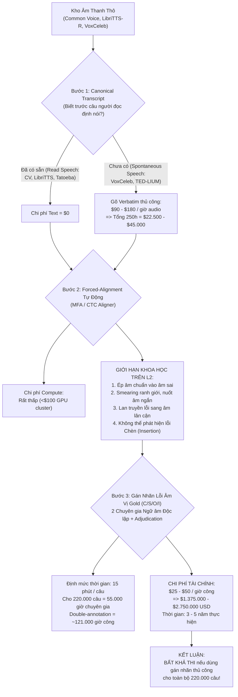
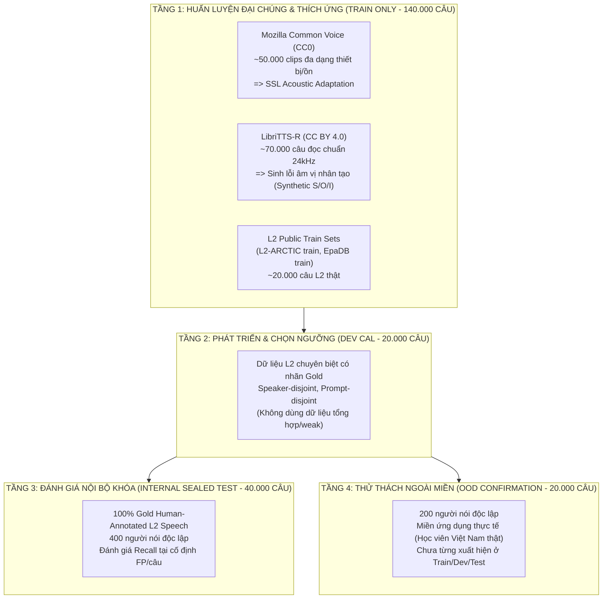

# Báo Cáo Khảo Sát Kho Dữ Liệu Lời Nói Đại Chúng Mở (Massive Open Speech Repositories) Cho Mục Tiêu 2.200 Người Nói / 220.000 Bản Thu MDD

**Mã tài liệu:** `SCOUT_CROWDSOURCE.md`  
**Ngày thực hiện:** 16/11/2026  
**Chủ quản điều tra:** `@scout-crowdsource`  
**Đơn vị tiếp nhận kiểm chứng:** `@verifier-source`  
**Mục tiêu tham chiếu:** [DATASET_R&D_GOAL.md](file:///home/khoa/Projects/New-Method-Research/DATASET_R&D_GOAL.md) (2.200 người nói độc lập / 220.000 bản thu có nhãn chẩn đoán lỗi âm vị L2 S/O/I).

---

## 1. Tóm Tắt Điều Hành & Kết Luận Cốt Lõi

Khảo sát này đánh giá tính khả thi kỹ thuật, pháp lý và chi phí kinh tế khi tái sử dụng 5 kho ngữ liệu lời nói đại chúng mở quy mô lớn hàng đầu thế giới: **Mozilla Common Voice**, **VoxCeleb (1 & 2)**, **LibriTTS-R / LibriTTS**, **Tatoeba**, và **TED-LIUM (1, 2, 3)**.

### Kết Luận Ra Quyết Định:
1. **Nghịch lý Quy Mô vs. Nhãn Chẩn Đoán Âm Vị (S/O/I):**
   - Về mặt **âm thanh thô và số lượng người nói**: Các kho đại chúng mở vượt xa mục tiêu 2.200 speaker (Common Voice có hơn 100.500 speaker; VoxCeleb có 7.363 speaker; LibriTTS-R có 2.456 speaker).
   - Về mặt **nhãn đánh giá chẩn đoán lỗi phát âm (Gold MDD Ground Truth)**: **Cả 5 kho dữ liệu đều có 0% nhãn lỗi âm vị (Substitution, Omission, Insertion)**. Không có bất kỳ kho ngữ liệu đại chúng nào chứa nhãn lệch âm vị do chuyên gia ngữ âm thẩm định.
2. **Tính Bất Khả Thi của Việc Tự Gán Nhãn Thủ Công Toàn Bộ 220k Câu:**
   - Việc chuyển đổi 220.000 bản thu âm thô thành bộ dữ liệu Gold MDD đòi hỏi 2 chuyên gia ngữ âm độc lập nghe và gán nhãn từng âm vị kèm phân xử (adjudication).
   - Với định mức thời gian thực nghiệm tối thiểu **15 phút/bản thu**, tổng khối lượng công việc là **55.000 giờ chuyên gia** (tương đương ~121.000 giờ công lao động cho double-annotation + adjudication).
   - Chi phí tài chính ước tính từ **1,37 triệu USD đến 2,75 triệu USD** (tính theo mức thù lao chuyên viên ngôn ngữ $25 - $50/giờ) và mất nhiều năm thực hiện. Do đó, **kịch bản dùng kho mở để gán nhãn thủ công từ đầu thành 220k Gold MDD là hoàn toàn phi thực tế**.
3. **Cạm Bẫy Khoa Học của Forced-Alignment Tự Động trên L2:**
   - Dùng công cụ căn chỉnh cưỡng bức tự động (Montreal Forced Aligner - MFA, CTC aligner) không thể tạo ra Gold MDD. Trên tiếng Anh L2 có lỗi phát âm, forced aligner bị ép phải khớp chuỗi âm vị chuẩn (canonical phones) vào sóng âm bị biến dạng, dẫn tới hiện tượng trượt ranh giới (boundary smearing), triệt tiêu âm ngắn và lan truyền lỗi sang các âm kế cận. Kết quả này làm sai lệch chỉ số GOP (Goodness of Pronunciation) và không thể phát hiện lỗi chèn (Insertion).
4. **Định Vị Đúng Vai Trò Chiến Lược Của Kho Mở:**
   - Kho mở đại chúng **không được phép làm Gold Test** (vi phạm nghiêm trọng chuẩn mực đánh giá độc lập của [DATASET_R&D_GOAL.md §4.2](file:///home/khoa/Projects/New-Method-Research/DATASET_R&D_GOAL.md#L68-L74)).
   - Kho mở đóng vai trò cực kỳ giá trị ở **Tầng Huấn Luyện (Train Tier)** thông qua:
     - **Tự giám sát thích ứng miền âm học (SSL Acoustic Adaptation):** Common Voice (CC0) và LibriTTS-R (CC BY 4.0).
     - **Tạo sinh lỗi âm vị nhân tạo quy mô lớn (Synthetic Error Generation):** Dùng 585 giờ đọc chuẩn của LibriTTS-R kết hợp can thiệp âm vị nhân tạo (synthetic S/O/I perturbation) để huấn luyện mạng chẩn đoán mà không tốn chi phí gán nhãn tay.
     - **Tập neo âm chuẩn (Hard Negative Anchor):** Đánh giá và kiểm soát tỷ lệ báo động giả (False Alarm Rate / FP per utterance) trên người bản ngữ nói đúng.

---

## 2. Bảng Ma Trận So Sánh Tổng Thể 5 Kho Ngữ Liệu

| Tiêu chí | Mozilla Common Voice (EN) | VoxCeleb (1 & 2) | LibriTTS-R | Tatoeba (EN Audio) | TED-LIUM 3 |
|---|---|---|---|---|---|
| **Phiên bản & URL** | CV Corpus 16.0 / 17.0 / 27.0 ([Data Collective](https://mozilladatacollective.com)) | VoxCeleb1 & VoxCeleb2 ([VGG Oxford](https://www.robots.ox.ac.uk/~vgg/data/voxceleb/)) | LibriTTS-R ([OpenSLR 141](https://www.openslr.org/141/)) | Tatoeba Sentences with Audio ([Tatoeba.org](https://tatoeba.org)) | TED-LIUM Release 3 ([LIUM / SPECOM 2018](https://projets-lium.univ-lemans.fr/ted-lium/)) |
| **Giấy phép bản quyền (License)** | **CC0 1.0 Universal** (Public Domain Dedication) | **CC BY 4.0** (Metadata), YouTube Fair Use (Audio thô) | **CC BY 4.0** (Permissive) | **Phân mảnh:** Audio tùy thuộc người tải lên (CC BY, CC BY-NC, ND, All Rights Reserved) | **CC BY-NC-ND 3.0** (Cấm phát sinh phái sinh - No Derivatives) |
| **Quy mô Người nói** | **>100.500** contributors | **7.363** người nổi tiếng (1.251 + 6.112) | **2.456** người đọc sách nói | Hàng nghìn (phân bố lệch lũy thừa cực nặng) | **2.028** diễn giả TED |
| **Quy mô Bản thu / Giờ** | ~2,59 triệu clips (~3.796 giờ; ~2.827 giờ validated) | 1,28 triệu clips (~2.800 giờ) | ~360.000 câu (~585 giờ, 24kHz) | ~400.000 câu có audio | 2.351 bài nói (~452 giờ, 16kHz) |
| **Miền Lời nói (Domain)** | Đọc câu đơn lẻ crowdsourced (web/Wikipedia) | Hội thoại tự nhiên / Phỏng vấn "In the wild" (YouTube) | Đọc văn học cổ điển (Audiobook LibriVox khôi phục) | Đọc câu dịch ví dụ ngắn | Bài thuyết trình trên sân khấu hội nghị |
| **Chất lượng Âm thanh** | Rất đa dạng (điện thoại, laptop, tạp âm môi trường) | Kém/Nhiễu nặng (tiếng cười, nhạc nền, vang phòng) | Rất cao, sạch (đã khử nhiễu/vang qua Miipher) | Đa dạng, thiết bị nghiệp dư | Tốt (micro cài áo, có tiếng vỗ tay/khán giả) |
| **Văn bản Transcript** | Có sẵn (Prompt định trước do người đọc nhìn) | **Không có verbatim text chính thức** (chỉ có ASR ngoài) | Có sẵn chuẩn xác, đã chuẩn hóa văn bản | Có sẵn (Prompt câu dịch) | Phụ đề bám sát bài nói (Kaldi STM, không verbatim 100%) |
| **Nhãn Lỗi Âm Vị S/O/I** | **0%** (Chỉ có Up/Down vote độ rõ của câu) | **0%** (Chỉ có Speaker ID) | **0%** (Lời nói chuẩn bản ngữ) | **0%** | **0%** |
| **Tỷ lệ Tiếng Anh Người Việt (Vietnamese L2)** | Cực hiếm (<30 speaker, <300 clips self-tagged) | **0%** | **0%** | Không xác định rõ (thiếu metadata có hệ thống) | Gần như 0% (<1-2 diễn giả gốc Việt nói fluent) |
| **Mức độ Khả thi Tái sử dụng** | **Rất Cao** (Pretrain, Adaptation, Crowdsource test) | **Cực Thấp** (Rủi ro bản quyền, thiếu text, nhiễu nặng) | **Rất Cao** (Synthetic Error Base, Native Anchor) | **Trung bình - Thấp** (Phức tạp bản quyền, lệch speaker) | **Thấp** (Rào cản pháp lý CC BY-NC-ND cấm phái sinh) |

---

## 3. Thẩm Định Chi Tiết Từng Kho Ngữ Liệu

### 3.1. Mozilla Common Voice (Tiếng Anh)
- **Bản phát hành:** Common Voice Corpus 16.0 / 17.0 và bản thống kê mới nhất Corpus 27.0.
- **Giấy phép pháp lý:** **CC0 1.0 Universal**. Đây là giấy phép mở tối đa, cho phép sử dụng thương mại, nghiên cứu và phân phối lại mà không đòi hỏi nghĩa vụ attribution phức tạp. Điều khoản ràng buộc duy nhất là không được cố tình giải mã danh tính người nói (de-anonymization).
- **Quy mô thực tế:**
  - Tổng số câu ghi âm: ~2,59 triệu clips.
  - Tổng thời lượng: ~3.796 giờ (trong đó ~2.827 giờ đã qua cộng đồng thẩm định - validated).
  - Số lượng người nói: Hơn 100.500 contributors đã tạo profile.
- **Hiện trạng Phân bố Accent (Tự khai báo):**
  - Chỉ có khoảng 30% - 45% bản thu có thông tin nhân khẩu học (accent, age, gender).
  - Phân bố nghiêng áp đảo về các nước bản ngữ chính thống:
    - Hoa Kỳ (United States): ~574.821 clips (~11.023 speakers, chiếm 22,2% tổng clips).
    - Anh (England): ~204.881 clips (~3.466 speakers, 7,9%).
    - Ấn Độ & Nam Á (Indian/South Asian L2): ~153.048 clips (~3.045 speakers, 5,9%).
    - Canada: ~101.734 clips (~1.225 speakers, 3,9%).
    - Úc (Australia): ~69.393 clips (~953 speakers, 2,7%).
    - Scotland: ~69.286 clips (~272 speakers).
    - Philippines: ~7.503 clips (~210 speakers).
    - Hồng Kông: ~7.004 clips (~190 speakers).
- **Phân bố Tiếng Anh Giọng Việt (Vietnamese English Accent):**
  - Trong kho tiếng Anh (`en`), nhãn giọng Việt cực kỳ khan hiếm. Số người đóng góp tự nhận accent "Vietnam / Vietnamese" chỉ đếm trên đầu ngón tay (ước tính dưới 30 người nói, với tổng lượng bản thu dưới 300 câu).
  - *Lưu ý quan trọng để tránh nhầm lẫn:* Kho tiếng Việt (`vi`) của Common Voice có 20.605 clips (~23 giờ, 419 speakers) là **người Việt nói tiếng Việt**, hoàn toàn không phải người Việt nói tiếng Anh L2.
- **Đánh giá về Nhãn Phát Âm:**
  - Common Voice chỉ có nhãn nhị phân `up_votes` và `down_votes` cho việc thẩm định "nghe có rõ ràng và đúng câu chữ trên màn hình hay không".
  - Một câu bị `down_vote` có thể do micro rè, đứt tiếng, ồn ào xung quanh, ngập ngừng, hoặc đọc sai từ. Hệ thống không cung cấp vị trí từ sai, càng không có ranh giới âm vị hay phân loại lỗi S/O/I.
- **Ứng dụng cho MDD:**
  - Không thể làm bộ Gold Evaluation.
  - Là nguồn tài nguyên số 1 cho tự giám sát thích ứng âm học (Acoustic Domain Adaptation) trên môi trường mic thực tế và đo False Alarms trên đa dạng giọng nói toàn cầu.

### 3.2. VoxCeleb (VoxCeleb 1 & VoxCeleb 2)
- **Nguồn gốc & Tác giả:** Nhóm VGG thuộc Đại học Oxford (Arsha Nagrani, Joon Son Chung, Andrew Zisserman).
- **Quy mô:**
  - VoxCeleb 1 (2017): 1.251 người nổi tiếng, 153.516 đoạn cắt video/audio, ~352 giờ.
  - VoxCeleb 2 (2018): 6.112 người nổi tiếng, 1.128.246 đoạn cắt, ~2.442 giờ.
  - Tổng hợp: 7.363 người nói độc lập, hơn 1,28 triệu utterances, ~2.800 giờ.
- **Giấy phép & Rào cản Bản quyền:**
  - Metadata do nhóm nghiên cứu phát hành theo CC BY 4.0. Tuy nhiên, toàn bộ dữ liệu audio/video gốc được trích xuất tự động từ các video phỏng vấn trên YouTube.
  - Bản quyền nội dung gốc thuộc về các chủ sở hữu kênh YouTube và đơn vị truyền hình. Bộ dữ liệu chỉ được cấp phép ngầm dưới học thuyết "Fair Use" cho nghiên cứu phi thương mại. Việc đưa VoxCeleb vào pipeline sản phẩm thương mại tiềm ẩn rủi ro kiện tụng bản quyền rất lớn.
- **Hạn chế Cốt tử về Văn bản & Nhãn:**
  - **Không có Verbatim Transcript:** VoxCeleb được thiết kế thuần túy cho bài toán xác thực người nói (Speaker Verification / Identification). Dữ liệu cung cấp khuôn mặt và giọng nói gắn với `speaker_id`, hoàn toàn không có văn bản những gì người nói đã phát âm.
  - Mọi nỗ lực lấy transcript bằng ASR (như Whisper) đều đưa vào lỗi nhận dạng từ (WER) và hiện tượng ảo giác (hallucination). Khi ASR nghe một người nói ngọng hoặc nuốt âm, ASR hoặc tự sửa thành từ đúng, hoặc nghe thành từ khác, khiến việc xác lập "intended prompt" bị vô hiệu hóa.
- **Đặc tính Âm học & Đối tượng Người nói:**
  - Lời nói tự do, tốc độ nhanh, nhiều thán từ, xen lẫn tiếng cười, tiếng nhạc nền, tiếng vỗ tay và nén âm thanh YouTube (AAC/Opus).
  - Người nói là chính trị gia, diễn viên, vận động viên nổi tiếng, chủ yếu là người bản ngữ (Mỹ, Anh) hoặc người L2 thông thạo trình độ cao (gần như C1/C2). Tỷ lệ người học tiếng Anh L2 thông thường là 0%. Người Việt học tiếng Anh hoàn toàn không có mặt.
- **Ứng dụng cho MDD:** Gần như bằng 0. Chi phí xử lý âm thanh và văn bản quá tốn kém trong khi dữ liệu không phản ánh đúng miền bài toán phát hiện lỗi phát âm L2.

### 3.3. LibriTTS & LibriTTS-R
- **Nguồn gốc & Tác giả:** Heiga Zen et al. (Interspeech 2019) và bản nâng cấp khôi phục LibriTTS-R bởi Yuma Koizumi et al. (Interspeech 2023, Google Research).
- **Quy mô:**
  - 2.456 người nói độc lập.
  - ~585 giờ âm thanh đọc sách nói tiếng Anh, chia thành ~360.000 câu.
  - Tần số lấy mẫu: 24kHz (vượt trội so với 16kHz của LibriSpeech truyền thống).
  - Các tập chuẩn hóa: `train-clean-100` (247 spk), `train-clean-360` (904 spk), `train-other-500` (1.160 spk), `dev-clean`, `dev-other`, `test-clean`, `test-other`.
- **Giấy phép:** **CC BY 4.0** (Cho phép tự do sử dụng học thuật lẫn thương mại, chỉ cần ghi nhận nguồn gốc).
- **Đặc tính Kỹ thuật Nổi bật:**
  - Khác với LibriSpeech, LibriTTS được cắt theo ranh giới câu chuẩn xác, giữ nguyên dấu câu viết hoa/viết thường và có quy trình chuẩn hóa văn bản (text normalization) mở rộng số và từ viết tắt cực kỳ khắt khe.
  - Phiên bản **LibriTTS-R** đã sử dụng mô hình phục hồi âm thanh nơ-ron (Miipher) để loại bỏ hoàn toàn hiện tượng vang, tiếng ồn nền của micro nghiệp dư, đem lại chất lượng âm học chuẩn phòng thu (studio-quality).
- **Phân bố Đối tượng:**
  - 100% người đọc là tình nguyện viên đọc sách nói tiếng Anh (chủ yếu là giọng bản ngữ Mỹ, Anh, Canada).
  - Không chứa người học tiếng Anh L2 và không có người Việt.
- **Ứng dụng Chiến Lược Cho MDD:**
  - **Tập Neo Chuẩn Bản Ngữ (Native Reference Baseline):** 2.456 người nói với 360.000 câu đọc chuẩn chỉ là nguồn đối chứng lý tưởng nhất để kiểm tra tỷ lệ False Positives (cảnh báo sai âm vị khi người dùng đọc đúng).
  - **Nền Tảng Tạo Dữ Liệu Lỗi Âm Vị Nhân Tạo (Synthetic MDD Engine):** Nhờ văn bản chuẩn xác và âm thanh 24kHz cực sạch, LibriTTS-R có thể được chạy forced alignment tự động với độ chính xác rất cao (>98% ranh giới chuẩn). Từ đó, ta có thể chủ động can thiệp âm học (cắt bỏ frame để tạo Omission, thay thế đoạn phổ/âm vị để tạo Substitution, chèn đoạn âm thanh để tạo Insertion). Phương pháp này cho phép sinh ra hàng trăm nghìn mẫu có nhãn lỗi âm vị chính xác tuyệt đối ở tầng Train mà không tốn 1 USD thuê chuyên gia.

### 3.4. Tatoeba (Tập Âm Thanh Câu Nói)
- **Nguồn gốc:** Nền tảng dịch thuật cộng đồng mở Tatoeba.org.
- **Quy mô:** Hơn 400.000 bản thu âm câu tiếng Anh đọc bởi các tình nguyện viên quốc tế.
- **Rào cản Pháp lý Phân mảnh:**
  - Văn bản câu dịch trên Tatoeba tuân theo giấy phép CC BY 2.0 FR hoặc CC0.
  - **Bản quyền âm thanh KHÔNG đồng nhất:** Mỗi người đóng góp âm thanh tự chọn giấy phép riêng cho bản thu của mình (một số cấp CC BY 3.0/4.0, một số chọn CC BY-NC, CC BY-NC-ND, hoặc giữ toàn quyền All Rights Reserved). Việc tải hàng loạt (bulk download) để đưa vào quy trình huấn luyện đòi hỏi bộ lọc giấy phép phức tạp để tránh vi phạm bản quyền thương mại.
- **Hạn chế về Phân bố Người nói (Power-law Skew):**
  - Mặc dù có nhiều tài khoản tham gia, phân bố bản thu bị lệch nghiêm trọng: một số cá nhân siêu đóng góp (như Charles Kelly) chiếm tới hàng chục nghìn câu (hơn 50% tổng số câu âm thanh tiếng Anh). Số lượng người nói độc lập có đóng góp cân bằng thực tế thấp hơn nhiều so với con số đăng ký trên web.
- **Nhãn & Đặc tính Lời nói:**
  - Lời nói đọc câu đơn lập, không có nhãn lỗi âm vị S/O/I. Metadata nhân khẩu học và accent không được kiểm soát khoa học.
- **Ứng dụng cho MDD:** Giá trị thấp hơn Common Voice do vấn đề phân mảnh bản quyền và độ lệch người nói.

### 3.5. TED-LIUM (Release 1, 2, 3)
- **Nguồn gốc & Tác giả:** Phòng thí nghiệm LIUM (Đại học Le Mans, Pháp) phối hợp cùng Ubiqus (Hernandez et al., SPECOM 2018).
- **Quy mô bản Release 3:**
  - 2.351 bài thuyết trình TED talks.
  - 452 giờ âm thanh ở tần số 16kHz mono.
  - Khoảng 2.028 diễn giả độc lập.
- **Rào cản Pháp lý Nghiêm ngặt:**
  - Giấy phép phân phối: **CC BY-NC-ND 3.0** (Creative Commons Attribution-NonCommercial-NoDerivatives).
  - **Điều khoản "No Derivatives" (Cấm tác phẩm phái sinh)** là một rào cản chí mạng: Nó nghiêm cấm việc sửa đổi, cắt ghép, trích xuất đặc trưng biến đổi âm thanh hoặc tái phân phối dữ liệu đã qua tiền xử lý. Đồng thời điều khoản **Non-Commercial** ngăn cản mọi ứng dụng trong môi trường công nghiệp.
- **Đặc tính Lời nói & Đối tượng:**
  - Thuyết trình sân khấu chuyên nghiệp, diễn giả nói rất lưu loát, giàu cảm xúc, có ngữ điệu hùng biện.
  - Phụ đề đi kèm ở định dạng STM của Kaldi là bản phụ đề chuẩn hóa cho người xem, nhiều chỗ đã được biên tập rút gọn, không phản ánh chính xác 100% từng từ phát ra ở miệng (verbatim disfluencies).
  - Dù có nhiều diễn giả quốc tế, tất cả đều đạt mức độ thành thạo ngôn ngữ cực cao, không xuất hiện các lỗi âm vị cơ bản của người học L2.
- **Ứng dụng cho MDD:** Hoàn toàn không khuyến nghị sử dụng do vướng rào cản bản quyền cấm phái sinh và sự lệch pha hoàn toàn về miền bài toán.

---

## 4. Phân Tích Tính Khả Thi: Tái Sử Dụng Âm Thanh Thô Sang MDD Có Khả Thi Không?

Để biến một kho dữ liệu âm thanh thô thành dữ liệu chẩn đoán lỗi âm vị L2 đạt chuẩn theo [DATASET_R&D_GOAL.md §4.1](file:///home/khoa/Projects/New-Method-Research/DATASET_R&D_GOAL.md#L57-L66), dữ liệu bắt buộc phải trải qua 3 công đoạn: **(1) Xác lập Văn bản Chuẩn**, **(2) Căn chỉnh Cưỡng bức (Forced-Alignment)**, và **(3) Gán Nhãn Lỗi Âm Vị Vàng (Gold Phonetic Error Annotation)**.

### 4.1. Chi Phí & Tính Khả Thi Xác Lập Canonical Transcripts
- Với các tập **Read Speech** (Common Voice, LibriTTS-R, Tatoeba): Prompt văn bản đã được hiển thị trên màn hình cho người thu âm đọc. Chi phí văn bản là **0 USD**.
- Với các tập **Spontaneous Speech** (VoxCeleb, TED-LIUM): Không có văn bản gốc định trước. Bắt buộc phải thuê người nghe và gõ lại từng từ chính xác (verbatim, bao gồm cả từ nói lắp, tiếng ậm ừ).
  - Đơn giá thị trường dịch vụ gõ văn bản lời nói: **$1,50 – $3,00 / phút audio** ($90 – $180 / giờ).
  - Với 250 giờ audio (quy mô 220.000 câu × 4s): Chi phí gõ transcript tốn từ **$22.500 đến $45.000 USD**.

### 4.2. Căn Chỉnh Cưỡng Bức (Forced-Alignment) & Giới Hạn Cốt Tử Trên L2
- **Chi phí điện toán:** Rất rẻ. Sử dụng cụm GPU chạy Montreal Forced Aligner (MFA) hoặc PyTorch torchaudio CTC Aligner chỉ tốn vài chục giờ tính toán, chi phí compute dưới **100 USD**.
- **Cạm bẫy khoa học khi dùng Aligner trên giọng L2:**
  1. **Định kiến bản ngữ (Native Bias):** Các mô hình âm học của Aligner được huấn luyện trên giọng người bản ngữ phát âm chuẩn. Khi gặp giọng L2 với khẩu hình và biến thể âm sắc phi chuẩn (như người Việt thay /θ/ bằng [t]), Aligner bị nhiễu loạn nghiêm trọng.
  2. **Bản chất "cưỡng bức" (Forced Constraint):** Thuật toán giải mã Viterbi trong Aligner bắt buộc phải gán ranh giới thời gian cho *mọi* âm vị có trong từ điển chuẩn. Nếu người học nuốt âm (Omission) hoặc thay thế bằng âm khác hoàn toàn (Substitution), Aligner vẫn ép một khoảng thời gian giả tạo cho âm chuẩn đó, làm ranh giới bị kéo giãn hoặc co cụm bất thường.
  3. **Lan truyền sai số ranh giới (Boundary Smearing & Error Propagation):** Khi một âm vị bị đặt sai mốc thời gian, toàn bộ các âm vị kế tiếp trong từ đó bị xô lệch ranh giới.
  4. **Hậu quả trực tiếp tới bộ đo GOP (Goodness of Pronunciation):** Tính toán điểm phát âm GOP dựa trên trung bình xác suất hậu nghiệm (posterior) trên các khung thời gian bị cắt sai. Ranh giới bị lệch khiến GOP giảm mạnh dù người học phát âm đúng, tạo ra hàng loạt cảnh báo sai (False Positives). Ngược lại, nếu âm sai bị Aligner gom chung vào một cửa sổ rộng của âm đúng bên cạnh, lỗi sẽ bị bỏ lọt (False Negatives).
  5. **Bất lực trước lỗi Chèn (Insertion):** Forced Aligner chỉ căn chỉnh chuỗi âm vị có trong transcript chuẩn ($N$ targets). Nó hoàn toàn không thể phát hiện các âm chèn thêm ($N+1$ gaps) nếu không có cơ chế Phone Recognition mở rộng.

### 4.3. Gán Nhãn Lỗi Âm Vị Vàng (Gold Phonetic Error Annotation)
Theo tiêu chuẩn tại [DATASET_R&D_GOAL.md §4.2](file:///home/khoa/Projects/New-Method-Research/DATASET_R&D_GOAL.md#L68-L74), nhãn dùng để đánh giá phương pháp phải do chuyên gia con người thẩm định độc lập, không được lấy nhãn suy diễn từ mô hình hay công cụ tự động làm chân lý.
- **Thực tế từ tiền lệ L2-ARCTIC:**
  - Trong dự án L2-ARCTIC (Zhao et al., Interspeech 2018), dù thu được 27,1 giờ âm thanh (26.867 câu), nhóm nghiên cứu gồm các nghiên cứu sinh tiến sĩ ngành Ngôn ngữ học Ứng dụng tại Đại học Bang Iowa **chỉ gán nhãn thủ công được 3.599 câu** (~3,5 giờ).
  - Lý do: Nghe phân tích âm vị học chi tiết (narrow phonetic transcription) đòi hỏi nghe đi nghe lại nhiều lần ở tốc độ chậm, xem phổ âm (spectrogram) trên Praat, xác định ranh giới và gán nhãn C/S/O/I. Tốc độ thực tế dao động từ **10 đến 25 lần thời gian thực (10x – 25x Real-Time Factor)**, trung bình mất **10 – 15 phút cho một câu nói ngắn 4 giây**.
- **Bài toán Chi Phí cho Mục Tiêu 220.000 Câu:**
  - Thời gian gán nhãn cho 1 câu: ~15 phút = 0,25 giờ công.
  - Tổng thời gian gán nhãn đơn (Single Pass): $220.000 \times 0,25 = 55.000$ giờ công.
  - Áp dụng quy chuẩn thẩm định chất lượng cao: 2 chuyên gia gán nhãn độc lập (Double-annotation) + 1 chuyên gia cấp cao phân xử các ca bất đồng (Adjudication ước tính 20% số ca):
    $$\text{Tổng giờ công} = (55.000 \times 2) + (55.000 \times 0,2) = 121.000 \text{ giờ công}$$
  - Mức thù lao chuyên gia ngôn ngữ học / ngữ âm học (Phonetic Annotators):
    - Mức thị trường quốc tế: **$25 – $50 / giờ**.
    - Tổng ngân sách chi trả chuyên gia:
      $$\text{Chi phí tối thiểu (ở mức \$25/h)} = 121.000 \times 25 = 3.025.000 \text{ USD}$$
      $$\text{Chi phí nếu thuê theo mức \$50/h} = 121.000 \times 50 = 6.050.000 \text{ USD}$$
    - Ngay cả khi thuê trợ lý sinh viên giá rẻ tại Việt Nam với mức khoán $10 – $15/giờ, chi phí vẫn vượt quá **1,2 triệu đến 1,8 triệu USD**, đi kèm rủi ro chất lượng gán nhãn không đạt chuẩn quốc tế.
  - Thời gian hoàn thành: Nếu một đội ngũ gồm 10 chuyên viên làm việc toàn thời gian (40 giờ/tuần = 1.600 giờ/tháng):
    $$\text{Thời gian cần thiết} = \frac{121.000}{1.600 \times 10} \approx 7,5 \text{ năm!}$$

**Kết luận dứt khoát:** Không thể tự gán nhãn thủ công từ đầu cho toàn bộ 220.000 câu từ các kho âm thanh đại chúng để tạo thành một bộ Gold MDD thuần nhất.

---

## 5. Chiến Lược Phân Tầng: Định Vị Đúng Vai Trò Của Kho Mở Đại Chúng

Mặc dù không thể dùng làm tập đánh giá Gold, các kho âm thanh đại chúng mở (đặc biệt là **LibriTTS-R** và **Common Voice**) đóng vai trò hạt nhân trong việc giải quyết bài toán quy mô 220.000 mẫu khi được tổ chức theo kiến trúc phân tầng (Tiered Data Architecture) tuân thủ nghiêm ngặt nguyên tắc của [DATASET_R&D_GOAL.md §4.2 & §4.4](file:///home/khoa/Projects/New-Method-Research/DATASET_R&D_GOAL.md#L68-L89):

### 5.1. Phân Bổ Chiến Lược Chi Tiết
1. **Tầng Huấn Luyện (Train - 140.000 câu / 1.400 speaker):**
   - **Tận dụng LibriTTS-R cho Sinh Lỗi Nhân Tạo (Synthetic Perturbation):** Lấy ~70.000 câu từ 700 người nói của LibriTTS-R. Do âm thanh chuẩn phòng thu và text chính xác, ta tự động chèn các lỗi âm vị nhân tạo (synthetic S/O/I) dựa trên ma trận xác suất chuyển di âm vị học L2 (ví dụ: mô phỏng lỗi người Việt hay nuốt phụ âm cuối /t, s, z/, thay thế âm /θ/ thành [t], chèn nguyên âm đệm). Điều này cung cấp hàng trăm nghìn mẫu có nhãn lỗi âm vị chính xác mà không tốn chi phí con người.
   - **Tận dụng Common Voice cho Thích Ứng Âm Học (Acoustic Invariance):** Lấy ~50.000 clips từ 500 người nói của Common Voice (CC0) để huấn luyện encoder âm học (WavLM/HuBERT backbone) thích ứng với các loại microphone tạp âm thực tế.
   - **Dữ liệu L2 Thật (Real L2 Speech):** ~20.000 câu còn lại từ các nguồn L2 có sẵn được phép dùng.
2. **Tầng Phát Triển (Dev - 20.000 câu / 200 speaker):**
   - Tuyệt đối không dùng dữ liệu tổng hợp (synthetic) hay weak label.
   - Dùng 100% bản thu L2 thật có nhãn kiểm chứng để chọn mô hình, căn chỉnh nhiệt độ (calibration) và khóa ngưỡng quyết định (thresholds).
3. **Tầng Đánh Giá Nội Bộ Khóa (Internal Test - 40.000 câu / 400 speaker):**
   - Tập trung toàn bộ nguồn lực tài chính gán nhãn thủ công cho tập này.
   - Đảm bảo 400 người nói hoàn toàn mới, prompt mới, cân bằng giới tính và trình độ.
4. **Tầng Thử Thách Ngoài Miền (OOD Test - 20.000 câu / 200 speaker):**
   - Độc lập hoàn toàn với toàn bộ quá trình R&D, tập trung vào đối tượng học viên mục tiêu (người Việt học tiếng Anh trong môi trường lớp học/ứng dụng thực tế).

---

## 6. Khuyến Nghị Hành Động Cho Đội Ngũ R&D

1. **Khóa vai trò của kho đại chúng mở:** Không tìm kiếm một "kho mở bí mật có sẵn 220k nhãn gold" vì kho đó không tồn tại trong ngành ngôn ngữ học thế giới hiện nay. Dừng việc tìm kiếm các kho mở để làm Gold Test.
2. **Khai thác ngay LibriTTS-R (OpenSLR 141):**
   - Tải và xây dựng pipeline sinh lỗi âm vị nhân tạo (Synthetic Error Generation Pipeline) trên LibriTTS-R.
   - Sử dụng 2.456 speaker của LibriTTS-R làm bộ benchmark chuẩn để đo tỷ lệ cảnh báo sai (False Positive Rate) trên âm thanh đọc đúng.
3. **Khai thác Common Voice (Corpus 16.0+):**
   - Trích xuất tập âm thanh CC0 cho mục tiêu tự giám sát và tiền huấn luyện bộ trích xuất đặc trưng (Acoustic Feature Extractor).
   - Không phụ thuộc vào Common Voice để giải quyết bài toán giọng tiếng Anh người Việt (vì số lượng speaker Việt nói tiếng Anh trong Common Voice gần như bằng không).
4. **Tránh xa rủi ro bản quyền của TED-LIUM và VoxCeleb:**
   - Loại bỏ TED-LIUM khỏi kế hoạch xây dựng dữ liệu phái sinh do vướng điều khoản cấm sửa đổi (No Derivatives - CC BY-NC-ND 3.0).
   - Không sử dụng VoxCeleb cho bài toán MDD do thiếu văn bản chuẩn và tính chất đàm thoại tự do không tương thích với rubric đánh giá âm vị S/O/I.
5. **Dồn ngân sách gán nhãn cho các bộ dữ liệu L2 mục tiêu:**
   - Chuyển hướng toàn bộ ngân sách gán nhãn chuyên gia sang tập trung tạo 20.000 câu Dev + 40.000 câu Test nội bộ + 20.000 câu OOD trên đối tượng học viên L2 thật (đặc biệt là người học Việt Nam).

---
*Báo cáo được hoàn thành và bàn giao cho `@verifier-source` để tiến hành đối soát độc lập các dẫn chứng và số liệu.*
