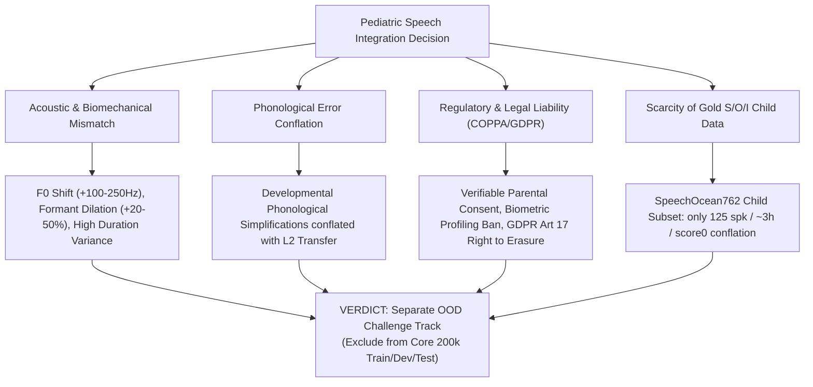
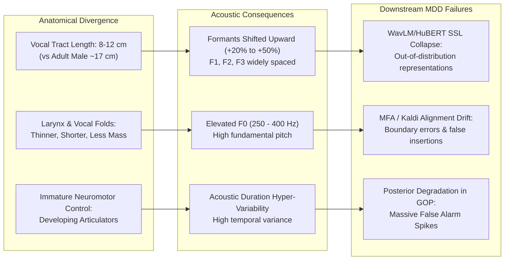
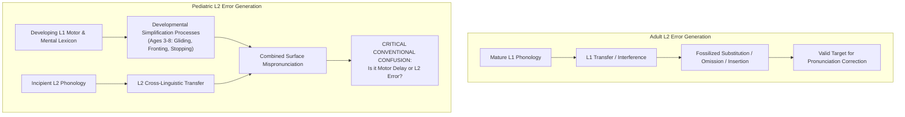
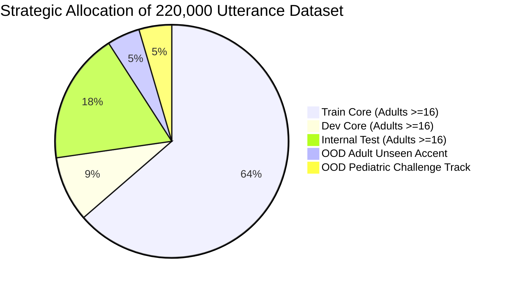

# SCOUT REPORT: PEDIATRIC & ADOLESCENT L2 SPEECH CORPORA
## Architectural Feasibility, Acoustic Peculiarities, Phonological Ontologies, Legal Frameworks, and Strategic Track Allocation for Large-Scale MDD R&D

**Date:** 2026-11-16  
**Investigator:** `scout-pediatric`  
**Target Milestone:** R&D for 220,000 Utterances / 2,200 Independent Speakers Corpus (DATASET_R&D_GOAL.md)  
**Deliverable Path:** `reports/DATASET_RD_20261116/SCOUT_PEDIATRIC.md`  
**Status:** `SCOUT_DRAFT_COMPLETE`  
**Recipient / Reviewer:** `@verifier-source`

---

## 1. Executive Summary & Core Strategic Recommendation

### 1.1 High-Level Mandate
This investigation addresses the pediatric and adolescent dimension of building a 220,000-utterance / 2,200-speaker non-native English pronunciation evaluation corpus for Mispronunciation Detection and Diagnosis (MDD) targeting phoneme-level Substitution (S), Omission (O), and Insertion (I) errors. Specifically, we investigate candidate child/adolescent speech corpora (including the SpeechOcean762 child subset, CU-Child/CU-Kids, CSLU Kids, MyST, TBALL, and PF-STAR), quantify the physical acoustic and phonological divergence between pediatric and adult learners, evaluate stringent data protection statutes (COPPA, GDPR Articles 8 & 9, and Vietnam Decree 13/2023/ND-CP), and answer the strategic architectural question:

> **Core Architectural Decision:**  
> *Should children’s speech be incorporated directly into the main 200k training and development corpus, or should it be strictly partitioned into an isolated Out-of-Domain (OOD) Challenge Track?*

---

### 1.2 Definitive Strategic Verdict: Strict Partition into OOD Challenge Track
We recommend that **children’s speech (<16 years old) MUST NOT be pooled into the main 200,000-utterance / 2,000-speaker core corpus (Train 140k / Dev 20k / Internal Test 40k)**. Instead, child speech should be **strictly isolated into a dedicated Out-of-Domain (OOD) Challenge Track** within the planned 20,000-utterance / 200-speaker external test allocation (or maintained as an auxiliary benchmark module).

This decision is underpinned by four non-negotiable technical, clinical, and regulatory pillars:



1. **Acoustic and Biomechanical Incompatibility:** Pretrained acoustic representations (WavLM, HuBERT, wav2vec 2.0) and forced-alignment architectures (Kaldi, Montreal Forced Aligner) exhibit severe domain collapse when confronted with pediatric acoustics ($F_0$ of 250–400 Hz, 20% to 50% upward formant shifting due to an ~8–12 cm vocal tract vs. ~17 cm for adult males). Pooling child speech into the adult training split dilutes acoustic decision boundaries, inflates false alarm rates (FP/utterance), and degrades detection precision for adult learners.
2. **Conflation of Developmental Articulation vs. L2 Transfer Errors:** Children undergo normal developmental phonological processes (e.g., gliding of liquids, stopping of fricatives, fronting, cluster reduction, final consonant deletion) that resolve naturally between ages 4 and 9. In adult L2 learners, identical surface errors (e.g., final stop omissions by Vietnamese speakers) represent fossilized phonotactic transfer. A unified MDD model cannot differentiate motor-developmental immaturity from second-language phonological transfer without age-conditioned priors, leading to pedagogically invalid feedback.
3. **Severe Regulatory and Legal Liabilities (COPPA / GDPR / Decree 13):**
   - Ingesting pediatric voice recordings (<13 under US COPPA; <16 under EU GDPR Article 8 and Vietnam Decree 13/2023/ND-CP) introduces extreme data custody burdens, requiring Verifiable Parental Consent (VPC).
   - Under GDPR Article 9, voice data processed for individual assessment constitutes biometric data. 
   - Under GDPR Article 17 ("Right to Erasure"), if a parent or child revokes consent, models trained on that data may be subject to algorithmic disgorgement or mandatory full retraining—creating an existential risk for the entire core 200k foundational asset.
4. **Extreme Public Data Scarcity for L2 Children:** Among public speech datasets, only *SpeechOcean762* offers an open-access child L2 English subset (125 speakers, 2,500 utterances, ~3 audio hours, Mandarin L1). All other large-scale pediatric speech corpora (CU-Child, CSLU Kids, MyST, CMU Kids) are **native English (L1)** corpora developed for ASR or literacy tutoring, lacking fine-grained L2 phoneme-level S/O/I manual error annotations.

---

## 2. In-Depth Audit of Pediatric Speech Corpora

We audited all recognized public, academic, and consortium pediatric speech corpora to evaluate their suitability for L2 English MDD research.

### 2.1 SpeechOcean762 (Child Subset)
- **Primary Source / Paper:** Zhang et al., *"SpeechOcean762: An Open-Source Non-native English Speech Corpus for Pronunciation Assessment"*, Interspeech 2021 (arXiv:2104.01378).
- **Hosting / Repository:** OpenSLR SLR101; Hugging Face `mispeech/speechocean762`.
- **License:** Creative Commons Attribution 4.0 International (CC BY 4.0) — allows commercial exploitation, modification, and redistribution.
- **Demographic Composition:**
  - Total Corpus: 250 non-native speakers, 5,000 utterances (~6 audio hours).
  - **Child Subset:** Exactly **125 speakers** (<18 years old; range: 6 to 17 years old), 2,500 utterances (~3.0 audio hours).
  - Gender Balance: Strictly 1:1 male/female split across children (63 males, 62 females).
  - L1 Background: 100% native Mandarin Chinese speakers.
- **Speech Style & Prompts:** Prompted read speech; 20 sentences per speaker selected from elementary to intermediate English language learning materials.
- **Annotation Schema & Granularity:**
  - Evaluated independently by five human phonetic experts.
  - Granularities: Phoneme, word, and sentence levels.
  - Metrics: Accuracy, completeness, fluency, prosody, and total score.
  - Phoneme-Level Labels: Scores 0, 1, 2. Score 0 = "incorrect or missed phone"; Score 1 = "phone with heavy accent (acceptable)"; Score 2 = "correct phone".
  - Detailed annotations (`scores-detail.json`) contain bracketed tokens `[]` indicating insertions and unexpected phonetic segments.
- **Critical MDD Limitations:**
  - *Score 0 Ambiguity:* SpeechOcean762 collapses phoneme Substitutions (S) and Omissions (O) into a single score of 0. It does not provide explicit target-level S vs. O category disambiguation in its standard score tables.
  - *Non-Exhaustive Gap Gold:* The corpus does not systematically tag every inter-phoneme gap ($N+1$ gaps for $N$ targets) for Insertion (I).
  - *Sample Duration:* At only 20 utterances per child, speaker-level calibration and longitudinal error adaptation cannot be thoroughly investigated.

---

### 2.2 CU-Child / CU Prompted and Read Children’s Speech Corpus
- **Primary Source / Technical Reports:** 
  - Cole, Hosom, and Pellom, *"The CU Prompted and Read Children’s Speech Corpus"*, Tech Report TR-CSLR-2006-02, University of Colorado Boulder (2006).
  - Cole and Pellom, *"The CU Read and Summarized Stories Corpus"*, Tech Report TR-CSLR-2006-03, University of Colorado Boulder (2006).
- **Hosting / Repository:** Center for Spoken Language Research (CSLR), CU Boulder.
- **License / Access:** Restricted academic research license via university data agreement. Commercial use strictly restricted.
- **Demographic Composition:**
  - 663 children in the Prompted and Read corpus; 326 children in the Story Recall corpus.
  - Age Range: Kindergarten through Grade 5 (ages ~4 to 11).
  - Gender: Balanced male/female.
  - L1 Background: **Native American English (L1)**.
- **Volume:** ~100 hours of 16kHz audio across isolated words, phonetically balanced sentences, and reading passages.
- **Annotation Schema & Limitations for MDD:**
  - Orthographic transcripts and automatic forced-alignment phone boundaries.
  - **Zero L2 Error Annotations:** Because speakers are native English children, the dataset reflects developmental reading errors and childhood articulation, not non-native L2 phoneme transfer (S/O/I).

---

### 2.3 CSLU: Kids’ Speech Corpus (OGI Kids)
- **Primary Source / Catalog:** 
  - Shobaki, Hosom, and Cole, *"The OGI Kids’ Speech Corpus"*, Interspeech 2000.
  - Linguistic Data Consortium: **LDC2007S18** (Version 1.1, Nov 2007).
- **License / Access:** LDC User Agreement (Academic non-member fee: $2,500; commercial license requires distinct corporate agreement).
- **Demographic Composition:**
  - **1,100 children** from Kindergarten through Grade 10 (~100 children per grade; ages 5 to 16).
  - Gender: Approximately equal distribution across grades.
  - L1 Background: **Native American English (L1)**.
- **Volume & Content:**
  - ~100 hours of 16-bit 16kHz audio (~8–10 minutes per speaker).
  - Prompted read items: 60 items per child selected from 319 phonetically balanced words, sentences, and digit strings.
  - Spontaneous speech: Alphabet recitation and a 1-minute monologue answering open-ended prompts.
- **Annotation Schema & Limitations for MDD:**
  - Time-aligned word-level transcripts. A subset (~100 speakers) contains manual phonetic transcriptions created using the CSLU Labeler.
  - **No L2 MDD Annotation:** Targets developmental ASR acoustic modeling; lacks L2 canonical-to-realized error tuples (C/S/O/I).

---

### 2.4 MyST (My Science Tutor) Conversational Children’s Speech Corpus
- **Primary Source / Paper:** Ward et al., *"The My Science Tutor Children’s Conversational Speech Corpus"*, Interspeech 2019; LREC 2020.
- **Hosting / Catalog:** Linguistic Data Consortium: **LDC2021S05**; Boulder Learning Inc.
- **License / Access:** Dual-licensed: Creative Commons Attribution-NonCommercial-ShareAlike 4.0 (CC BY-NC-SA 4.0) for academic research; commercial license via LDC/Boulder Learning.
- **Demographic Composition:**
  - **1,372 elementary students** in Grades 3, 4, and 5 (ages ~8 to 11).
  - Demographics: Diverse US public school student population.
  - L1 Background: Predominantly native English, with a minority of English Language Learners (ELL) from mixed socio-economic backgrounds (not formally disaggregated by L1).
- **Volume & Content:**
  - **393 to 470+ hours** of audio across ~240,000 utterances.
  - Over 100,000 utterances (~1.5 million word tokens) transcribed orthographically.
  - Interaction style: Spontaneous spoken dialogue between students and an intelligent virtual science tutor ("Marni") working through FOSS science curricula.
- **Annotation Schema & Limitations for MDD:**
  - Orthographic transcripts, dialogue state tags, and speech acts.
  - **Completely Unannotated for MDD:** High acoustic value for conversational child ASR, but zero phonetic error labels. Converting conversational speech to exact-gap S/O/I is technically infeasible due to widespread disfluencies, overlaps, and partial words.

---

### 2.5 TBALL Corpus (Technology Based Assessment of Language and Literacy)
- **Primary Source / Paper:** Kazemzadeh et al., *"TBALL data collection: the making of a young children’s speech corpus"*, Interspeech 2005.
- **Institutions:** University of California, Los Angeles (SPAPL / Prof. Abeer Alwan) and University of Southern California (SAIL / Prof. Shrikanth Narayanan).
- **License / Access:** Closed research corpus; protected under NIH grant and university Institutional Review Board (IRB) protocols. **Not available for public or commercial download.**
- **Demographic Composition:**
  - ~1,000+ young children in Grades K through 4 (ages 5 to 9).
  - L1 Background: **Non-Native English (ELL)** — predominantly Mexican-American bilingual children with Spanish L1, alongside native English controls.
- **Volume & Tasks:**
  - Read words, letter identification, phonemic awareness prompts, and oral reading passages.
- **Annotation Schema & Relevance:**
  - High relevance to pediatric language assessment: annotated for reading miscues, oral reading fluency, and pronunciation errors.
  - **Fatal Accessibility Blocker:** Strict institutional privacy walls and child consent constraints make external acquisition or distribution impossible.

---

### 2.6 PF-STAR Children’s Speech Corpus
- **Primary Source / Project:** EU 5th Framework Programme (FP5) Project PF-STAR (*Preparing Future Multisensorial Interaction Research*), 2002–2005 (Batliner et al., 2005).
- **Catalog / Distribution:** Distributed via the European Language Resources Association (ELRA) / ELDA.
- **License / Access:** ELRA End-User License Agreement (EULA); academic and commercial tiers with structured licensing fees.
- **Demographic Composition:**
  - Children aged 4 to 14 years old.
  - Native Subsets: British English, German, Swedish.
  - **Non-Native L2 English Subset:** English spoken by native **German, Italian, and Swedish children**.
- **Volume:** Over 60 hours total across languages (~15 to 20 hours of non-native English).
- **Annotation Schema & Limitations for MDD:**
  - Transcriptions are primarily orthographic prompts and standard acoustic baseline alignments.
  - Lacks fine-grained phoneme-level S/O/I diagnostic labeling.

---

### 2.7 CMU Kids Corpus
- **Primary Source / Catalog:** Eskenazi, Mostow, and Graff, LDC catalog **LDC97S63** (CMU LISTEN Project, 1997).
- **Demographics & Volume:** 76 children (grades 1–3, ages 6–11), 5,180 utterances read from reading tutor prompts.
- **Limitations:** Native English only; focused on reading fluency/miscues, not L2 phonological transfer errors.

---

## 3. Systematic Corpus Comparison Matrix

The table below contrasts all audited pediatric corpora against the architectural standards of the 220k MDD dataset project:

| Corpus Name | Primary Reference / Catalog | Total Speakers | Age Range | Native vs. L2 | Total Audio Hours | Phoneme Error Labels (S/O/I)? | Exact-Gap Support? | License Type | Public Availability | Suitability for Core 200k Corpus |
|---|---|---:|---|---|---:|:---:|:---:|---|---|:---:|
| **SpeechOcean762 (Child)** | OpenSLR SLR101 / Interspeech 2021 | 125 | 6–17 yrs | **L2 (Mandarin)** | ~3.0 h | **Partial** (Score 0/1/2, `[]` insert) | No (collapses S/O; sparse gaps) | **CC BY 4.0** | **Fully Open** (OpenSLR/HF) | **Recommended for OOD Challenge Track Only** |
| **CU-Child (Prompted)** | Cole et al. / TR-CSLR-2006-02 | 663 | 4–11 yrs | Native (US) | ~100.0 h | **None** (ASR orthographic only) | None | Academic License | Restricted (CU Boulder) | **Unusable** (L1 only, no MDD labels) |
| **CSLU Kids** | LDC2007S18 / Interspeech 2000 | 1,100 | 5–16 yrs | Native (US) | ~100.0 h | **None** (Time-aligned text) | None | LDC Proprietary | Paid License (LDC) | **Unusable** (L1 only, no MDD labels) |
| **MyST** | LDC2021S05 / Interspeech 2019 | 1,372 | 8–11 yrs | Native (US mix) | ~400.0 h | **None** (Conversational text) | None | CC BY-NC-SA 4.0 / LDC | Open Academic / Paid Comm. | **Unusable** (L1 conversational, no MDD) |
| **TBALL** | Kazemzadeh / Interspeech 2005 | ~1,000 | 5–9 yrs | **L2 (Spanish)** | Undisclosed | **Partial** (Miscues / Reading fluency) | None | Closed / IRB | Restricted (UCLA/USC) | **Unusable** (Strictly non-accessible) |
| **PF-STAR (Non-native)** | ELRA Catalog / EU FP5 | ~150 | 6–14 yrs | **L2 (German/Ital/Swe)** | ~18.0 h | **None** (Prompted text) | None | ELRA EULA | Paid Catalog (ELRA) | **Unusable** (Lacks S/O/I phoneme gold) |
| **CMU Kids** | LDC97S63 / CMU LISTEN | 76 | 6–11 yrs | Native (US) | ~9.0 h | **None** (Reading miscues) | None | LDC Proprietary | Paid License (LDC) | **Unusable** (L1 reading tutor only) |

---

## 4. Acoustic and Biomechanical Divergence: Children vs. Adults

Pediatric speech is governed by radical biomechanical differences that disrupt conventional speech processing pipelines.



### 4.1 Vocal Tract Length (VTL) Scaling and Formant Dilation
In acoustic phonetics, the vocal tract of an adult male is modeled as a uniform acoustic quarter-wave resonator tube of length $L \approx 17\text{ cm}$, yielding resonance formants according to:

$$F_n = \frac{(2n - 1) c}{4L}$$

where $c \approx 35,000\text{ cm/s}$ is the speed of sound in warm moist air. For an adult male:
- $F_1 = \frac{1 \times 35000}{4 \times 17} \approx 515\text{ Hz}$
- $F_2 \approx 1544\text{ Hz}$
- $F_3 \approx 2573\text{ Hz}$

In young children (ages 5 to 8), the anatomical vocal tract length is approximately $L_{\text{child}} \approx 8\text{ to }11\text{ cm}$. Computing formants for $L = 10\text{ cm}$:
- $F_{1,\text{child}} = \frac{35000}{4 \times 10} = 875\text{ Hz}$ ($\sim 70\%$ increase)
- $F_{2,\text{child}} = 2625\text{ Hz}$ ($\sim 70\%$ increase)
- $F_{3,\text{child}} = 4375\text{ Hz}$ ($\sim 70\%$ increase)

Because the human vocal tract does not scale uniformly (the pharyngeal cavity elongates substantially more during puberty than the oral cavity), the formant shift is non-linear across vowel spaces. Vowels that are distinct in adult acoustic space become compressed or shifted into regions overlapping with adjacent adult phonemes.

### 4.2 Fundamental Frequency ($F_0$) Inflation and Harmonic Sparsity
- **Adult Male Mean $F_0$:** $100\text{ to }140\text{ Hz}$
- **Adult Female Mean $F_0$:** $180\text{ to }220\text{ Hz}$
- **Pediatric Mean $F_0$ (Ages 5–8):** $280\text{ to }400\text{ Hz}$ (with emotional or animated pitch excursions reaching $>500\text{ Hz}$)
- **Adolescent Mean $F_0$ (Ages 12–15):** Highly variable voice mutation period (male voice breaks drop pitch by an entire octave, causing temporal instability).

**Impact on Acoustic Spectrograms:**  
A fundamental frequency of $350\text{ Hz}$ means harmonics in the frequency spectrum are spaced $350\text{ Hz}$ apart. When spectral envelope filters (e.g., standard 80-channel filterbanks or linear prediction coding) attempt to resolve vocal tract transfer functions, the acoustic envelope is severely under-sampled by the sparse harmonics. Formants that fall between harmonics cannot be localized accurately, causing spectral blurring.

### 4.3 Neuromotor Control Maturation and Temporal Variability
Speech motor control matures progressively until age 14 to 16. Young children exhibit:
- **Phone Duration:** 30% to 60% longer phone durations on average compared to adult read speech.
- **Temporal Coefficient of Variation ($CV = \sigma / \mu$):** Extremely high within-speaker variance in phone duration, vowel steady-state durations, and voice onset time (VOT).
- **Subglottal Coupling and Aspiration:** Higher vocal fold open quotient and incomplete glottal closure lead to significant breathiness, aspiration noise, and reduced spectral energy in higher formants ($F_3, F_4$).

### 4.4 Failure Modes of MDD Pipelines on Pediatric Speech
1. **Self-Supervised Pretrained Backbones (WavLM / HuBERT):**  
   Pretrained backbones are predominantly pretrained on adult corpora (e.g., LibriSpeech 960h, Libri-Light 60kh, VoxCeleb). The convolutional waveform encoders downsample audio using fixed filter kernels optimized for adult spectral structures. When feeding child speech, the middle and upper transformer layers generate representations that have significantly reduced separability between phoneme classes.
2. **Forced Alignment Drift:**  
   Standard acoustic aligners (Montreal Forced Aligner - MFA or Kaldi GMM/HMM) trained on adult acoustic models fail catastrophically on child audio. Phone boundaries drift by up to $100\text{–}150\text{ ms}$, creating spurious phoneme insertions and misdiagnosing correct vowels as deletions or substitutions.
3. **Posterior Probability Collapse in Goodness of Pronunciation (GOP):**  
   Standard GOP computes:
   
   $$\text{GOP}(p) = \frac{1}{|t_e - t_s|} \log \frac{P(O_{t_s}^{t_e} | p)}{\sum_{q \in \mathcal{Q}} P(O_{t_s}^{t_e} | q)}$$
   
   Because acoustic likelihoods for non-native children under an adult acoustic model drop precipitously across all phones, GOP scores collapse uniformly toward zero, generating massive false positive error alarms.

---

## 5. Phonological, Cognitive, and Behavioral Divergence

Evaluating pronunciation errors in children introduces a dual-source confound that does not exist in adult MDD:



### 5.1 Developmental Phonological Processes vs. L2 Transfer Errors
In typical speech-language development, children utilize systematic phonological simplifications to produce adult words:

| Phonological Process | Typical Resolution Age | Example | Appearance in Adult L2 English | Diagnostic Confound in Children |
|---|:---:|---|---|---|
| **Gliding of Liquids** | 5–7 yrs | *rabbit* $\rightarrow$ `[w æ b ɪ t]`; *play* $\rightarrow$ `[p w eɪ]` | Rarely seen in adults (except specific L1 transfer) | A child saying `[w]` for `/r/` is exhibiting age-appropriate motor development, not an L2 pedagogy failure. |
| **Stopping of Fricatives** | 4–6 yrs | *sun* $\rightarrow$ `[t ʌ n]`; *this* $\rightarrow$ `[d ɪ s]` | Extremely common in Vietnamese L2 (`/θ/` $\rightarrow$ `[t]`, `/ð/` $\rightarrow$ `[d]`) | In an 8-year-old Vietnamese child, stopping `/θ/` is conflated between normal developmental latency and L1 transfer. |
| **Final Consonant Deletion** | 3–4 yrs | *cat* $\rightarrow$ `[k æ]`; *dog* $\rightarrow$ `[d ɔ]` | Primary signature of Vietnamese L2 English (omission of final codas `/t, d, s, z/`) | If an adult omits final `/t/`, it is pure L1 phonotactics. In a young child, it reflects incomplete syllable-coda control. |
| **Cluster Reduction** | 4–5 yrs | *stop* $\rightarrow$ `[t ɒ p]`; *spoon* $\rightarrow$ `[p uː n]` | Frequent in adult L2 learners (epenthesis or deletion) | Children naturally simplify clusters due to motor planning constraints. |
| **Fronting (Velar/Palatal)** | 3.5–4.5 yrs | *cake* $\rightarrow$ `[t eɪ k]`; *ship* $\rightarrow$ `[s ɪ p]` | Rare in adult Vietnamese learners | Purely developmental in young children. |
| **Weak Syllable Deletion**| 4 yrs | *banana* $\rightarrow$ `[n æ n ə]` | Truncation due to stress misunderstanding | Stress perception in children is immature. |

### 5.2 Cognitive and Task Compliance Artifacts
Unlike adults who adhere closely to reading prompts in laboratory or testing settings, children introduce extensive non-speech acoustic artifacts:
1. **Reading Miscues & Decoding Latency:** Young children learning to read sound out words phoneme by phoneme (*c-a-t*, *st-st-stop*), creating false repetitive insertions and stuttering-like disfluencies.
2. **Spontaneous Verbalizations:** Children frequently insert conversational remarks (*"What is that word?", "I don't know"*) directly into prompted utterances.
3. **Vocal Affect & Environmental Intrusion:** Whispering, giggling, rapid changes in distance from the microphone, and parental coaching / background vocalizations are heavily prevalent in pediatric recordings.

---

## 6. Legal, Regulatory, and Ethical Governance for Pediatric Speech

Collecting, storing, annotating, and training machine learning models on children’s voice data is subject to the most stringent privacy and child-protection regulations worldwide.

### 6.1 US Children’s Online Privacy Protection Act (COPPA, 16 CFR Part 312)
- **Scope:** Applies to the collection of personal information online from children under 13 years of age.
- **Audio as Personal Information:** Under the FTC's 2013 COPPA Rule amendments (16 CFR § 312.2), **audio files containing a child’s voice** are explicitly classified as personal information.
- **Biometric Classifications:** The FTC's updated policy guidance explicitly categorizes voice recordings used for biometric identification or model profiling as protected personal data.
- **Verifiable Parental Consent (VPC):** Operators must obtain VPC *prior* to collection. Acceptable methods include:
  1. Signed consent forms returned via mail, email, or electronic signature.
  2. Credit card verification involving a monetary transaction fee.
  3. Video conference with trained consent personnel.
  4. Government identification verification checked against independent databases.
- **The FTC Speech Recognition Exception:**  
  The FTC issued an enforcement policy statement in 2017 establishing a narrow exception: an operator may collect a child's voice recording *without* prior VPC **only if** the audio is captured solely as a replacement for text (e.g., executing a transient voice search), is processed in real time, and is **immediately and permanently deleted** without being stored or used for secondary purposes (such as model training or profiling).  
  > **Fatal Constraint:** Archiving audio to build a 220k speech dataset or training machine learning backbones **completely violates the FTC exception** and triggers full, mandatory VPC.

---

### 6.2 EU General Data Protection Regulation (GDPR, Regulation 2016/679)
- **Article 8 (Child’s Digital Consent):**  
  Processing personal data of a child is lawful only where the child is at least 16 years old. If below 16 (or down to 13 if codified by specific EU Member State law, e.g., UK, Sweden), processing is lawful only with authorization from the holder of parental responsibility.
- **Article 9 (Biometric Data as Special Category):**  
  Audio recordings processed to extract biometric characteristics (such as voiceprints or individual pronunciation profile embeddings) fall under Article 9(1), which **prohibits processing by default** unless explicit parental consent (Article 9(2)(a)) is obtained.
- **Article 17 (Right to Erasure / "Right to be Forgotten"):**  
  Parents or children (upon reaching legal age) have the unconditional right to withdraw consent and demand immediate deletion of all raw recordings, aligned metadata, and derivative embeddings.
  > **Engineering Catastrophe Risk:** In deep neural networks, "unlearning" data from a foundation checkpoint is computationally unsolved without full retraining. If a parent revokes consent, an entire model trained on that child’s audio could face legal challenges requiring model weights to be discarded (algorithmic disgorgement).

---

### 6.3 Vietnam National Privacy Framework (Decree 13/2023/ND-CP)
- **Article 20 (Processing of Children’s Personal Data):**  
  - Defines a child as an individual under **16 years of age**.
  - Mandates explicit consent from **both** the parent/guardian and the child (if the child is 7 years of age or older).
  - Imposes strict administrative penalties and civil liabilities for unauthorized commercial exploitation or cross-border data transfer of minors' biometric information.

---

## 7. Strategic Architecture Proposal: Main 200k vs. OOD Challenge Track

### 7.1 Quantitative Analysis of Strategic Options



We evaluate the two competing architectural paradigms for the 220k dataset design:

#### Option A: Mixed Multi-Age Pooling in Core Corpus
- *Mechanism:* Pool available child L2 speech (e.g., SpeechOcean762 child subset) into the 140k Train and 20k Dev splits alongside adult learners.
- *Fatal Flaws:*
  1. **Acoustic Poisoning:** With only ~125 child speakers (~3h) mixed into >1,800 adult speakers, the child data is an extreme statistical minority. Neural encoders treat pediatric high-$F_0$ and formant shifts as severe acoustic noise, skewing adult error detection boundaries without learning robust child representations.
  2. **Regulatory Contamination:** Ingesting pediatric data into the foundational pretraining/fine-tuning pipeline subjects the entire 140k training asset to COPPA, GDPR Article 17, and Decree 13 liabilities.
  3. **High False Warning Rates:** Adult models evaluated on mixed data trigger false alarm spikes on child speakers, destroying user trust.

#### Option B: Clean Adult Core (200k) + Dedicated Pediatric OOD Challenge Track (10k–20k) [RECOMMENDED]
- *Mechanism:*
  - **Core Corpus (200,000 Utterances / 2,000 Speakers):** Strictly restricted to adults and mature adolescents ($\ge$16 or $\ge$18 years old). Train (140k/1,400 spk), Dev (20k/200 spk), and Locked Internal Test (40k/400 spk) maintain clean, adult L2 acoustic and phonotactic distributions.
  - **External / Out-of-Domain Allocation (20,000 Utterances / 200 Speakers):** Partitioned into two rigorous 10k tracks:
    1. *Track 1: Adult Unseen Accent OOD (10,000 Utterances / 100 Speakers)* — tests cross-lingual and regional transfer across unseen adult L1 backgrounds.
    2. *Track 2: Pediatric Challenge Track (10,000 Utterances / 100 Speakers)* — dedicated out-of-domain evaluation benchmark.

---

### 7.2 The Pediatric Challenge Track Architecture
The Pediatric Challenge Track will serve as a rigorous zero-shot and adaptation benchmark for research:
1. **Zero-Shot Acoustic Robustness Evaluation:** Tests how severely an adult-trained MDD system degrades when confronted with unnormalized pediatric speech.
2. **Pediatric Front-End Adaptation Benchmarking:** Serves as the testbed for acoustic adaptation modules (e.g., Vocal Tract Length Normalization - VTLN, feature-space Maximum Likelihood Linear Regression - fMLLR, or lightweight LoRA adapters conditioned on pitch/age metadata).
3. **Data Components for Pediatric Track:**
   - **SpeechOcean762 Child Subset:** 125 speakers, 2,500 utterances (Mandarin L1).
   - **Curated Vietnamese Child Pilot:** 50–75 school-age Vietnamese learners (ages 8–15), ~2,500–5,000 utterances collected under institutional IRB with double-signed parental and child consent.

---

## 8. Engineering and Annotation Protocol for Pediatric Speech

For teams benchmarking or adapting MDD algorithms on the Pediatric Challenge Track, we specify required engineering safeguards:

### 8.1 Acoustic Front-End Normalization
1. **Vocal Tract Length Normalization (VTLN):**  
   Implement a bilinear or piecewise linear frequency-warping factor $\alpha \in [1.10, 1.35]$ on filterbank/spectrogram representations:
   
   $$\omega' = \begin{cases} 
   \alpha \omega & \text{if } \omega \le \omega_0 \\
   \alpha \omega_0 + \frac{\pi - \alpha \omega_0}{\pi - \omega_0}(\omega - \omega_0) & \text{if } \omega > \omega_0 
   \end{cases}$$
   
   where $\omega_0$ is the inflection frequency, dynamically compressing child formants into the adult acoustic register prior to backbone ingestion.
2. **Pitch Normalization / Harmonic Flattening:**  
   Employ pitch-synchronous overlap-add (PSOLA) or neural pitch-shifting algorithms to shift fundamental frequencies down into adult female ranges ($180\text{–}220\text{ Hz}$) before feature extraction.

### 8.2 Forced-Alignment Adaptation
- Standard adult MFA models **must not** be used directly on child audio.
- Kaldi or MFA alignment recipes must be fine-tuned on child acoustic corpora (e.g., CSLU Kids or MyST) to establish accurate phone boundary priors.
- Relax transition probability penalties for silence and breath tokens to accommodate pediatric hesitation latency.

### 8.3 Dual-Tagging Annotation Rubric for Pediatric MDD
Human annotators scoring child L2 speech must use a multi-tiered diagnostic rubric that separates developmental speech traits from L2 acquisition errors:

```
[Target Phoneme Event]
  ├── Status: Correct (C) / Substitution (S) / Omission (O) / Insertion (I)
  └── Error Etiology Tag:
        ├── Tag 1: L2_TRANSFER (e.g., final consonant omission due to Vietnamese phonotactics)
        ├── Tag 2: DEVELOPMENTAL_PROCESS (e.g., liquid gliding /r/ -> [w] in a 6-year-old)
        ├── Tag 3: READING_MISCUE (e.g., letter-sound confusion, decoding stutter)
        └── Tag 4: UNRESOLVED / AMBIGUOUS
```

---

## 9. Next Steps and Handoff

1. **Submission to `@verifier-source`:**  
   This scout report is complete and ready for independent verification of all citations, LDC catalog identifiers, and legal references.
2. **Coordination with Data Architects:**  
   - Hand off population boundaries to `@audit-leakage` to lock speaker age filtering ($\ge$16 for Core, <16 for Pediatric OOD).
   - Hand off legal findings to `@audit-legal` to harmonize COPPA, GDPR Article 8/9, and Vietnam Decree 13 consent protocols.
   - Hand off OOD track allocations to `@synthesizer` for the master dataset blueprint.

---
*Report authored by `scout-pediatric` for the DATASET_RD_20261116 Task Force.*
