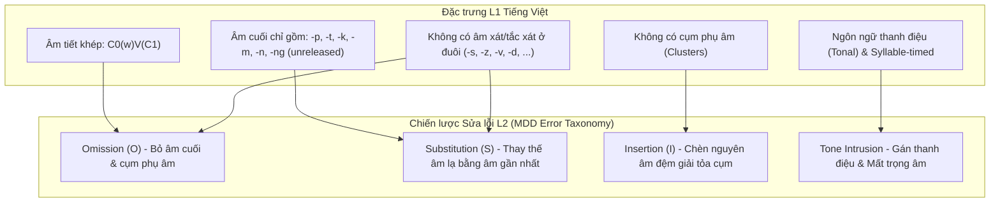
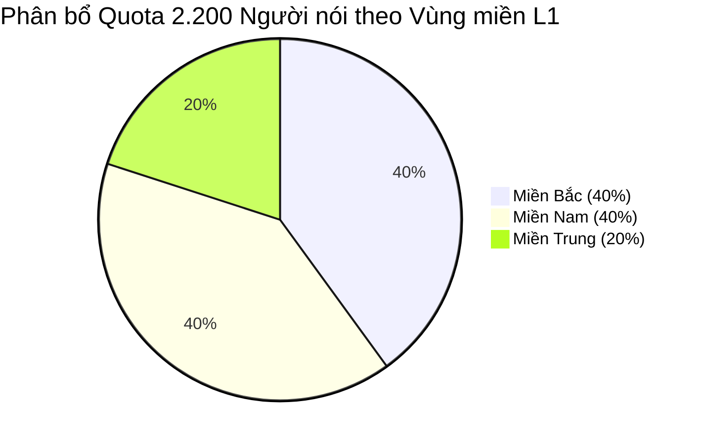

# SCOUT REPORT: Khảo sát Nguồn Dữ liệu Tiếng Anh L2 của Người Việt & Đặc trưng Âm học Chuyển di (Transfer Errors)

**Mã tài liệu:** `reports/DATASET_RD_20261116/SCOUT_VIETNAMESE.md`  
**Ngày thực hiện:** 16/11/2026  
**Agent phụ trách:** `@scout-vietnamese`  
**Trạng thái:** `DRAFT_COMPLETE — PENDING_SOURCE_VERIFICATION`  
**Mục tiêu liên kết:** Phục vụ mục tiêu nghiên cứu tại [DATASET_R&D_GOAL.md](file:///home/khoa/Projects/New-Method-Research/DATASET_R&D_GOAL.md) (Quy mô mục tiêu: 220.000 bản thu / 2.200 người nói độc lập cho bài toán Chẩn đoán Lỗi Âm vị MDD S/O/I).

---

## 1. Tóm tắt điều hành & Kết luận cốt lõi (Executive Summary)

1. **Thực trạng dữ liệu công khai (Public Ground Truth):**
   - Hiện tại **không tồn tại** bất kỳ bộ dữ liệu tiếng Anh L2 người Việt quy mô lớn nào có sẵn nhãn lỗi âm vị (phoneme-level S/O/I) được phát hành mở.
   - Bộ dữ liệu công khai chuẩn duy nhất có nhãn lỗi âm vị cho người Việt là **L2-ARCTIC (v5.0)**, nhưng chỉ có vỏn vẹn **4 người nói tiếng Việt** (`HQTV`, `PNV`, `THV`, `TLV`) với tổng cộng **600 câu được gán nhãn lỗi thủ công (manual gold)** (mỗi người 150 câu).
   - Các bộ dữ liệu quốc tế khác có tập con người Việt (như GMU Speech Accent Archive có 40 người nhưng chỉ đọc 1 đoạn văn 69 từ ~20 phút tổng; EdAcc có người Việt nhưng chỉ có transcript chữ; CSLU FAE là thoại 8kHz nhãn accent 1–4; Mozilla Common Voice chỉ có text; SpeechOcean762 và EpaDB có **0** người Việt).
2. **Thực trạng các nguồn trong nước (Việt Nam):**
   - Các corpus lớn phổ biến từ viện trường và doanh nghiệp Việt Nam (**VIVOS** - AILab VNU-HCM, **VinBigData 100h/VLSP**, **FPT Open Speech Data / FOSD**, **MICA VNSpeechCorpus**) đều là **100% tiếng Việt bản ngữ**, hoàn toàn **không có subset tiếng Anh L2**.
   - Cuộc thi **VLSP VMD (Vietnamese Mispronunciation Detection)** là bài toán phát hiện lỗi phát âm trong **tiếng Việt bản ngữ** (trẻ em/người lớn nói ngọng phụ âm, nguyên âm, thanh điệu tiếng Việt), **không phải tiếng Anh L2**.
   - Corpus dịch tiếng nói **PhoST (VinAI)** chứa 508 giờ audio tiếng Anh, nhưng audio là của **người bản ngữ tiếng Anh** (từ TED talks), không phải người Việt nói tiếng Anh.
   - Doanh nghiệp thương mại (như **ELSA Speak**) sở hữu tập dữ liệu người Việt học tiếng Anh đồ sộ nhưng là **tài sản thương mại đóng kín hoàn toàn** (proprietary), chỉ cung cấp qua API chấm điểm thương mại, không phát hành corpus.
3. **Khoảng cách (Gap Analysis) so với Mục tiêu 220.000 bản thu / 2.200 người nói:**
   - Dữ liệu gold S/O/I người Việt hiện có công khai: **4 người nói / 600 câu**.
   - Mục tiêu đặt ra tại `DATASET_R&D_GOAL.md`: **2.200 người nói / 220.000 câu**.
   - **Khoảng cách thiếu hụt: 550 lần về số người nói và 366 lần về số câu**.
   - **Kết luận:** **Không thể đạt mục tiêu 220k bằng cách cào gom (scrape/aggregate) các corpus công khai sẵn có**. Để phục vụ bài toán MDD cho người Việt, bắt buộc phải thiết kế quy trình **thu âm mới (data collection) và gán nhãn chuyên gia (annotation pipeline)**, hoặc đàm phán mua bản quyền thương mại.
4. **Bản đồ lỗi âm học chuyển di (Phonetic Transfer Taxonomy):**
   - Người Việt học tiếng Anh bị chi phối nặng nề bởi cấu trúc âm tiết đơn lập, không cụm phụ âm ($C_0(w)V(C_1)$), chỉ có 6 âm cuối khép không bật hơi (/p̚, t̚, k̚, m, n, ŋ/), không có âm xát/tắc xát ở đuôi, và là ngôn ngữ có thanh điệu.
   - Lỗi phổ biến nhất là **Omission (O)** ở phụ âm cuối (đặc biệt /s, z, t, d, v, f, θ, ð, tʃ, dʒ/), tỷ lệ bỏ âm cuối trong các nghiên cứu thực nghiệm lên tới **28,4% – 50,7%** (tăng vọt khi gặp biến tố ngữ pháp số nhiều `-s` hoặc quá khứ `-ed` đi sau phụ âm).
   - Lỗi **Substitution (S)** tập trung vào âm răng xát (/θ/ $\rightarrow$ [t, s], /ð/ $\rightarrow$ [d, z]), âm xát sau lợi (/ʃ, ʒ/ $\rightarrow$ [s, z]), vô thanh hóa phụ âm cuối (devoicing: /d/ $\rightarrow$ [t], /z/ $\rightarrow$ [s]), và nhầm lẫn cặp nguyên âm căng/chùng (/iː/ vs /ɪ/, /uː/ vs /ʊ/, /æ/ vs /e/).
   - Lỗi **Insertion (I)** xuất hiện dưới dạng chèn nguyên âm đệm (epenthesis schwa [ə]) để tách cụm phụ âm đầu/đuôi (*blue* $\rightarrow$ [bəˈluː], *desk* $\rightarrow$ [dɛs.kə]).
   - Có sự khác biệt rõ rệt giữa **3 miền (Bắc - Trung - Nam)** ảnh hưởng đến lỗi âm học tiếng Anh (miền Nam biến /v/ thành [j], miền Bắc biến /r/ thành [z] hoặc [r], miền Nam trung hòa âm cuối /t/ thành [k̚] sau nguyên âm sau).

---

## 2. Khảo sát chi tiết các Kho ngữ liệu Tiếng Anh L2 & Tài nguyên liên quan

### 2.1. Nguồn Quốc tế có tập con Người Việt (International Corpora with Vietnamese Subsets)

| Tên Corpus | Đơn vị / Tác giả | Quy mô tổng | Phần người Việt (VN subset) | Dạng nhãn (Annotation) | Giấy phép | Tình trạng truy cập |
|---|---|---|---|---|---|---|
| **L2-ARCTIC (v5.0)** | Texas A&M Univ. / Iowa State Univ. (Zhao et al., 2018) | 24 người nói, 27,1 giờ, 26.867 câu | **4 người nói** (2M: `HQTV`, `TLV`; 2F: `PNV`, `THV`). Tổng ~4.500 câu thu âm (~4,5 giờ). | **Chỉ 150 câu/người có manual gold S/O/I** (tổng **600 câu gold** cho người Việt). ~3.900 câu còn lại chỉ có forced-alignment TextGrid thô. | CC BY-NC 4.0 | Công khai (Official TAMU / GitHub / HuggingFace) |
| **Speech Accent Archive (SAA)** | George Mason Univ. (Steven Weinberger) | 2.100+ người nói toàn cầu | **40 người nói** (`vietnamese1` $\rightarrow$ `vietnamese40`), 20 nam / 20 nữ. | Đọc 1 đoạn văn chuẩn ("Please call Stella...", 69 từ). Tổng ~20 phút audio. Nhãn: **IPA phonetic transcription** (bản ghi âm vị dạng text). Không có TextGrid phân đoạn thời gian sẵn, không có ma trận S/O/I. | Academic Open Access | Công khai trên website GMU / Kaggle mirror |
| **CSLU: Foreign Accented English (FAE v1.2)** | CSLU / OHSU (LDC2006S38) | 22 ngôn ngữ, hàng nghìn bản thu | Có phân đoạn người Việt nói tiếng Anh tự do ~20 giây. | Chất lượng điện thoại **8 kHz narrowband**. Nhãn: Điểm accent 4 mức (1=none $\rightarrow$ 4=very strong) từ native listeners. **Không có nhãn âm vị S/O/I**. | Bản quyền LDC (Có phí / Hạn chế) | Cần tài khoản LDC / Không dùng cho thương mại |
| **EdAcc (Edinburgh Accents of English)** | Univ. of Edinburgh (Sanabria et al., 2023) | 40 giờ hội thoại tự nhiên video call, 100+ người | Có người nói L1 tiếng Việt (phân cụm rõ trong không gian embedding âm học). | Audio hội thoại tự do. Nhãn: **Orthographic transcription (chính tả) phục vụ ASR**. **Hoàn toàn không có nhãn lỗi âm vị S/O/I**. | CC BY 4.0 | Công khai qua Edinburgh DataShare / HuggingFace |
| **Mozilla Common Voice (English)** | Mozilla Foundation | 3.000+ giờ tiếng Anh toàn cầu | Có nhãn metadata tự khai `accent=Vietnamese` trong tệp `validated.tsv`. | Câu đọc rời rạc. Nhãn: **Chính tả văn bản + upvote/downvote cộng đồng**. **Không có nhãn âm vị**. | CC0 | Công khai |
| **SpeechOcean762** | Tsinghua Univ. / Bodata (Zhang et al., 2021) | 250 người nói, 5.000 câu | **0 người nói tiếng Việt** (100% người nói L1 tiếng Quan Thoại/Mandarin). | Điểm 0–2 âm vị, bracket insertion `[]`. | CC BY 4.0 | Công khai (OpenSLR 101) |
| **EpaDB** | Univ. of Buenos Aires (Vidal et al., 2019) | 50 người nói, 3.200 câu | **0 người nói tiếng Việt** (100% người Argentina nói tiếng Tây Ban Nha L1). | Phonetic transcription, dấu 0 (omission) và + (insertion). | Academic / On request | Công khai hạn chế |
| **AESRC 2020** | Interspeech 2020 Challenge (Shi et al., 2021) | 160 giờ audio tiếng Anh accent | **0 người nói tiếng Việt** (8 accent: Trung Quốc, Ấn Độ, Nhật Bản, Hàn Quốc, Mỹ, Anh, Bồ Đào Nha, Nga). | ASR transcript + Accent ID. | Challenge License | Kết thúc cuộc thi |

> [!IMPORTANT]
> **Đính chính thông tin "BVT" trong Brief:**  
> Trong câu hỏi điều tra có đề cập: *"e.g. L2-ARCTIC Vietnamese speakers: BVT, etc."*.  
> Qua rà soát mã nguồn và tài liệu chính thức của L2-ARCTIC (TAMU): **Không có speaker nào mang mã `BVT`**. 4 người nói tiếng Việt trong L2-ARCTIC được mã hóa theo quy tắc kết thúc bằng chữ `V`:  
> - `HQTV` (Nam, Hà Nội / Bắc Bộ)  
> - `PNV` (Nữ, Nam Bộ)  
> - `THV` (Nữ, Bắc Bộ)  
> - `TLV` (Nam, Nam Bộ — người nói nằm trong Standard Test Split 6 người: `NJS`, `TLV`, `TNI`, `TXHC`, `YKWK`, `ZHAA`).  
> Ký hiệu **`/bVt/`** thực chất là thuật ngữ ngữ âm học kinh điển (*b – Vowel – t frame*: các từ kiểm tra nguyên âm như *bit, bat, bet, but, boat, boot*) thường dùng trong các bài test thu âm người học tiếng Anh, dễ bị nhầm lẫn thành tên mã speaker.

---

### 2.2. Rà soát Tài nguyên Tiếng nói & Cuộc thi tại Việt Nam (Domestic Resources Audit)

| Dự án / Tổ chức | Tên Dataset / Tài nguyên | Ngôn ngữ thu âm | Quy mô | Có tiếng Anh L2 không? | Khả năng tận dụng cho bài toán MDD Tiếng Anh L2 |
|---|---|---|---|---|---|
| **AILab (ĐH Khoa học Tự nhiên ĐHQG-HCM)** | **VIVOS** (Luong & Vu, 2016) | Tiếng Việt | 15 giờ, 65 người nói (65 speakers đọc câu tiếng Việt) | **KHÔNG**. 100% tiếng Việt bản ngữ. | Không dùng được cho MDD tiếng Anh. Chỉ có giá trị tham khảo pipeline thu âm / alignment tiếng Việt. |
| **VinBigData (Vingroup)** | **VinBigData 100h (VLSP 2020)** / 14k giờ nội bộ | Tiếng Việt | 100h công khai; hàng nghìn giờ thương mại | **KHÔNG**. 100% tiếng Việt phục vụ ASR tiếng Việt. | Không có dữ liệu tiếng Anh L2. |
| **FPT Corporation (FPT.AI)** | **FPT Open Speech Data (FOSD)** | Tiếng Việt | ~30 giờ (Nam / Nữ đọc văn bản tiếng Việt) | **KHÔNG**. Dữ liệu đọc tiếng Việt phục vụ TTS/ASR. | Không có tiếng Anh L2. |
| **Hiệp hội VLSP (HUST / VNU)** | **VLSP Shared Tasks (ASR, TTS, VMD)** | Tiếng Việt | Nhiều bộ qua các năm (10h – 100h) | **KHÔNG có tiếng Anh**. Cuộc thi **VMD (Vietnamese Mispronunciation Detection)** là phát hiện lỗi phát âm **tiếng Việt** (trẻ em và người lớn đọc từ đôi/đoạn văn tiếng Việt). | Bộ nhãn và mô hình VMD (như DaNangVMD, LingWav2vec2) có thể học hỏi về mặt **kiến trúc mô hình** (acoustic + canonical phone encoder), nhưng **dữ liệu hoàn toàn không dùng được** vì khác ngôn ngữ đích. |
| **VinAI Research** | **PhoST** (Nguyen et al., Interspeech 2022) | Anh $\rightarrow$ Việt | 508 giờ audio | **CÓ tiếng Anh, NHƯNG là người bản ngữ (Native English)** từ TED Talks kèm phụ đề dịch tiếng Việt. | Không phải tiếng Anh L2 của người Việt. Không có nhãn âm vị hay lỗi phát âm. |
| **ĐH Quốc gia Úc (ANU)** | **CanVEC** (Canberra VN-EN Code-Switching) | Tiếng Việt pha tiếng Anh | 10 giờ, 45 người nói song ngữ | Có code-switching Việt-Anh tự nhiên trong giao tiếp. | Nhãn là từ vựng và POS tag, không phục vụ bài toán phát hiện lỗi phát âm âm vị chuẩn. |
| **ELSA Speak (Doanh nghiệp)** | Cơ sở dữ liệu ELSA | Tiếng Anh L2 người Việt & toàn cầu | Hàng triệu bản thu từ app người dùng | **CÓ — Rất lớn và đa dạng**. | **BẢN QUYỀN ĐÓNG KÍN (Proprietary)**. ELSA không mở dữ liệu, chỉ bán quyền truy cập API chấm điểm (Speech Analyzer API). |
| **Các nghiên cứu cấp Trường (HUST, ULIS, HCMUT, Vinh Univ., Da Nang Univ.)** | Các tập dữ liệu luận án / đề tài NCKH (ví dụ: nghiên cứu /s, z/ của Disney & Le 2024; khảo sát phụ âm cuối tại ĐH Vinh, ĐH Phan Thiết) | Tiếng Anh L2 | Rất nhỏ: 10 – 60 sinh viên, mỗi người đọc 20 – 100 từ/câu test. | **CÓ tiếng Anh L2 người Việt**. | Dữ liệu nằm rải rác trong file Praat cục bộ của tác giả, **không được đóng gói hay phát hành công khai**, quy mô quá nhỏ để huấn luyện mô hình học sâu. |

---

## 3. Đánh giá Khả năng Khả thi so với Mục tiêu Quy mô (Feasibility & Scale Reality)

### 3.1. Đối chiếu Thực tế với Mục tiêu `DATASET_R&D_GOAL.md`

| Chỉ số | Mục tiêu Planning (`DATASET_R&D_GOAL.md`) | Dữ liệu Gold Công khai Hiện có (Người Việt) | Tỷ lệ đáp ứng hiện tại |
|---|---:|---:|---:|
| **Số người nói độc lập (Speakers)** | **2.200** | **4** (L2-ARCTIC) | **0,18%** |
| **Số bản thu / câu (Utterances)** | **220.000** | **600** (L2-ARCTIC gold) | **0,27%** |
| **Thời lượng audio tương ứng** | **~244 – 367 giờ** | **~0,6 giờ** (gold) / ~4,5 giờ (thô) | **~0,2%** |
| **Độ phủ vùng miền L1** | Bắc (40%), Nam (40%), Trung (20%) | 2 Bắc (`HQTV`, `THV`), 2 Nam (`PNV`, `TLV`), **0 Trung** | Thiếu hẳn miền Trung |
| **Độ phủ độ tuổi & trình độ** | Trẻ em + Người lớn; A1 $\rightarrow$ C1 | Người lớn học thuật (sinh viên tại Mỹ); Trình độ khá | Rất hẹp |

> [!WARNING]
> **Kết luận bất khả thi từ nguồn công khai:**  
> Không thể ghép nối hay tải về từ bất kỳ nguồn công khai nào để có đủ 2.200 người nói tiếng Việt phát âm tiếng Anh có nhãn S/O/I.  
> Ngay cả khi tận dụng toàn bộ 3.900 câu thô chưa gán nhãn của 4 speaker L2-ARCTIC và 40 file ghi âm của GMU SAA, tổng số câu tối đa chỉ đạt ~4.540 câu từ 44 người nói (vẫn thiếu 98% mục tiêu và hoàn toàn thiếu nhãn gold S/O/I).

### 3.2. Đánh giá 3 Phương án Chiến lược Tiếp cận

1. **Phương án A: Thu âm mới hoàn toàn (Dedicated In-House Collection & Annotation)**
   - *Cách làm:* Thiết kế prompt 100–150 câu phủ kín các hiện tượng âm học tiếng Anh; tuyển 2.200 người học tiếng Việt qua các trường đại học/trung tâm tiếng Anh trên cả nước; thu âm đa thiết bị (điện thoại, tai nghe, mic rời).
   - *Chi phí & Nguồn lực:* Rất lớn (cần trả thù lao cho 2.200 người nói; đội ngũ 5–10 chuyên gia ngữ âm gán nhãn double-annotation + adjudication cho 220.000 câu).
   - *Thời gian:* Dự kiến 6–12 tháng.
2. **Phương án B: Chiến lược Hỗn hợp Đa tầng (Tiered Data Architecture) — KHUYẾN NGHỊ**
   - *Tầng 1 (Pretraining / Representation):* Sử dụng các corpus tiếng Anh L2 đa accent quốc tế công khai lớn (như SpeechOcean762, EdAcc, Common Voice, L2-ARCTIC toàn phần) để tinh chỉnh backbone wav2vec2 / Whisper.
   - *Tầng 2 (Vietnamese-specific Weak/Pseudo Supervised):* Thu thập ~1.000–2.000 người nói tiếng Việt đọc tiếng Anh tự do hoặc bài đọc kiểm tra, chạy forced-aligner và teacher model (SM13/GOP) để tạo pseudo-labels cho tập Train.
   - *Tầng 3 (Locked Evaluation Gold — 100% Chuyên gia):* Thu âm chuẩn độc lập cho 400 người nói Test nội bộ + 200 người nói Test ngoài miền (~60.000 câu) và đầu tư gán nhãn chuyên gia 2 lượt (double annotation).
3. **Phương án C: Hợp tác thương mại hoặc mua lại dữ liệu (Data Licensing)**
   - *Cách làm:* Ký hợp đồng hợp tác nghiên cứu hoặc mua lại dữ liệu ẩn danh từ các đơn vị EdTech có sẵn lượng người dùng tiếng Anh tại Việt Nam.

---

## 4. Phân tích Chi tiết Lỗi Âm học Chuyển di: Tiếng Việt $\rightarrow$ Tiếng Anh (L1-to-L2 Phonetic Transfer)

Do sự khác biệt sâu sắc giữa loại hình ngôn ngữ **đơn lập, đơn âm tiết, có thanh điệu** (tiếng Việt) và **đa âm tiết, biến hình, nhịp điệu trọng âm** (tiếng Anh), người Việt khi phát âm tiếng Anh biểu hiện các khuôn mẫu lỗi chuyển di tiêu cực (negative transfer) mang tính hệ thống.

---

### 4.1. Lỗi Bỏ Âm / Nuốt Âm (Omission - O)

Lỗi Omission là lỗi có tần suất xuất hiện cao nhất và gây suy giảm độ dễ hiểu (intelligibility) nghiêm trọng nhất ở người học Việt Nam.

1. **Bỏ phụ âm cuối dạng xát và tắc xát (Fricatives & Affricates Deletion):**
   - Trong tiếng Việt, **hoàn toàn không có âm xát hoặc tắc xát ở vị trí kết thúc âm tiết (coda)**.
   - Khi gặp các âm cuối tiếng Anh `/s, z, ʃ, ʒ, tʃ, dʒ, f, v, θ, ð/`, người học thường xuyên bỏ hoàn toàn âm này:
     - *is* `/ɪz/` $\rightarrow$ `[ɪ]`
     - *face* `/feɪs/` $\rightarrow$ `[feɪ]`
     - *five* `/faɪv/` $\rightarrow$ `[faɪ]`
     - *change* `/tʃeɪndʒ/` $\rightarrow$ `[tʃeɪn]`
     - *watch* `/wɒtʃ/` $\rightarrow$ `[wɒ]`
     - *breathe* `/briːð/` $\rightarrow$ `[briː]`
2. **Bỏ đuôi biến tố ngữ pháp (Morphological Endings Omission):**
   - Đuôi số nhiều danh từ / ngôi thứ 3 số ít: `-(e)s` (`/s, z, ɪz/`).
   - Đuôi thì quá khứ đơn / quá khứ phân từ: `-ed` (`/t, d, ɪd/`).
   - *Số liệu thực nghiệm (Disney & Le, 2024):* Tỷ lệ bỏ âm cuối `/s, z/` trung bình là **28,4%**, nhưng khi `/s, z/` đóng vai trò là đuôi ngữ pháp đi sau một phụ âm khác (tạo thành cụm phụ âm cuối như *cats* `/kæts/`, *desks* `/dɛsks/`), tỷ lệ bỏ âm vọt lên tới **50,7%**.
3. **Bỏ âm trong cụm phụ âm cuối (Final Consonant Cluster Reduction):**
   - Tiếng Việt không có cụm phụ âm ở đuôi. Khi gặp cụm 2, 3, 4 phụ âm cuối, người học thường bỏ âm cuối cùng hoặc bỏ toàn bộ chỉ giữ lại nguyên âm:
     - *fast* `/fɑːst/` $\rightarrow$ `[fɑːs]` hoặc `[fɑː]`
     - *text* `/tɛkst/` $\rightarrow$ `[tɛk]` hoặc `[tɛs]`
     - *world* `/wɜːld/` $\rightarrow$ `[wɜːl]` hoặc `[wɜː]`
4. **Bỏ hoặc nuốt âm tắc cuối (Final Stop Deletion / Inaudible Unrelease):**
   - Âm tắc cuối tiếng Việt (`-p, -t, -k`) là âm khép không bật hơi (unreleased stops `[p̚, t̚, k̚]`). Trong tiếng Anh, các âm `/t, d, p, b, k, ɡ/` ở cuối câu hoặc trước nguyên âm thường có giai đoạn mở (release) hoặc thanh hóa. Người Việt có xu hướng khép nắp thanh môn hoặc không phát âm, khiến hệ thống ASR/MDD ghi nhận là **Omission**:
     - *cat* `/kæt/` $\rightarrow$ `[kæ]` hoặc `[kæt̚]`
     - *bad* `/bæd/` $\rightarrow$ `[bæ]`

---

### 4.2. Lỗi Thay Thế Âm (Substitution - S)

Người học thay thế các âm vị tiếng Anh không có trong bảng âm vị tiếng Việt bằng các âm tiếng Việt có vị trí cấu âm hoặc cảm nhận âm học tương tự.

1. **Cặp âm răng xát (Interdental Fricatives) `/θ/` và `/ð/`:**
   - Hoàn toàn vắng mặt trong hệ thống ngữ âm tiếng Việt.
   - `/θ/` (vô thanh trong *think, three, thank*) $\rightarrow$ Thay bằng âm tắc đầu lưỡi răng `[t]` hoặc âm xát lợi `[s]`:
     - *think* `/θɪŋk/` $\rightarrow$ `[tɪŋk]` hoặc `[sɪŋk]`
     - *three* `/θriː/` $\rightarrow$ `[triː]`
   - `/ð/` (hữu thanh trong *this, that, mother*) $\rightarrow$ Thay bằng âm tắc đầu lưỡi `[d]`, âm xát lợi `[z]`, hoặc âm môi răng `[v]`:
     - *this* `/ðɪs/` $\rightarrow$ `[dɪs]` hoặc `[zɪs]`
     - *with* `/wɪð/` $\rightarrow$ `[wɪt]` hoặc `[wɪv]`
2. **Vô thanh hóa phụ âm cuối (Final Consonant Devoicing):**
   - Tiếng Việt không cho phép phụ âm hữu thanh đứng cuối từ. Các phụ âm hữu thanh tiếng Anh `/b, d, ɡ, v, z, dʒ/` ở coda bị vô thanh hóa thành các âm tương ứng `[p, t, k, f, s, tʃ]`:
     - *bed* `/bɛd/` $\rightarrow$ `[bɛt]`
     - *dog* `/dɒɡ/` $\rightarrow$ `[dɒk]`
     - *leaves* `/liːvz/` $\rightarrow$ `[liːfs]`
     - *bridge* `/brɪdʒ/` $\rightarrow$ `[brɪtʃ]`
3. **Âm xát sau lợi (Post-alveolar Fricatives) và Tắc xát (Affricates):**
   - `/ʃ/` (trong *she, shop*) $\rightarrow$ Thay bằng âm `[s]` (miền Bắc) hoặc âm quặt lưỡi `[ʂ]` (miền Nam).
   - `/ʒ/` (trong *measure, vision*) $\rightarrow$ Thay bằng `[z]` hoặc `[j]`.
   - `/tʃ/` (trong *chair, cheap*) $\rightarrow$ Thay bằng âm tắc ngạc cứng tiếng Việt `[c]` (chữ "ch").
   - `/dʒ/` (trong *jump, job, judge*) $\rightarrow$ Thay bằng âm `[z]` hoặc `[j]` (*job* $\rightarrow$ `[zɒp]` hoặc `[jɒp]`).
4. **Âm lỏng (Liquids) `/l/` và `/r/`:**
   - **Âm "Dark L" (Velarized `[ɫ]`) ở đuôi:** Tiếng Việt không có phụ âm biên bên ở coda. Khi `/l/` đứng cuối từ (*milk, school, table*), người Việt biến thành bán nguyên âm `[w]`, `[o]`, `[u]` hoặc bỏ hẳn:
     - *milk* `/mɪlk/` $\rightarrow$ `[mɪwk]`
     - *table* `/ˈteɪbl/` $\rightarrow$ `[teɪ.bo]`
     - *people* `/ˈpiːpl/` $\rightarrow$ `[piː.po]`
   - **Âm `/r/` ở đầu:** Tiếng Anh dùng âm tiếp cận sau lợi `[ɹ]`. Người học miền Bắc thường phát âm thành âm xát `[z]` (theo chữ viết "r" tiếng Việt), người miền Nam phát âm thành âm rung `[r]` hoặc xát quặt lưỡi `[ʐ]`.
5. **Cặp nguyên âm căng / chùng (Tense vs. Lax Vowels):**
   - Tiếng Việt không phân biệt cặp nguyên âm đối lập căng–chùng theo kiểu tiếng Anh. Người học thường đồng hóa (merge) các cặp âm này:
     - `/iː/` (căng) vs `/ɪ/` (chùng): *sheep* và *ship* đều phát âm thành `[ʃip]`.
     - `/uː/` (căng) vs `/ʊ/` (chùng): *fool* và *full* đều phát âm thành `[ful]`.
     - `/e/` vs `/æ/`: *bed* `/bɛd/` và *bad* `/bæd/` thường bị phát âm lẫn thành `[bɛt]`.
     - `/ɔː/` vs `/ɒ/` vs `/ʌ/`: *caught* `/kɔːt/`, *cot* `/kɒt/`, *cut* `/kʌt/` bị lẫn lộn.
6. **Nguyên âm suy giảm (Vowel Reduction Failure):**
   - Trong tiếng Anh, các âm tiết không nhấn trọng âm thường suy giảm về schwa `/ə/` hoặc `/ɪ/`. Tiếng Việt đọc theo chữ cái (spelling pronunciation), phát âm đầy đủ nguyên âm với âm lượng mạnh:
     - *banana* `/bəˈnænə/` $\rightarrow$ `[ba na na]`
     - *present* (danh từ) `/ˈprɛznt/` vs *present* (động từ) `/prɪˈzɛnt/` không được giảm âm.

---

### 4.3. Lỗi Chèn Âm (Insertion - I / Epenthesis)

Lỗi Insertion ở người học Việt Nam chủ yếu là hệ quả của chiến lược phá vỡ cụm phụ âm lạ (cluster simplification via epenthesis) hoặc giải tỏa âm cuối không bật hơi.

1. **Chèn nguyên âm đệm trong cụm phụ âm đầu (Onset Epenthesis):**
   - Khi gặp các cụm phụ âm đầu như `/bl-, kl-, st-, sp-, sk-, tr-, pr-/`, người học chèn một nguyên âm ngắn (thường là schwa `[ə]` hoặc nguyên âm chùng `[ɪ]`, `[ɯ]`) vào giữa hai phụ âm:
     - *blue* `/bluː/` $\rightarrow$ `[bəˈluː]` (tạo thành 2 âm tiết)
     - *class* `/klɑːs/` $\rightarrow$ `[kəˈlɑːs]`
     - *special* `/ˈspɛʃl/` $\rightarrow$ `[səˈpɛ.ʃəl]`
     - *stop* `/stɒp/` $\rightarrow$ `[səˈtɒp]`
2. **Chèn nguyên âm giải tỏa âm cuối (Coda Epenthesis / Echo Vowels):**
   - Để cố gắng phát âm được phụ âm cuối (nhất là sau khi được giáo viên nhắc "phải phát âm ending sound"), người học thường bật hơi kèm theo một nguyên âm ngắn ở đuôi:
     - *like* `/laɪk/` $\rightarrow$ `[laɪ.kə]`
     - *six* `/sɪks/` $\rightarrow$ `[sɪk.sə]`
     - *help* `/hɛlp/` $\rightarrow$ `[hɛl.pə]`
3. **Chèn âm tắc thanh môn (Glottal Stop Insertion `[ʔ]`):**
   - Tiếng Việt thường bắt đầu âm tiết mở bằng một âm tắc thanh môn `[ʔ]`. Khi người Việt phát âm các từ tiếng Anh bắt đầu bằng nguyên âm (*apple, orange, it*), họ chèn âm `[ʔ]` phía trước, ngăn cản hiện tượng nối âm tự nhiên (linking/liaison) giữa các từ.

---

### 4.4. Ảnh hưởng Ngữ điệu & Phân hóa Vùng miền (Regional Transfer & Prosody)

#### A. Hiện tượng Chuyển di Thanh điệu (Tone Intrusion)
Tiếng Việt có hệ thống thanh điệu phụ thuộc cao độ và đường nét (pitch contour). Người học thường vô thức gán thanh điệu tiếng Việt vào các từ tiếng Anh:
- **Thanh Sắc / Nặng:** Gán cho các âm tiết tiếng Anh kết thúc bằng phụ âm tắc `/p, t, k/` hoặc các âm tiết mang trọng âm chính (ví dụ: *cat* $\rightarrow$ mang thanh sắc `[kæt́]` hoặc thanh nặng `[kæṭ]`).
- **Thanh Ngang / Huyền:** Gán cho các âm tiết mở hoặc kết thúc bằng phụ âm mũi, hoặc các âm tiết không nhấn trọng âm (ví dụ: *table* $\rightarrow$ *tay* [ngang] + *bồ* [huyền]).
- **Hệ quả nhịp điệu (Syllable-timed Rhythm):** Người Việt phát âm tiếng Anh từng âm tiết rời rạc với trường độ và âm lượng tương đương nhau, làm triệt tiêu cấu trúc nhịp điệu định thời trọng âm (stress-timed rhythm) của tiếng Anh.

#### B. Phân hóa Âm học theo 3 Miền (Bắc – Trung – Nam)

| Vùng miền | Đặc điểm phát âm L1 đặc trưng | Chuyển di sang Tiếng Anh (L2 Transfer Effects) | Ví dụ cụ thể |
|---|---|---|---|
| **Bắc Bộ** (Hà Nội & đồng bằng sông Hồng) | - Không phân biệt `d/gi/r` (đều đọc thành `[z]`). - Không phân biệt `s/x` (đều đọc thành `[s]`). - Không phân biệt `tr/ch` (đều đọc thành `[c]`). | - Âm `/r/` tiếng Anh hay bị phát âm thành `[z]`. - Âm `/ʃ/` bị bẹt thành `[s]`. - Ít bị nuốt âm tắc cuối hơn miền Nam nhưng hay quên đuôi xát. | - *red* $\rightarrow$ `[zɛd]` - *she* $\rightarrow$ `[si]` - *tree* $\rightarrow$ `[ci]` |
| **Nam Bộ** (TP.HCM & Tây Nam Bộ) | - Phụ âm `v` được phát âm thành bán nguyên âm `[j]` (dở/dờ). - Phân biệt tốt `s` (quặt lưỡi `[ʂ]`) và `x` (`[s]`). - Biến đổi âm cuối: `-n` và `-t` sau nguyên âm sau biến thành `-ng` `[ŋ]` và `-c` `[k̚]`. | - Phụ âm `/v/` tiếng Anh bị thay bằng `[j]`. - Âm cuối `/t/` tiếng Anh sau các nguyên âm tròn môi bị biến thành `[k̚]`. - Tỷ lệ bỏ âm cuối (Omission) cao hơn miền Bắc do thói quen nuốt phụ âm cuối. | - *very* $\rightarrow$ `[ˈjɛ.ri]` - *video* $\rightarrow$ `[ˈjɪ.di.oʊ]` - *hot* $\rightarrow$ `[hɒk̚]` - *five* $\rightarrow$ `[faɪ]` |
| **Trung Bộ** (Huế, Đà Nẵng, Quảng Nam, Nghệ An) | - Hệ thống nguyên âm hẹp, biến đổi nguyên âm đôi. - Thanh hỏi và ngã thường gộp lại. - Giọng có xu hướng nặng và ngắn trường độ. | - Trường độ nguyên âm tiếng Anh bị rút ngắn đáng kể. - Dễ bị gán thanh nặng vào các âm tiết tiếng Anh. - Độ tương phản giữa nguyên âm dài và ngắn bị xóa nhòa nhất trong 3 miền. | - *bad* phát âm thành `[bæṭ]` (ngắn, giật giọng) - *bird* $\rightarrow$ `[bơṭ]` |

---

## 5. Đề xuất Thiết kế Thu thập Dữ liệu & Khung Gán nhãn Chuẩn hóa

Để đáp ứng mục tiêu nghiên cứu tại `DATASET_R&D_GOAL.md` (220.000 câu / 2.200 người nói), nhóm R&D cần thiết kế một **Data Collection & Annotation Protocol** chặt chẽ, tránh lặp lại các lỗ hổng của các tập dữ liệu trước đây:

### 5.1. Ma trận Phân bổ Quota Người nói (Demographic Matrix)

1. **Vùng miền L1:** 40% Bắc, 40% Nam, 20% Trung.
2. **Giới tính:** Cân bằng 50% Nam / 50% Nữ.
3. **Trình độ năng lực tiếng Anh (CEFR):**
   - **Beginner (A1 – A2):** 40% (Nguồn giàu lỗi Omission và Substitution rõ rệt).
   - **Intermediate (B1 – B2):** 45% (Nhóm người dùng phổ biến nhất, lỗi tinh vi hơn, nhiều lỗi biến tố ngữ pháp).
   - **Advanced (C1 – C2):** 15% (Kiểm tra năng lực phân biệt accent chấp nhận được vs lỗi thật, đo lường tỷ lệ cảnh báo sai - false alarms).
4. **Môi trường & Thiết bị thu âm:**
   - 60% Điện thoại di động thông minh (iOS / Android) trong môi trường phòng tự nhiên (có tiếng ồn nền nhẹ).
   - 25% Tai nghe có microphone (Earphones / Headsets).
   - 15% Studio / Microphone tụ điện chất lượng cao (Clean speech baseline).

### 5.2. Thiết kế Bộ Văn bản Đọc (Prompt Design)
- Mỗi người nói đọc **100 – 120 câu**.
- **Cấu trúc bộ câu hỏi:**
  - **30% Phụ âm cuối & Cụm phụ âm khó:** Tập trung vào các cặp từ đối lập (minimal pairs) chứa coda `/s, z, t, d, v, f, θ, ð, tʃ, dʒ/` và các cụm `/sts, ksts, mpt, lpt/`.
  - **25% Biến tố ngữ pháp (Morphological inflections):** Các câu bắt buộc chia động từ quá khứ `-ed` và danh từ số nhiều `-s/es` để kích thích lỗi bỏ đuôi theo ngữ cảnh.
  - **20% Khung nguyên âm `/bVt/` và cặp nguyên âm căng/chùng:** Phân biệt rõ *sheet/shit*, *leave/live*, *fool/full*, *heart/hut*.
  - **15% Cụm phụ âm đầu (Onset clusters):** Đo lường hiện tượng chèn âm đệm epenthesis (`/pl-, kl-, str-, skr-/`).
  - **10% Câu dài đo ngữ điệu & nối âm:** Kiểm tra hiện tượng ngắt âm tiết và gán thanh điệu.

### 5.3. Tiêu chuẩn Gán nhãn Lỗi Âm vị (Gold Annotation Schema)
- Tuân thủ cấu trúc **N targets / N+1 gaps** của SM13 để tương thích hoàn toàn với baseline.
- **Quy tắc phân định lỗi (Rubric Guidelines):**
  - **Omission (O):** Phụ âm đích hoàn toàn không có tín hiệu âm học (acoustic energy) hoặc bị tắt hoàn toàn. Lưu ý: Trường hợp âm tắc cuối bị giữ không bật hơi `[t̚]` nhưng vẫn khép thanh quản cần quy định rõ trong sổ tay gán nhãn: là Biến thể chấp nhận được (Allophone/Accent) hay Omission. Khuyến nghị: Nếu có điểm nghẽn thanh môn rõ rệt thì gán Substitution `[ʔ]` hoặc Correct-accented, chỉ gán Omission khi không có điểm nghẽn.
  - **Substitution (S):** Phát âm sang một âm vị khác rõ ràng trong bảng ARPAbet/IPA. Phải lưu trữ cả `intended_phone` và `actual_phone`.
  - **Insertion (I):** Xuất hiện âm vị ngoại lai ở vị trí gap (thường là schwa `[ə]` hoặc phụ âm thừa do phát âm sai chính tả).
  - **Correct (C):** Bao gồm cả các biến thể accent được chấp nhận trong tiếng Anh quốc tế (accented but correct), không phạt người nói chỉ vì không có giọng chuẩn bản ngữ (General American / RP).
- **Quy trình đảm bảo chất lượng (QA/QC):**
  - **Đánh giá độc lập 2 chuyên gia (Double Annotation):** 100% tập Test và tối thiểu 20% tập Train được gán bởi 2 chuyên gia ngôn ngữ độc lập mà không nhìn thấy dự đoán của mô hình.
  - **Adjudication:** Khi có bất đồng giữa 2 annotator, chuyên gia thứ ba (Senior Adjudicator) sẽ đưa ra phán quyết cuối cùng.
  - **Báo cáo thỏa thuận (Inter-annotator Agreement):** Báo cáo chỉ số Cohen's Kappa / Fleiss' Kappa chi tiết theo từng loại lỗi (S, O, I) và từng nhóm âm vị, không dùng độ chính xác chung để che giấu lỗi hiếm.

---

## 6. Danh mục Bằng chứng & Nguồn Đối chiếu (Evidence & References)

1. **L2-ARCTIC Corpus Official Repository & Docs:**  
   - Zhao, G., Sonsaat, S., Silpachai, A., Lucic, I., Chukharev-Hudilainen, E., Levis, J., & Gutierrez-Osuna, R. (2018). *L2-ARCTIC: A non-native English speech corpus*. Interspeech 2018. URL: [https://psi.engr.tamu.edu/l2-arctic-corpus/](https://psi.engr.tamu.edu/l2-arctic-corpus/).  
   - Chi tiết: 24 người nói, 6 L1. 4 người nói tiếng Việt: `HQTV`, `PNV`, `THV`, `TLV`. 150 câu có nhãn lỗi thủ công/người (tổng 600 câu). License: CC BY-NC 4.0.
2. **Speech Accent Archive (GMU):**  
   - Weinberger, Steven. (2015). *Speech Accent Archive*. George Mason University. URL: [http://accent.gmu.edu](http://accent.gmu.edu).  
   - Chi tiết: 40 người nói tiếng Việt (`vietnamese1` $\rightarrow$ `vietnamese40`), đoạn văn "Please call Stella" (69 từ).
3. **EdAcc Corpus:**  
   - Sanabria, R., Bogoychev, N., et al. (2023). *The Edinburgh International Accents of English Corpus*. Interspeech 2023. URL: [https://datashare.ed.ac.uk/handle/10283/4804](https://datashare.ed.ac.uk/handle/10283/4804). License: CC BY 4.0.
4. **Nghiên cứu Thực nghiệm về Lỗi Bỏ Phụ Âm Cuối của Người Việt:**  
   - Disney, J., & Le, T. (2024). *Acquisition of English Word-Final /s/ and /z/ by Vietnamese Adult Learners: Phonotactic and Morphological Factors*. *Languages*, MDPI.  
   - Bằng chứng số liệu: Tỷ lệ bỏ âm cuối trung bình 28,4%; bỏ âm khi gặp cụm phụ âm đuôi ngữ pháp là 50,7%.
5. **Nghiên cứu về Chuyển di Âm học & Thử nghiệm /bVt/:**  
   - Nguyen, T., & Ingram, J. (2005). *Acoustic and perceptual correlates of foreign accent in Vietnamese-accented English*. *Speech Communication*.  
   - Bằng chứng về sự trung hòa nguyên âm căng–chùng và hiện tượng vô thanh hóa phụ âm cuối.
6. **VIVOS Speech Corpus (AILab VNU-HCM):**  
   - Luong, H.-Q., & Vu, H.-Q. (2016). *VIVOS: A free Vietnamese speech corpus for academic research*. URL: [https://ailab.hcmus.edu.vn/vivos](https://ailab.hcmus.edu.vn/vivos). 15 giờ tiếng Việt, không có tiếng Anh.
7. **VinBigData VLSP Corpus & PhoST:**  
   - VinBigData 100h ASR (VLSP 2020): Tiếng Việt bản ngữ.  
   - Nguyen, B., et al. (2022). *PhoST: A Speech Translation Corpus for English-Vietnamese*. Interspeech 2022. Audio tiếng Anh bản ngữ từ TED Talks.
8. **VLSP Shared Task Vietnamese Mispronunciation Detection (VMD):**  
   - Ban tổ chức VLSP (2021–2023). Trang chính thức: [https://vlsp.org.vn](https://vlsp.org.vn). Xác nhận VMD là bài toán tiếng Việt, không phải tiếng Anh L2.

---

## 7. Bàn giao & Yêu cầu Thẩm định (Handoff to Verifier)

Tài liệu này hoàn thành toàn bộ các câu hỏi điều tra trong brief của `@scout-vietnamese`:
- [x] Rà soát toàn diện các nguồn viện trường Việt Nam, VIVOS, VinBigData, FPT, VLSP, PhoST, ELSA.
- [x] Rà soát toàn diện các tập con người Việt trong kho dữ liệu quốc tế (L2-ARCTIC, SAA, EdAcc, Common Voice, CSLU).
- [x] Đính chính sự nhầm lẫn giữa ký hiệu `/bVt/` và tên speaker trong L2-ARCTIC (xác định chuẩn 4 mã: `HQTV`, `PNV`, `THV`, `TLV`).
- [x] Lập bảng ma trận số lượng người nói, số câu, thời lượng và tình trạng nhãn thực tế.
- [x] Báo cáo chi tiết hệ thống lỗi âm học chuyển di (Omission, Substitution, Epenthesis, Tone intrusion, khác biệt Bắc/Trung/Nam) kèm số liệu nghiên cứu đối chiếu.

Kính mời `@verifier-source` tiến hành audit và kiểm chứng độc lập các nguồn trích dẫn và số liệu trong báo cáo.
